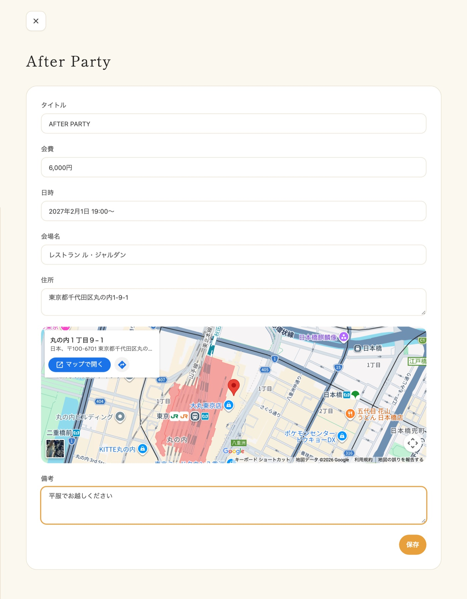
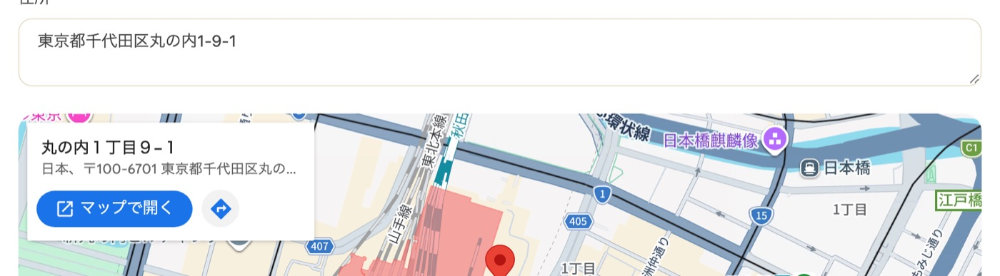
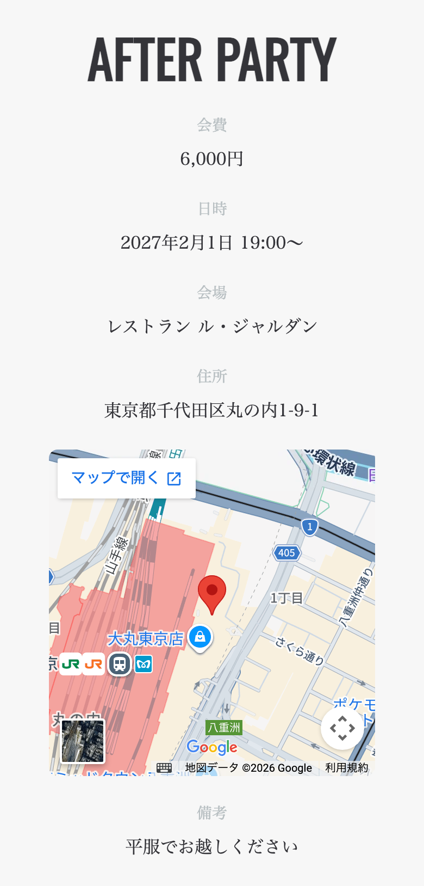

プロフィールブックに二次会の情報を掲載できます。
サイドバーの「二次会」メニューから設定ページを開き、会場や日時などの情報を入力したうえで、プロフィールブックの編集画面で二次会を「表示」にすると、二次会セクションが表示されます。

---

## 1. 二次会情報を設定する {#setup}

1. サイドバーの「二次会」メニューをタップして設定ページを開きます
2. 以下の情報を入力します
   - **タイトル**（例：After Party、二次会のご案内）
   - **会費**（例：5,000円）
   - **日時**
   - **会場名**（例：レストラン○○）
   - **住所**（例：東京都渋谷区○○1-2-3）
   - **備考**（自由記入欄）
3. 「保存」ボタンをタップします

すべての項目は任意入力です。必要な情報だけを入力してください。

:::warning[ご注意]
二次会情報の変更は公開済みのプロフィールブックにも即時反映されます。
公開中のプロフィールブックがある場合は、内容をよく確認してから保存してください。
:::

---

## 2. Google Maps プレビューについて {#google-maps}

住所を入力すると、設定ページに Google Maps のプレビューが自動的に表示されます。
このプレビューはプロフィールブックの公開ページにも表示されるため、ゲストが会場の場所を簡単に確認できます。

正しい位置が表示されているか、保存前にプレビューで確認することをおすすめします。

---

## 3. プロフィールブックでの表示 {#display}

プロフィールブックに二次会セクションを出すには、次の手順で表示を切り替えます。

1. サイドバーの「席次表＆プロフィールブック」から編集画面を開きます
2. ページ下部にある「二次会」の切り替えを「表示」にします
3. 画面右下の「保存」で保存します

- **情報が設定されている場合**: 入力した内容が二次会セクションとして表示されます
- **情報が未設定の場合**: 二次会セクションは表示されません

表示の切り替えは、公開中のプロフィールブックにはすぐには出ません。編集画面右下の「公開」から「現在の下書きを公開する」をタップすると反映されます。公開中にもう一度公開しても、追加の料金はかからず、URL も変わりません。会費や会場などの二次会情報の変更は、保存した時点で公開ページに反映されます。

---

## 4. よくある質問 {#faq}

### Q. 二次会情報は必ず設定しなければいけませんか？ {#faq-required}

いいえ。二次会情報の設定は任意です。設定しない場合、プロフィールブックに二次会セクションは表示されません。

### Q. 一部の項目だけ入力しても大丈夫ですか？ {#faq-partial}

はい。すべての項目は任意入力です。会場名だけ、日時だけなど、必要な情報のみを入力できます。入力された項目だけがプロフィールブックに表示されます。

### Q. 二次会情報を削除するにはどうすればよいですか？ {#faq-delete}

プロフィールブック編集画面の「二次会」の切り替えを「非表示」にして保存すると、プロフィールブックから二次会セクションが非表示になります。公開中のプロフィールブックには、もう一度公開すると反映されます。

### Q. 住所を入力しても Google Maps が表示されません {#faq-maps-not-shown}

住所の表記が正しいか確認してください。番地や建物名まで含めた正確な住所を入力すると、正しい位置が表示されやすくなります。
