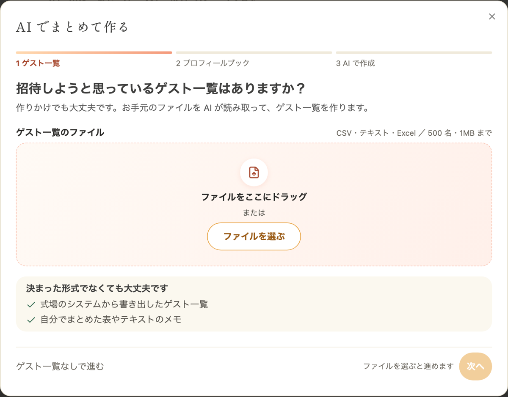
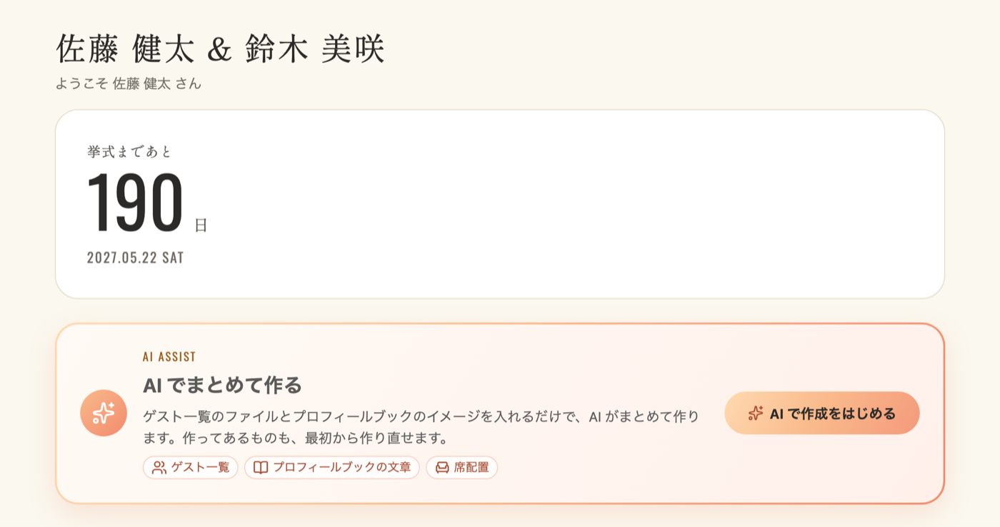
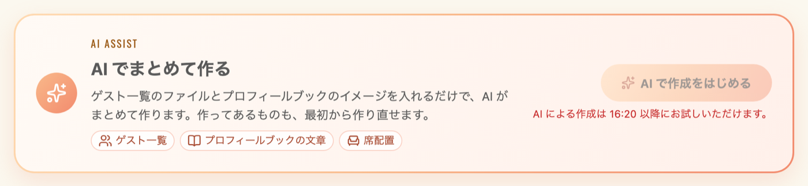
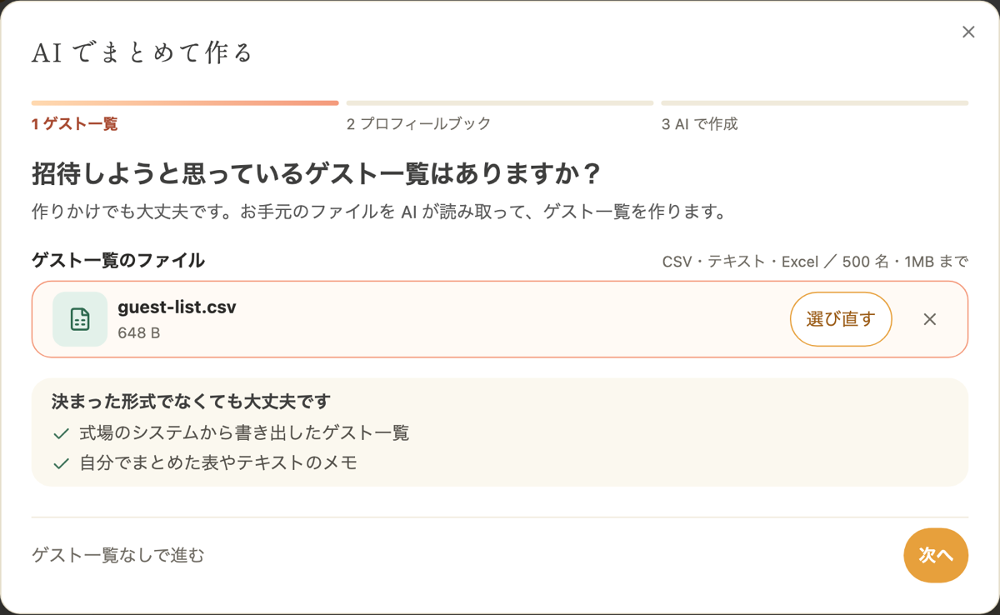
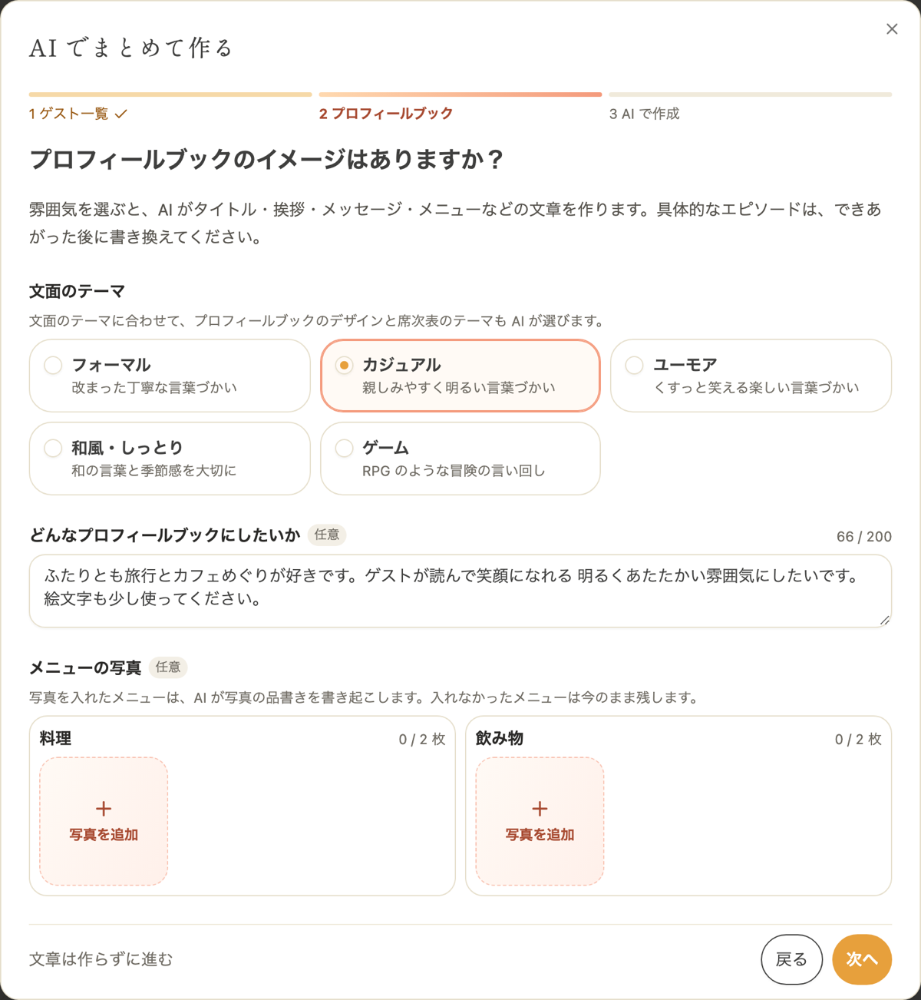
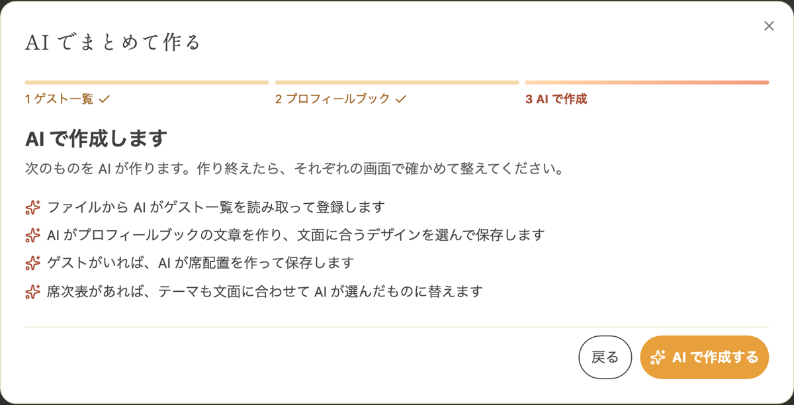
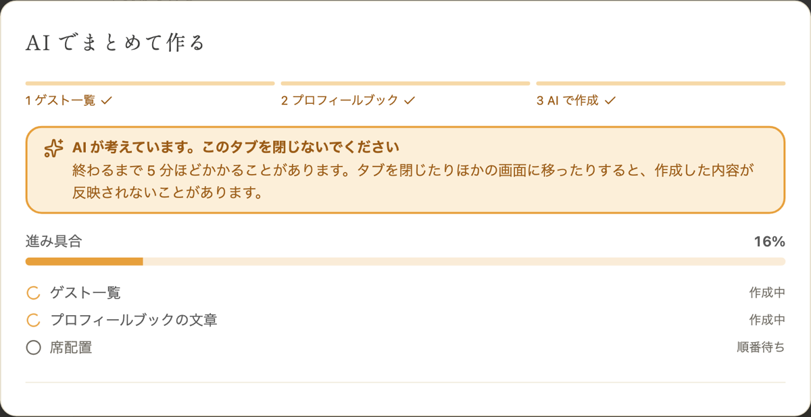
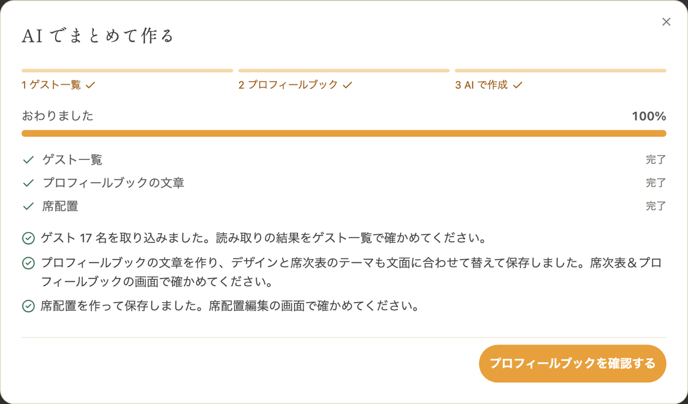

ゲスト一覧のファイルと、どんなプロフィールブックにしたいかを入れると、AI がゲスト一覧・プロフィールブックの文章・席配置をまとめて作ります。プロフィールブックのデザインと席次表のテーマも、文面に合わせて AI が選びます。AI でまとめて作るのは無料です。

---

## 1. AI がまとめて作るもの {#overview}

AI でまとめて作ると、次の 3 つを順に作ります。

- ゲスト一覧です。お手元のファイルから名前・敬称・肩書きを読み取って登録します。詳しくは「[AI でゲスト一覧を取り込む](/guest/#import-guests-ai)」をご覧ください
- プロフィールブックの文章です。文面のテーマと要望に合わせて文章を作り、プロフィールブックのデザインと席次表のテーマも選びます。詳しくは「[AI でプロフィールブックの文章を作る](/profile-book-writing/)」をご覧ください
- 席配置です。登録したゲストの肩書きをもとに、卓の数・並び・席を決めます。詳しくは「[AI に席配置を任せる](/seating-chart/#ai-arrangement)」をご覧ください

どれもたたき台です。できあがった後に、それぞれの画面で確かめて整えてください。

---

## 2. AI でまとめて作るを開く {#open}

### 挙式を作った直後に開く {#auto-open}

ゲスト一覧・プロフィールブック・席次表のどれかがまだ無いときは、ダッシュボードを開くと「AI でまとめて作る」の画面が自動で開きます。挙式を作った直後は、すべてがまだ無いのでこの画面から始まります。

閉じたり、途中の手順を飛ばしたりしても、3 つがそろうまでは、ダッシュボードを開くたびに表示されます。

この開き方では、すでにあるものは作り直しません。たとえばゲスト一覧を登録済みなら、ゲスト一覧の手順に「ゲスト一覧はすでに登録されています。ここでは作り直さずに次へ進みます。」と表示され、「次へ」だけを押せます。

### ダッシュボードから開く {#dashboard}

ダッシュボードの「挙式まであと」の下に、「AI でまとめて作る」の欄があります。「AI で作成をはじめる」を押すと、同じ画面が開きます。

ここから開くと、すでにあるものも最初から作り直せます。作り直すと今のゲスト一覧・文章・席配置が置き換わるので、作成する前の確認で知らせます。

「AI で作成をはじめる」は、次のあいだは押せません。理由がボタンの下に赤い字で表示されます。

- AI が作成している間は「AI が作成しています。終わるまでお待ちください。」と表示されます。ほかのメンバーが頼んだ作成も含みます
- 前回 AI に頼んでから 5 分たつまでは「AI による作成は 16:20 以降にお試しいただけます。」のように、次に頼める時刻が表示されます

---

## 3. 作る手順 {#steps}

### 3-1. ゲスト一覧のファイルを選ぶ {#step-guests}

「招待しようと思っているゲスト一覧はありますか？」の画面で、ゲスト一覧のファイルを選びます。ファイルをドラッグするか、「ファイルを選ぶ」から選んでください。決まった形式でなくても大丈夫です。作りかけのファイルでも読み取ります。

- CSV・TSV・テキスト・Excel のファイルを選べます
- 1MB まで、ゲスト 500 名までです

ファイルを選んだら「次へ」を押します。ゲスト一覧を作らないときは「ゲスト一覧なしで進む」を押します。

### 3-2. プロフィールブックのイメージを入れる {#step-profile-book}

「プロフィールブックのイメージはありますか？」の画面で、次のものを入れます。

1. 文面のテーマを選びます。「フォーマル」「カジュアル」「ユーモア」「和風・しっとり」「ゲーム」から選べます
2. 「どんなプロフィールブックにしたいか」に、お二人の好きなことやゲストにどう感じてほしいかを書きます。任意で、200 文字まで書けます。絵文字を使ってほしいときは、そのこともここに書いてください
3. メニューを書き起こしたいときは、「メニューの写真」の「料理」と「飲み物」の「写真を追加」から、メニュー表の写真を選びます。任意で、それぞれ 2 枚までです
4. 「次へ」を押します

文章を作らないときは「文章は作らずに進む」を押します。ゲスト一覧も文章も作らず、ほかに作るものも無いときは、そのまま画面が閉じます。

入れるものの詳しい書き方は「[AI でプロフィールブックの文章を作る](/profile-book-writing/#write)」をご覧ください。

### 3-3. 作るものを確かめて作成する {#step-confirm}

「AI で作成します」の画面に、AI が作るものの一覧が表示されます。内容を確かめて「AI で作成する」を押します。

今のゲスト一覧・文章・席配置が置き換わるときは、「今のデータは置き換わり、公開中の席次表＆プロフィールブックにもすぐに反映されます。」と表示されます。

### 3-4. できあがるまで待つ {#running}

「AI で作成する」を押すと、進み具合が表示されます。ゲスト一覧とプロフィールブックの文章は同時に作り、席配置はゲスト一覧ができてから作ります。

終わるまで 5 分ほどかかることがあります。終わるまでこの画面を開いたままお待ちください。

:::warning[タブを閉じないでください]
作成した文章と席配置は、この画面が保存します。作成中にタブを閉じたり、ほかの画面に移ったりすると、作成した内容が反映されないことがあります。そのときは 5 分たってから、もう一度お試しください。
:::

### 3-5. できあがったものを確かめる {#finished}

終わると、作ったものごとの結果が表示されます。「プロフィールブックを確認する」を押すと、プロフィールブックの編集画面に移ります。

作ったものは、それぞれの画面で確かめてください。

- ゲスト一覧は、サイドメニューの「ゲスト一覧」で、名前の誤字や脱字、敬称、肩書きを確かめます
- プロフィールブックは、編集画面で文章を読み直し、お二人の言葉に書き換えます。ニックネームとローマ字は名前の読みを AI が推測したものなので、特にご確認ください
- 席配置は、サイドメニューの「席配置編集」で、ゲストの席と並びを確かめます

---

## 4. 席配置を作るとき {#seating}

席配置は、次のどちらかのときに作ります。

- 今回ゲスト一覧を取り込んだとき
- ゲスト一覧の手順を飛ばしたが、ゲストが登録済みで、席配置がまだ無いとき

ゲスト一覧を変えていないときに、作ってある席配置を作り直すことはありません。出席するゲストが 1 名もいないときも作りません。欠席のゲストは席に座らせず、出欠が未定のゲストは座らせます。

---

## 5. ご注意 {#notes}

- AI による作成は、ゲスト一覧・文章・席配置のそれぞれで 5 分に 1 回までです。どれか 1 つでも前回から 5 分たっていないと、「AI で作成をはじめる」は押せません
- 一部だけ作れなかったときは、作れなかったものに理由が表示されます。作れたものは保存されています
- 10 分たっても終わらないときは、「時間内に終わりませんでした。しばらくしてから、それぞれの画面で確かめてください。」と表示されます
- AI が作ったものには誤りがあり得ます。公開する前に、必ず内容を確かめてください

---

## 6. よくある質問 {#faq}

### Q. 一部だけ AI に作ってもらえますか？ {#faq-partial}

はい。ゲスト一覧の手順で「ゲスト一覧なしで進む」、プロフィールブックの手順で「文章は作らずに進む」を押すと、その手順を飛ばせます。それぞれの画面からも、1 つずつ AI に頼めます。

- ゲスト一覧は「[AI でゲスト一覧を取り込む](/guest/#import-guests-ai)」
- 文章は「[AI でプロフィールブックの文章を作る](/profile-book-writing/)」
- 席配置は「[AI に席配置を任せる](/seating-chart/#ai-arrangement)」

### Q. 閉じた画面をもう一度開くには？ {#faq-reopen}

ゲスト一覧・プロフィールブック・席次表のどれかがまだ無ければ、ダッシュボードを開き直すと表示されます。3 つともそろっているときは、ダッシュボードの「AI で作成をはじめる」から開いてください。

### Q. 作成中にタブを閉じてしまいました {#faq-closed}

ゲスト一覧の取り込みは、タブを閉じても続き、終わるとゲスト一覧が置き換わります。文章と席配置は反映されないことがあります。それぞれの画面で確かめ、反映されていなければ 5 分たってからもう一度お試しください。

### Q. 「AI でまとめて作る」の欄が表示されません {#faq-hidden}

ゲスト一覧・プロフィールブック・席次表を読み込んでいる間は表示されません。読み込みに失敗したときも表示されないので、画面を読み込み直してください。AI 機能をご利用いただけない状態の挙式でも表示されません。
