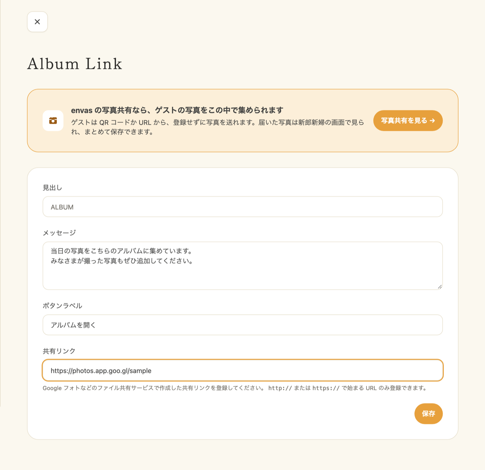
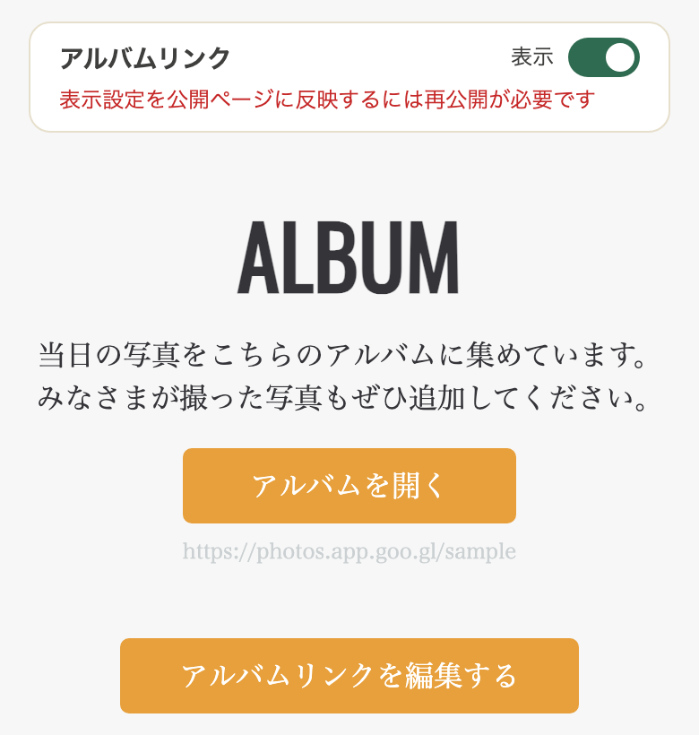

Google フォトなどで作った共有アルバムへのボタンを、プロフィールブックに載せる機能です。ゲストはボタンから共有アルバムを開き、写真を見たり追加したりできます。envas に写真を保存するのではなく、お使いの共有アルバムへの入口を置く機能です。

ゲストから envas の中で写真や動画を集めたいときは、「[ゲストと写真を共有する](/guest-photo-sharing/)」をご覧ください。

---

## 1. アルバムリンクを設定する {#setup}

1. サイドメニューの「席次表＆プロフィールブック」の下にある「アルバムリンク」をタップします
2. 次の項目を入力します
   - **見出し**: プロフィールブックに表示されるセクションの見出しです。空欄のときは「ALBUM」と表示されます
   - **メッセージ**: ボタンの上に表示する文章です
   - **ボタンラベル**: ボタンに表示する文字です。空欄のときは「写真を共有する」と表示されます
   - **共有リンク**: Google フォトなどのファイル共有サービスで作った、共有アルバムの URL です
3. 「保存」をタップします

- 共有リンクは `http://` か `https://` で始まる URL だけ登録できます
- 見出しは 255 文字、メッセージは 1000 文字、ボタンラベルは 30 文字まで入力できます

ページの上には、envas の写真共有の案内が表示されます。「写真共有を見る」から写真共有の画面へ移れます。

---

## 2. プロフィールブックに表示する {#display}

アルバムリンクのセクションは、はじめは表示されません。次の手順で表示に切り替えます。

1. サイドメニューの「席次表＆プロフィールブック」から編集画面を開きます
2. ページ下部にある「アルバムリンク」の切り替えを「表示」にします
3. 画面右下の「保存」で保存します

セクションは、切り替えが「表示」で、共有リンクが登録されているときだけ表示されます。共有リンクを登録していないときは表示されません。

:::warning[公開中のプロフィールブックへの反映]
表示の切り替えは、公開中のプロフィールブックにはすぐには出ません。編集画面右下の「公開」から「現在の下書きを公開する」をタップすると反映されます。公開中にもう一度公開しても、追加の料金はかからず、URL も変わりません。
見出し・メッセージ・ボタンラベル・共有リンクの変更は、保存した時点で公開ページに反映されます。
:::

---

## 3. よくある質問 {#faq}

### Q. 共有リンクにはどのサービスの URL を使えますか？ {#faq-service}

Google フォトなど、共有用の URL を発行できるサービスであればお使いいただけます。ゲストがその URL を開けるように、共有アルバム側で共有の設定をしておいてください。

### Q. プロフィールブックにアルバムのボタンが表示されません {#faq-not-displayed}

次の 2 点をご確認ください。

1. アルバムリンクの設定ページで、共有リンクが登録されていること
2. プロフィールブックの編集画面で「アルバムリンク」の切り替えが「表示」になっていること

公開中のプロフィールブックは、切り替えたあとにもう一度公開すると反映されます。

