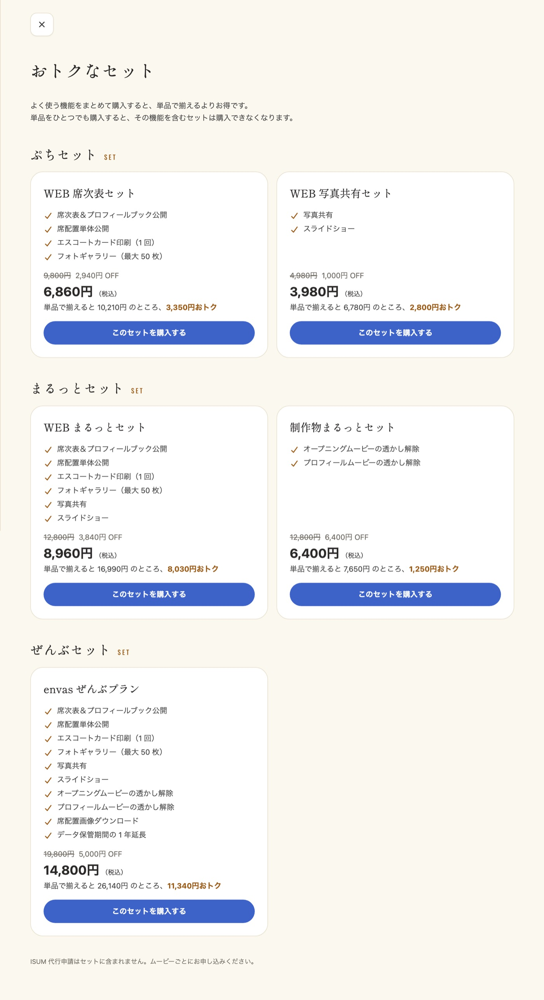
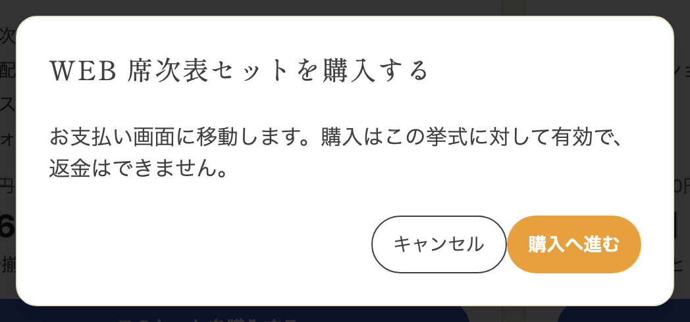
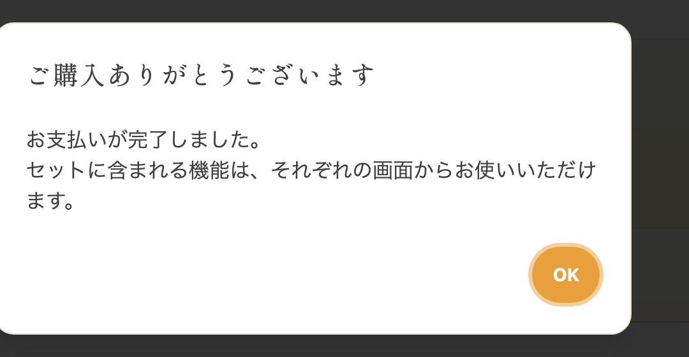
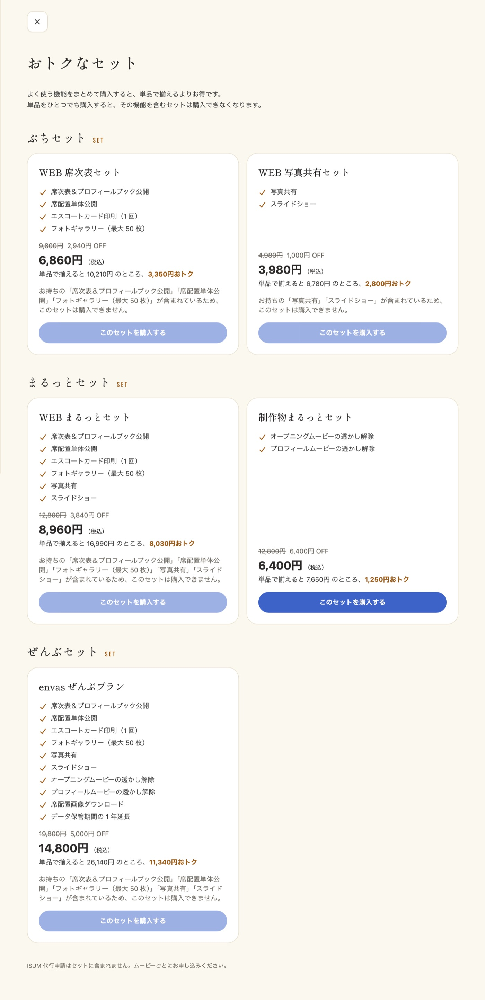

よく使う機能を、1 回のお支払いでまとめて購入できるセットです。単品で揃えるよりお得にご購入いただけます。
セットは挙式ごとのご購入です。

---

## 1. セットの種類と料金 {#plans}

セットは「ぷちセット」「まるっとセット」「ぜんぶセット」の 3 段階です。料金はすべて税込です。

| セット | 料金 | 単品で揃えた場合 | おトクな額 |
| --- | --- | --- | --- |
| WEB 席次表セット | ~~9,800円~~ 6,860円 | 10,210円 | 3,350円 |
| WEB 写真共有セット | ~~4,980円~~ 3,980円 | 6,780円 | 2,800円 |
| WEB まるっとセット | ~~12,800円~~ 8,960円 | 16,990円 | 8,030円 |
| 制作物まるっとセット | ~~12,800円~~ 6,400円 | 7,650円 | 1,250円 |
| envas ぜんぶプラン | ~~19,800円~~ 14,800円 | 26,140円 | 11,340円 |

「単品で揃えた場合」は、セットの中身を単品の現在の料金で購入したときの合計です。

### ぷちセット {#petit}

- WEB 席次表セットには、プロフィールブック公開、席次表公開、エスコートカード印刷（1 回）、フォトギャラリー（最大 50 枚）が含まれます
- WEB 写真共有セットには、写真共有とスライドショーが含まれます。リリース記念として 12 月 31 日まで 1,000円 OFF です

### まるっとセット {#full}

- WEB まるっとセットには、WEB 席次表セットと WEB 写真共有セットの中身がすべて含まれます
- 制作物まるっとセットには、オープニングムービーとプロフィールムービーの透かし解除が含まれます

### ぜんぶセット {#all}

- envas ぜんぶプランには、上のすべてに加えて、席次表画像ダウンロードとデータ保管期間の 1 年延長が含まれます

ISUM 代行申請はセットに含まれません。ムービーごとにお申し込みください。手順は「[ISUM の代行申請](/opening-movie-isum/)」をご覧ください。

---

## 2. セットを購入する {#purchase}

1. サイドメニューの「おトクなセット」をタップします。ダッシュボードの「おトクなセット」の「セットを見る」からも開けます
2. 購入するセットの「このセットを購入する」をタップします
3. 確認画面で「購入へ進む」をタップし、お支払い画面で手続きを行います
4. お支払いが完了するとダッシュボードに戻り、「ご購入ありがとうございます」と表示されます

取引履歴には、セットとして 1 件表示されます。

:::warning[ご注意]
ご購入はその挙式に対して有効で、返金はできません。
:::

---

## 3. 購入後に使えるようになるもの {#after-purchase}

セットに含まれる機能は、お支払いが完了するとすぐに使えるようになります。

- プロフィールブックと席次表は、お支払いの時点で保存済みのプロフィールブックと席次表が公開されます。まだ保存していなかった場合は、それぞれの画面の公開ボタンから無料で公開できます。手順は「[公開・非公開の管理](/publish/)」と「[席次表だけを公開する](/seating-chart-publish/)」をご覧ください
- エスコートカード印刷（1 回）は、次の印刷のご依頼をお支払いなしで受け付けます。依頼の確認画面に「セットに含まれる印刷 1 回分を使います。お支払いはありません。」と表示されます。依頼をキャンセルすると、1 回分が戻ります
- データ保管期間の 1 年延長は、お支払いの時点で保管期限を 1 年延ばします。詳しくは「[挙式データの保管期限](/storage-period/)」をご覧ください
- そのほかの機能は、それぞれの画面から購入済みとしてお使いいただけます

---

## 4. 単品とセットの関係 {#singles}

単品をひとつでも購入すると、その機能を含むセットは購入できなくなります。セットで揃える場合は、先にセットをご購入ください。

- 購入できないセットには、「お持ちの「（機能名）」が含まれているため、このセットは購入できません。」と表示されます
- 単品を購入する前に、購入できなくなるセットがあるときは「セットで購入するとお得です」の画面が表示されます。「セットを見る」からセットの一覧へ移れます。「単品で購入する」を選ぶと、そのまま単品のお支払いへ進みます
- 席次表画像ダウンロード、データ保管期間の延長、エスコートカード印刷は、単品で購入していてもセットの購入には影響しません

---

## 5. よくある質問 {#faq}

### Q. 単品を購入済みです。セットに切り替えられますか？ {#faq-switch-to-bundle}

購入済みの単品を含むセットは購入できません。購入済みの単品を含まないセットは、そのまま購入できます。

### Q. セットにクーポンは使えますか？ {#faq-coupon}

セットにはクーポンをお使いいただけません。

### Q. セットで公開したプロフィールブックは、後から編集できますか？ {#faq-edit-after-publish}

はい。公開後も何度でも編集でき、編集した内容は無料で公開し直せます。
