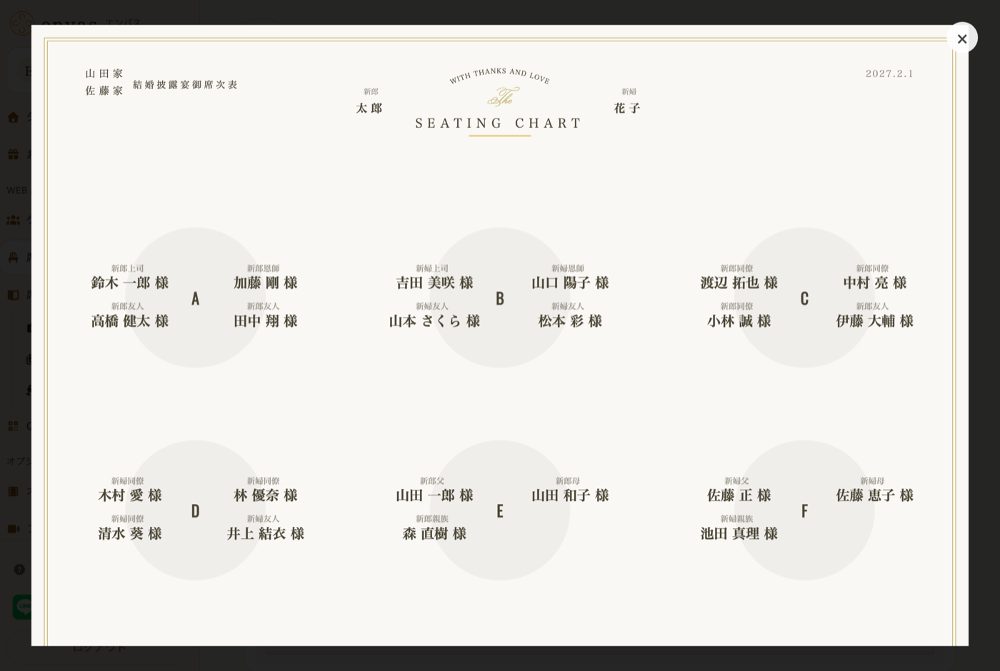
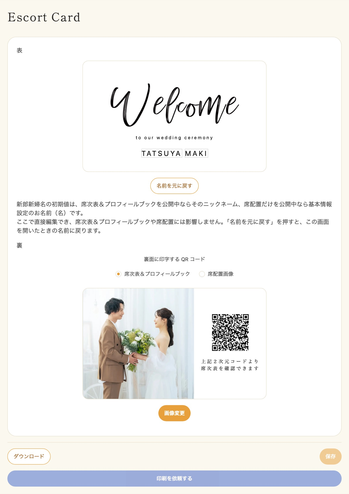
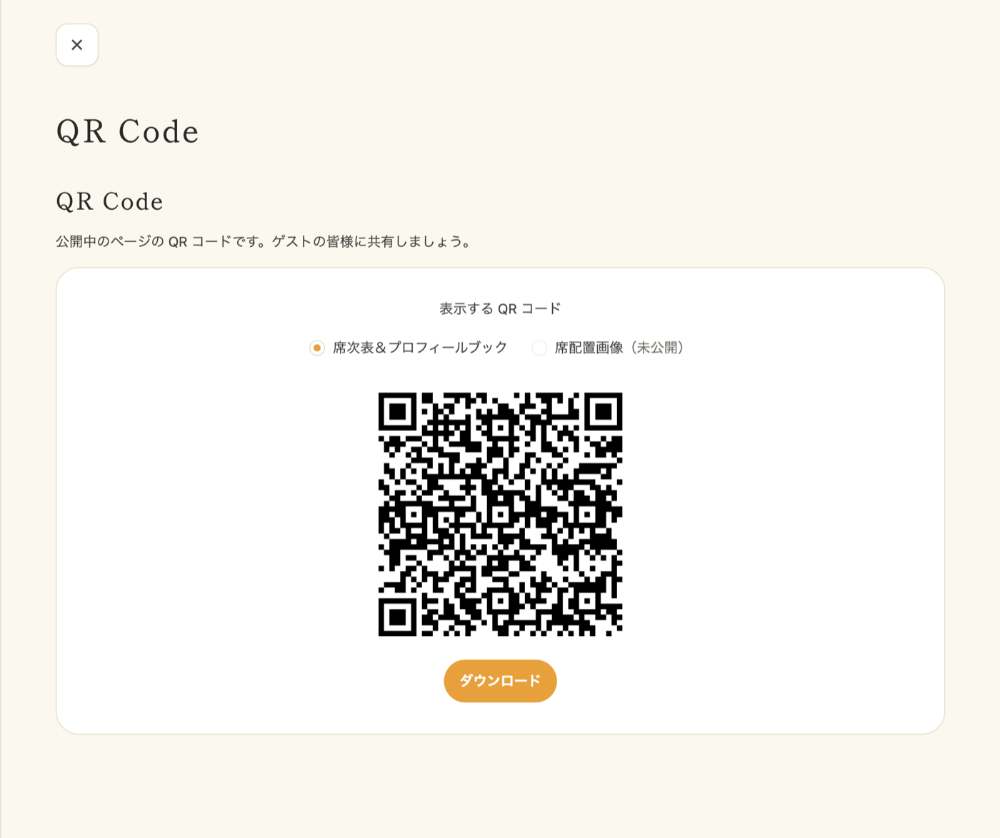
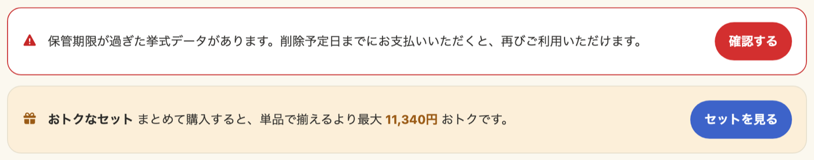
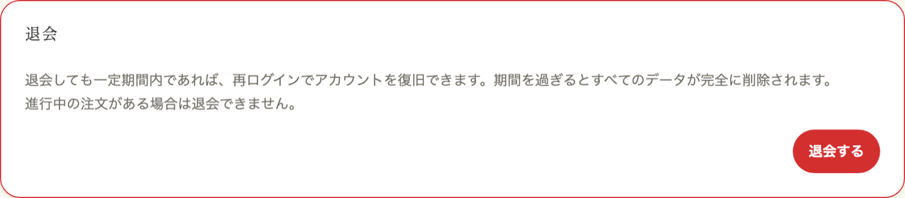

## 文字サイズを変更したい

大変申し訳ございません。  
現状、文字サイズの変更には対応しておりません。  
機能追加をご期待くださいませ。

## エスコートカードの印刷を依頼をした場合、どのくらいの日程で届きますか？

エスコードカードの印刷をご依頼いただいた場合、ご入稿完了から約1週間程度でのお届けとなります。  
<small>※ お住まいの地域や配送状況により、多少前後する場合がございます</small>

お急ぎの場合は、可能な限り調整させていただきますので、お気軽にご相談くださいませ。

## エスコートカードの印刷依頼をしたあと、再度依頼するボタンが表示されました。これはなんですか？

エスコートカードの印刷依頼は1回あたり100枚までとなっている都合上、それ以上の枚数を必要とするお客様向けに、何度でも依頼ができるような仕様となっております。

そのため、エスコートカードの発送後でも依頼ボタンが表示されることがございますが、エスコートカードの発送自体は済んでおりますのでご安心くださいませ。

## プロフィールブックや席次表の内容を変更しても同じQRコードで読み取ることができますか？

はい。読み取ることができます。  
一度購入いただいた時点で一意のURLが発行される仕組みですので、公開後何度でも編集することが可能です。  
QR コードは、サイドメニューの「QR コード」からダウンロードできます。  
<small>※ 挙式データには保管期限があります。期限を過ぎると読み取れなくなりますのでご注意ください（[挙式データの保管期限](/storage-period/)）</small>

## プロフィールブックや席次表の任意の項目を完全に削除したい。

大変申し訳ございません。  
編集することのできない項目は固定されたデザインとなっておりますので、編集・削除することはできません。  
予め、ご了承くださいませ。

## 挙式データはいつまで保管されますか？

挙式日から90日間です。挙式日を設定されていない場合は、挙式データを作成した日から90日間となります。  
データ保管手数料（1年間）のお支払いで延長いただけます。詳しくは[挙式データの保管期限](/storage-period/)をご覧ください。

## 公開していたプロフィールブックや席次表が見られなくなりました

挙式データの保管期限を過ぎている可能性がございます。  
期限を過ぎると、プロフィールブックや席次表、エスコートカードの二次元コードからのアクセスができなくなります。  
削除されるまでの間であれば、データ保管手数料のお支払いで元の状態に戻せます。手順は[データの削除と保管期限の延長](/storage-extension/)をご覧ください。

## 退会したい

サイドメニューの「基本情報設定」から開く設定画面の、ページ下部の「退会」からお手続きいただけます。手順と退会後のデータの扱いは[退会について](/withdrawal/)をご覧ください。  
<small>※ エスコートカードの印刷注文が進行中の場合は退会できません</small>

