結婚式のゲストが撮った写真と動画を、QR コードからそのまま送ってもらえる機能です。ゲストはアプリのインストールも会員登録もいらず、スマートフォンのブラウザで写真や動画を送り、みんなの写真と動画を見られます。届いた写真と動画は、元の画質のままお二人でまとめて保存したり、Google フォトや Google ドライブに送ったりできます。
写真共有は基本料金とは別のご購入で、1,980円（税込）です。スライドショーと合わせた WEB 写真共有セットでもご購入いただけます。詳しくは「[おトクなセット](/bundle/)」をご覧ください。

写真共有は、挙式を作成した方と、招待リンクから参加したパートナーのどちらでも使えます。

---

## 1. 写真共有の画面を開く {#open}

サイドメニューの「オプション」にある「写真共有」をタップすると、写真共有の画面が開きます。ダッシュボードの写真共有のカードからも開けます。カードには購入済みかどうかが表示されます。

写真共有の画面は、上から順に次の 3 つでできています。

- ゲストに配る QR コード
- ゲストへのメッセージ
- ゲストから届いた写真と動画の一覧

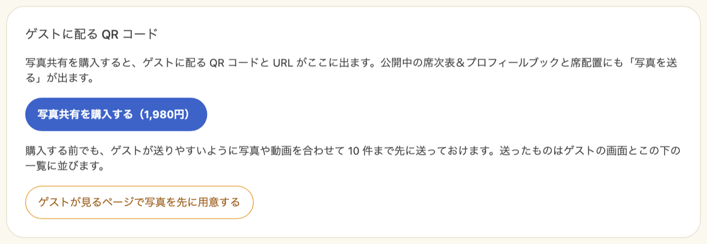

---

## 2. 購入して QR コードを配る {#purchase}

1. 写真共有の画面の「写真共有を購入する」をタップします
2. 確認の画面で内容を確かめて進み、お支払い画面でお支払いを済ませます
3. 写真共有の画面に戻り、「お支払いありがとうございます。」と表示されたら購入は完了です

確認の画面の前に「セットで購入するとお得です」の画面が表示されたときは、単品で買うなら「単品で購入する」を、セットを見るなら「セットを見る」をタップします。

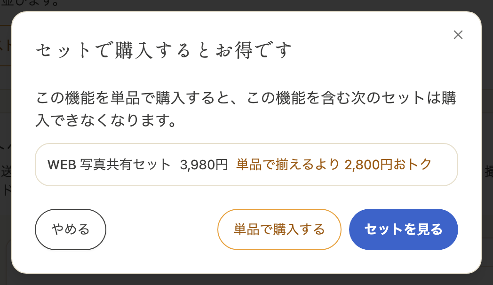

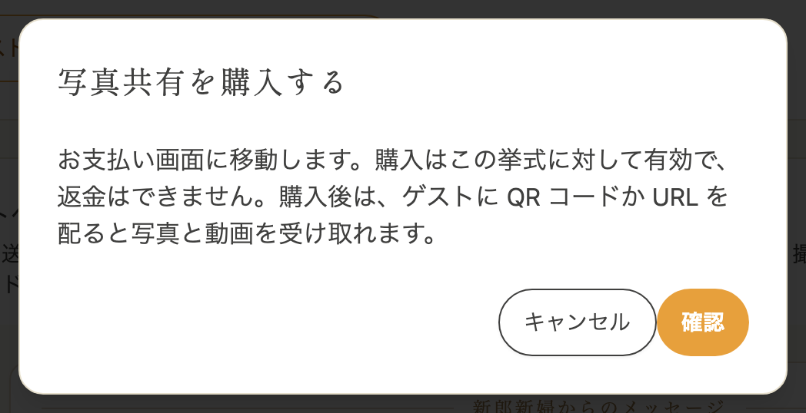

購入すると、「ゲストに配る QR コード」に QR コードと URL が表示されます。

- 「URL をコピー」で URL をコピーできます。LINE などでゲストに送るときにお使いください
- 「QR コードを保存」で QR コードを画像として保存できます。受付に置いたり、席札やペーパーアイテムに印刷したりしてお使いください

ゲストはこの QR コードか URL から、登録せずに写真や動画を送って見られます。

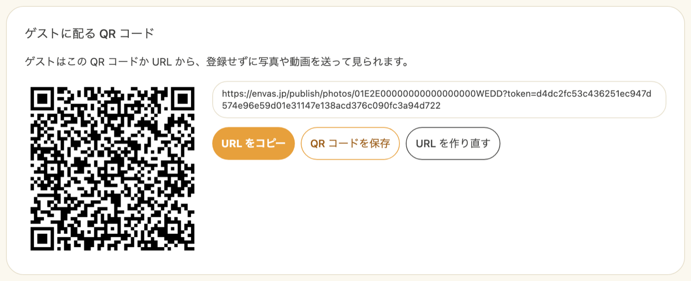

購入はこの挙式に対して有効です。お支払い方法は[はじめに](/)の「ご利用料金」をご覧ください。

### 公開ページの「写真を送る」 {#publish-link}

購入すると、[公開中のプロフィールブックと席次表](/publish/)の右下に「写真を送る」のボタンが表示されます。ゲストはプロフィールブックや席次表を見ているところから、そのまま写真を送る画面へ移れます。QR コードを別に配らなくても、プロフィールブックや席次表の QR コードから写真を集められます。

「写真を送る」のボタンは、購入したあとに写真共有の画面を一度開くと表示されるようになります。

### URL を作り直す {#reissue}

QR コードや URL が思わぬところに出回ってしまったときは、「URL を作り直す」をタップし、確認の画面で「作り直す」をタップします。

:::warning[配った QR コードは使えなくなります]
作り直すと、今の URL と QR コードは使えなくなります。すでに印刷して配った QR コードも使えなくなるため、新しい QR コードを配り直してください。
公開中のプロフィールブックと席次表の「写真を送る」は、新しい URL に自動で替わります。
:::

---

## 3. ゲストが写真や動画を送る {#guest-upload}

ゲストは QR コードを読み取るか URL を開くと、写真や動画を送る画面が表示されます。

1. 「お名前」を入力します。お名前は写真や動画と一緒に表示されます。空欄のままでもかまいません
2. 画面の右下の ＋ をタップします
3. 「みんなに見せる」か「新郎新婦だけに見せる」を選びます
4. 送る写真や動画を選びます。写真と動画を一緒に、何件でもまとめて選べます

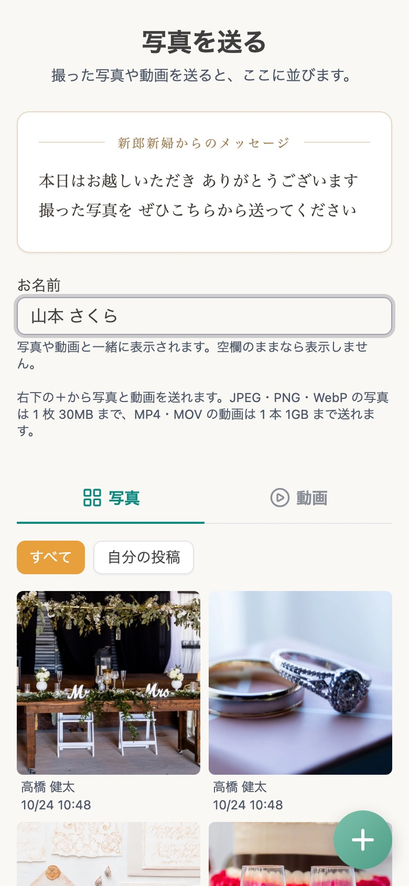

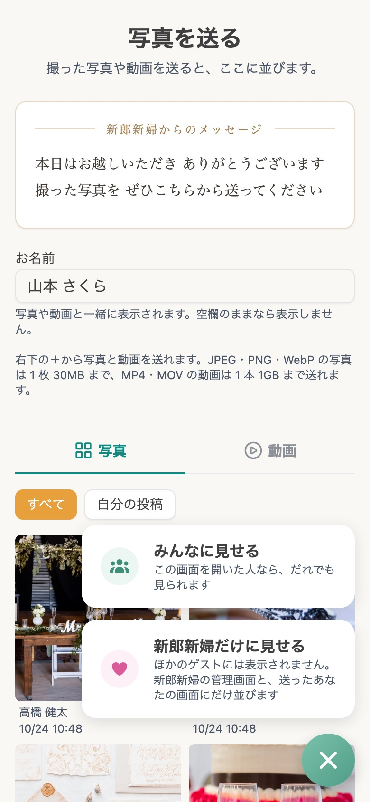

送っている間は、送れた件数と進み具合が表示されます。送り終わるまで、画面を開いたままにしてください。動画は大きいので、写真より時間がかかります。
送れた写真と動画は、すぐに画面の一覧に並びます。

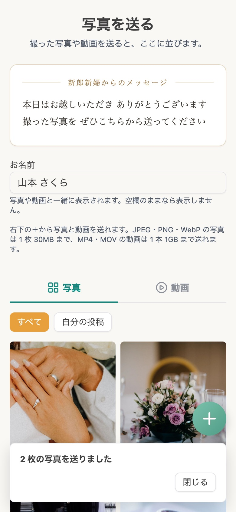

| 選ぶもの | 見られる人 |
| --- | --- |
| みんなに見せる | 写真を送る画面を開いた人なら、どなたでも見られます |
| 新郎新婦だけに見せる | ほかのゲストには表示されません。お二人の写真共有の画面と、送ったゲスト自身の画面にだけ並びます |

見せる相手は、送ったあとで変えられません。

### 送れる写真 {#photo-limits}

- JPEG・PNG・WebP の写真を送れます
- 写真は 1 枚 30MB までです
- お名前は 50 文字までです

iPhone で撮った写真は、そのまま選べば送れる形に変換されます。パソコンなどから HEIC 形式の写真を選ぶと「HEIC 形式の写真は送れません。JPEG に変換してから選んでください。」と表示されます。
送れなかった写真があるときは「送れなかった写真を送り直す」をタップすると、もう一度送れます。

### 送れる動画 {#video-limits}

- MP4・MOV の動画を送れます。iPhone や Android のカメラで撮った動画は、そのまま選べば送れます
- 動画は 1 本 1GB までです。長さの上限はありません

動画は、撮影した場所や機種名などの情報を取り除いてから送ります。動画そのものの画質は変わりません。
動画の形式によっては、送れないことがあります。そのときは「この動画は送れません。端末のカメラで撮った動画を選んでください。」と表示されます。

回線が途切れて送れなかった動画は、「送れなかった動画を送り直す」をタップすると、途中から続きを送ります。最初から送り直さずに済みます。

### ゲストができること {#guest-view}

- 「写真」と「動画」のタブを切り替えて、見たいほうを表示できます
- 「すべて」と「自分の投稿」を切り替えて、写真や動画を見られます
- 写真をタップすると、大きく表示できます
- 動画には再生のマークと長さが表示されます。タップすると、その場で再生できます
- 自分が送った写真や動画は、削除のボタンから削除できます

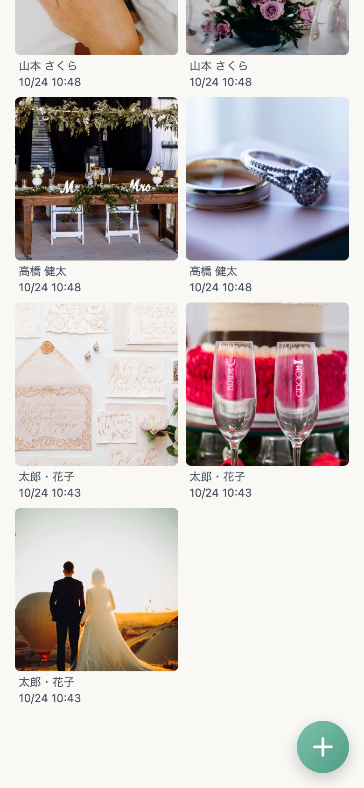

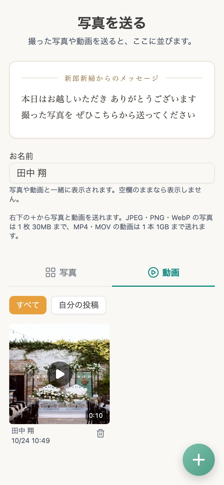

自分の投稿かどうかは、写真や動画を送ったスマートフォンのブラウザごとに見分けています。別のスマートフォンやブラウザで開くと、それまでに送った写真や動画は「自分の投稿」に表示されず、削除もできません。

---

## 4. ゲストへのメッセージを添える {#host-message}

写真を送る画面の上に、お二人からゲストへのメッセージを表示できます。来てくれたお礼や、撮ってほしい場面のお願いなどを書いておけます。

1. 写真共有の画面の「ゲストへのメッセージ」のカードを開きます
2. カードの中をタップして、メッセージを書きます。カードはゲストの画面と同じ見た目で表示されます
3. 「保存する」をタップします

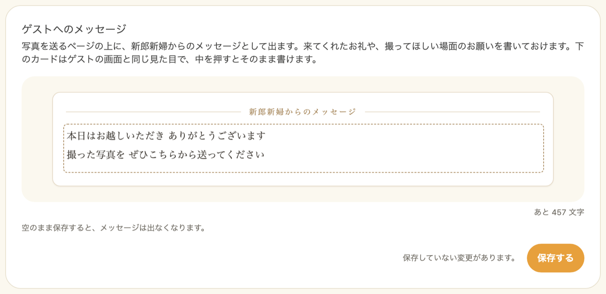

- メッセージは 500 文字までです
- 空のまま保存すると、メッセージは表示されなくなります
- 保存したメッセージは、ゲストが写真や動画を送る画面を開いたときに表示されます

メッセージは購入する前でも書いておけます。

---

## 5. 届いた写真と動画を見て保存する {#manage}

ゲストから届いた写真と動画は、写真共有の画面の一覧に新しい順に並びます。一覧の上の「写真」と「動画」のタブで、表示するほうを切り替えられます。動画はタップすると、その場で再生できます。
写真や動画ごとに、送ったゲストのお名前が表示されます。お名前のないものは「名前なし」と表示されます。「新郎新婦だけに見せる」で届いたものには「新郎新婦だけ」と表示されます。

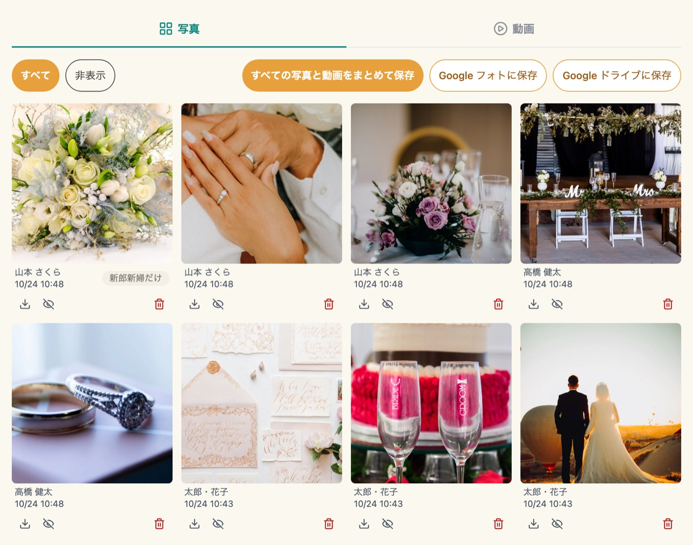

写真や動画の下のボタンで、次の操作ができます。

| ボタン | できること |
| --- | --- |
| 元の画質で保存 | その写真や動画を、ゲストが送ったときの画質のまま保存します |
| ゲストから隠す | ゲストの画面に表示されなくなります。写真や動画は残り、お二人の一覧では「非表示」と表示されます |
| ゲストに表示する | 隠した写真や動画を、もう一度ゲストの画面に表示します |
| 削除 | 写真や動画を削除します |

一覧の上の「すべて」と「非表示」で、表示するものを切り替えられます。

:::warning[削除した写真や動画は元に戻せません]
削除した写真や動画は、ゲストの一覧からも消えます。載せたくないだけのものは、削除ではなく「ゲストから隠す」をお使いください。
:::

### まとめて保存する {#bulk-save}

「すべての写真と動画をまとめて保存」をタップすると、届いた写真と動画を元の画質のまま zip ファイルにまとめて保存できます。「写真」と「動画」のどちらのタブを開いていても、両方を保存します。「非表示」を選んでいるときは「非表示の写真と動画をまとめて保存」になり、隠したものだけを保存します。

- Google Chrome や Microsoft Edge では、保存先を選ぶ画面が表示されます。保存先を選ぶと、すべての写真と動画が 1 つの zip ファイルにまとまります
- Safari などでは、写真や動画が多いと zip ファイルを 500 件または 1GB ごとに分けて作ります。「zip ができました。保存してください。続きがあれば、保存の後にまとめます。」と表示されたら、そのつど「〇〇 を保存」のボタンをタップしてください。保存すると、続きをまとめ始めます

写真や動画が多いと、まとめるのに時間がかかります。途中でやめるときは「保存を止める」をタップしてください。保存できなかったものがあるときは、その件数が表示されます。

### Google フォト・Google ドライブに保存する {#google-export}

届いた写真と動画を、元の画質のまま、お二人の Google フォトか Google ドライブへ送れます。スマートフォンやパソコンにいったん保存する必要はありません。

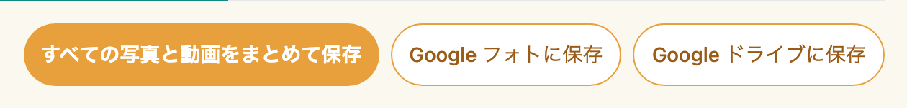

1. 写真共有の画面の「Google フォトに保存」か「Google ドライブに保存」をタップします
2. Google の画面が開くので、保存する Google アカウントを選び、保存を許可します。許可を求める項目には、すべてチェックを入れてください
3. 「元の画質の写真と動画を Google フォトに送っています。画面を閉じずにお待ちください。」と表示され、送った件数が増えていきます
4. 「〇 件を Google フォトに保存しました。」と表示されたら完了です。「Google フォトで開く」から、保存先を開けます

「写真」と「動画」のどちらのタブを開いていても、両方を送ります。「非表示」を選んでいるときは「非表示のものを Google フォトに保存」になり、隠したものだけを送ります。

| 保存先 | 保存される場所 |
| --- | --- |
| Google フォト | 「envas ゲストの写真（お二人の姓）」という名前のアルバムを作り、その中に入れます |
| Google ドライブ | マイドライブに「envas ゲストの写真（お二人の姓）」という名前のフォルダを作り、その中に保存します |

- 一度送ったものは、次に保存するときに送りません。新しく届いた写真や動画だけを送ります。「〇 件は保存済みなので送りませんでした。」と表示されます
- 途中でやめるときは「Google フォトへの保存を止める」をタップしてください。もう一度タップすると、続きから送ります
- 送っている間は、まとめての保存や、一覧の写真の操作はできません
- 保存した写真と動画は、お二人の Google アカウントの保存容量を使います

:::warning[送り終わるまで画面を開いたままにしてください]
写真と動画は、お使いのスマートフォンやパソコンのブラウザから Google へ送ります。送っている途中で画面を閉じたり、ほかの画面へ移ったりすると止まります。動画が多いと時間がかかるので、Wi-Fi につないだ状態でお使いください。
:::

止まったときは、次のように表示されます。どの場合も、もう一度タップすると送り済みのものを飛ばして続きから送ります。

| 表示 | 理由 |
| --- | --- |
| Google の許可の期限が切れたので止めました。 | Google の許可は 1 時間ほどで切れます。もう一度タップして、許可し直してください |
| Google フォトに受け付けてもらえませんでした。 | Google アカウントの保存容量が足りないか、短い時間に多く送りすぎています。空き容量を確かめて、時間をおいてからお試しください |
| Google に保存するための許可が足りません。 | Google の画面で、許可を求める項目のチェックが外れていました。すべての項目にチェックを入れて許可してください |

---

## 6. 購入する前に写真を並べておく {#seed-photos}

購入する前でも、ゲストが送りやすいように、お二人の写真や動画を先に並べておけます。前撮りの写真などを並べておくと、ゲストが画面を開いたときに最初から写真が並んでいて、送り方も伝わりやすくなります。

1. 写真共有の画面の「ゲストが見るページで写真を先に用意する」をタップします
2. 新しいタブで、ゲストが見るページが開きます
3. 画面の右下の ＋ をタップして、写真や動画を選びます

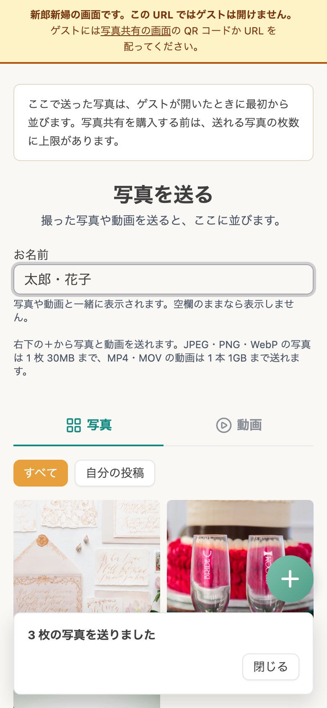

ここで送った写真や動画は、ゲストの画面と、写真共有の画面の一覧に並びます。購入する前に並べられるのは、写真と動画を合わせて写真共有の画面に表示される件数までです。購入すると上限はなくなります。

:::warning[このページの URL はゲストに配らないでください]
「新郎新婦の画面です。この URL ではゲストは開けません。」と表示されているページは、ログインしたお二人だけが開けるページです。ゲストには、購入後に表示される QR コードか URL を配ってください。
:::

---

## 7. 使える期間 {#period}

写真共有は、挙式の[データの保管期限](/storage-period/)まで使えます。ゲストが写真や動画を送れるのも保管期限までです。

保管期限を過ぎると、写真共有の画面に「保管期限を過ぎたため、写真共有は使えません。保管期間を延長すると、また使えます。」と表示されます。[データ保管期間を延長する](/storage-extension/)と、また使えるようになります。

届いた写真と動画は、保管期限までに[まとめて保存](#bulk-save)するか、[Google フォト・Google ドライブに保存](#google-export)しておいてください。

---

## 8. よくある質問 {#faq}

### Q. ゲストにアプリのインストールや会員登録は必要ですか？ {#faq-app}

必要ありません。ゲストは QR コードを読み取るか URL を開くだけで、スマートフォンのブラウザから写真や動画を送って見られます。

### Q. 写真は何枚まで送れますか？ {#faq-count}

枚数の上限はありません。写真は 1 枚 30MB まで、動画は 1 本 1GB までで、1 つの挙式で写真と動画を合わせて 30GB まで受け取れます。上限に達すると、ゲストの画面に「送れる写真の上限に達したため、送れませんでした。」と表示されます。

### Q. 写真の画質は落ちますか？ {#faq-quality}

落ちません。ゲストが送った写真と動画は元の画質のまま届き、写真共有の画面から元の画質のまま保存できます。画面の一覧には、すばやく表示するために小さくした写真を表示しています。

### Q. 動画も送れますか？ {#faq-video}

送れます。MP4・MOV の動画を、1 本 1GB まで送れます。詳しくは[送れる動画](#video-limits)をご覧ください。
送った動画は、ゲストの画面とお二人の写真共有の画面で再生できます。[スライドショー](/guest-photo-slideshow/)には流れません。

### Q. 動画に撮影した場所の情報が残りませんか？ {#faq-video-location}

残りません。動画は送る前に、撮影した場所や機種名などの情報を取り除いています。ほかのゲストに撮影した場所が伝わることはありません。

### Q. 載せたくない写真が届いたときはどうすればよいですか？ {#faq-hide}

写真共有の画面で、その写真の「ゲストから隠す」をタップしてください。ゲストの画面には表示されなくなり、写真はお二人の一覧に残ります。いらない写真は「削除」で削除できます。動画も同じように操作できます。

### Q. ゲストが送った写真を、ゲスト自身で消せますか？ {#faq-guest-delete}

送ったときと同じスマートフォンのブラウザからなら、自分が送った写真や動画を削除できます。

### Q. 購入する前に、ゲストに写真を送ってもらえますか？ {#faq-before-purchase}

できません。ゲストに配る QR コードと URL は、購入すると表示されます。購入する前は、[お二人の写真を先に並べておく](#seed-photos)ことだけができます。

### Q. 配った QR コードが外に出回ってしまいました {#faq-leaked}

写真共有の画面の「URL を作り直す」で、今の URL と QR コードを使えなくできます。詳しくは[URL を作り直す](#reissue)をご覧ください。

### Q. Google フォトや Google ドライブに保存すると、envas から Google の写真やファイルが見えますか？ {#faq-google-access}

見えません。envas が Google に求める許可は、envas が作ったアルバムやフォルダに写真と動画を入れることと、そこに何を入れたかを確かめることだけです。お二人がもともと Google に保存している写真やファイルは読めません。
Google の許可は保存するたびにお使いのブラウザで求め、envas のサーバーには残しません。

### Q. Google フォトのアルバムの名前を変えてもよいですか？ {#faq-google-album-name}

変えられますが、次に Google フォトへ保存するときは、名前を変えたアルバムを見つけられず、新しいアルバムを作ってすべての写真と動画を送り直します。続けて保存するときは、アルバムの名前を変えずにお使いください。
Google ドライブのフォルダは、名前を変えたり、ほかの場所へ移したりしても、同じフォルダに続けて保存します。

### Q. パートナーの Google アカウントに保存できますか？ {#faq-google-partner}

できます。保存するときに Google の画面で選んだアカウントに保存されます。招待リンクから参加したパートナーも、写真共有の画面から保存できます。

