[写真共有](/guest-photo-sharing/)でゲストから集めた写真を、披露宴の会場のスクリーンに流す機能です。ゲストが送った写真は数秒で会場の画面に映り、賞を作っておくと、当日にスタッフのスマートフォンから発表できます。
スライドショーは基本料金とも写真共有とも別のご購入で、4,800円（税込）です。写真共有と合わせた WEB 写真共有セットでもご購入いただけます。詳しくは「[おトクなセット](/bundle/)」をご覧ください。

スライドショーは、挙式を作成した方と、招待リンクから参加したパートナーのどちらでも使えます。

---

## 1. スライドショーとは {#about}

会場の PC でスライドショーの画面を開いてスクリーンに映すと、ゲストが写真共有で送った写真が 1 枚ずつ流れます。ゲストはいつもどおり写真を送るだけで、新しく届いた写真が順に会場の画面に加わります。

当日の進行は、会場のスタッフが手元のスマートフォンのリモコンで行います。リモコンで、写真を流すスライドショーと、お二人が用意した賞の発表を切り替えます。会場の PC を操作する必要はありません。

お二人が用意するものは次の 3 つです。

- 会場の画面の見た目
- 発表する賞と、受賞する写真
- 会場のスタッフに渡す、会場の画面とリモコンの 2 つの URL

会場の画面とリモコンは、どちらもログインせずに URL だけで開けます。

会場の画面には、ゲストが写真を送るための QR コードも表示されます。スクリーンを見たゲストがその場で読み取って写真を送れるので、上映中にも写真が増えていきます。

:::warning[スライドショーに流れる写真]
流れるのは、写真共有で「みんなに見せる」で届いた写真のうち、公開中の写真だけです。「新郎新婦だけに見せる」で届いた写真と、写真共有の画面で「ゲストから隠す」をした写真は流れません。
写真共有で届いた動画も流れません。
:::

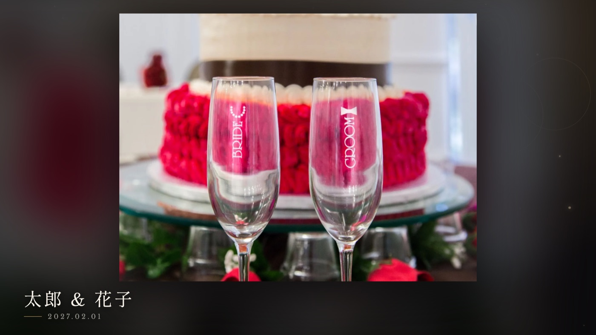

---

## 2. スライドショーの画面を開く {#open}

サイドメニューの「写真共有」の下にある「スライドショー」をタップすると、スライドショーの画面が開きます。次の場所からも開けます。

- ダッシュボードの写真共有のカードにある「スライドショー」
- 写真共有の画面の「スライドショーの画面へ」

ダッシュボードと写真共有の画面には、スライドショーを購入済みかどうかが表示されます。

スライドショーの画面は、上から順に次のものでできています。

- サンプルを見る
- 会場の画面とリモコン
- 見た目を選ぶ
- 発表する賞

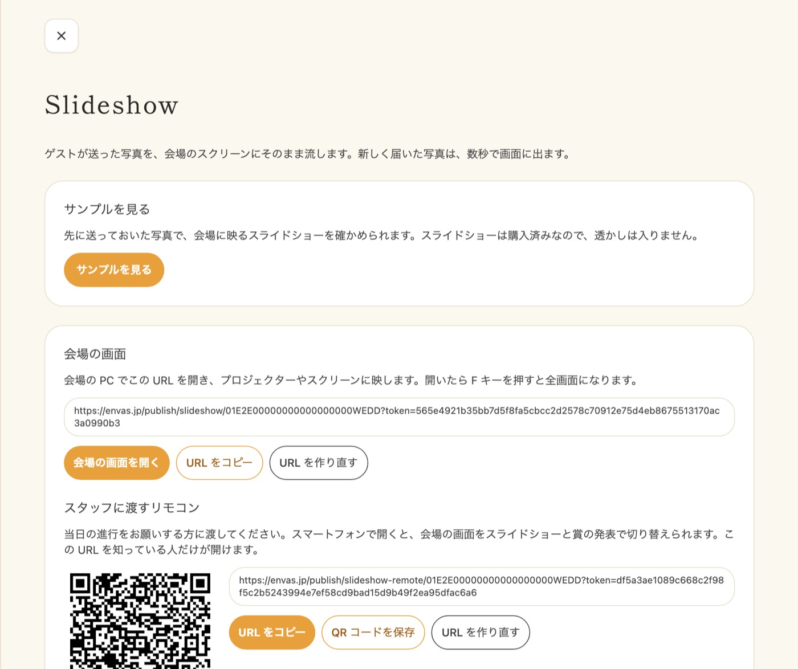

---

## 3. サンプルを見る {#sample}

購入する前に、会場に映るスライドショーを実際の写真で確かめられます。

1. スライドショーの画面の先頭にある「サンプルを見る」をタップします
2. 新しいタブで、会場の画面と同じ見た目のスライドショーが開きます

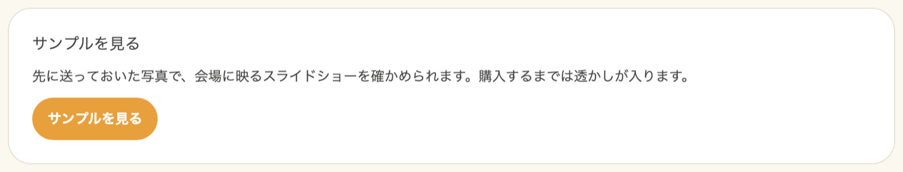

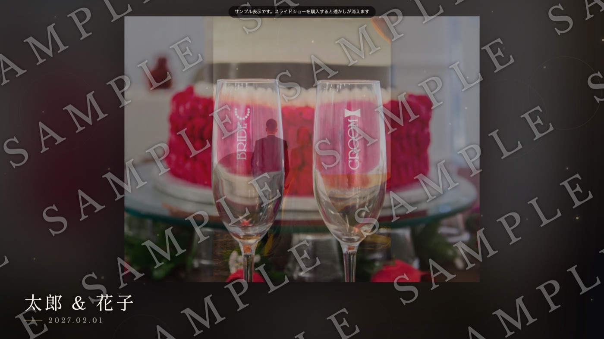

サンプルには、写真共有の画面で[先に並べておいた写真](/guest-photo-sharing/#seed-photos)を使います。写真が多いときは、古いものから購入する前に並べられる枚数までを流します。写真が 1 枚もないときは「写真共有で写真を送ると、ここに流れます」と表示されます。

購入する前のサンプルには「SAMPLE」の透かしが入り、画面の上に「サンプル表示です。スライドショーを購入すると透かしが消えます」と表示されます。購入すると、サンプルにも透かしは入らなくなります。

「全画面で映す（F キー）」で全画面にでき、「管理画面に戻る」でスライドショーの画面に戻れます。

サンプルには、写真を送る QR コードは表示されません。

---

## 4. 購入する {#purchase}

スライドショーを購入するには、先に[写真共有を購入](/guest-photo-sharing/#purchase)しておく必要があります。スライドショーは写真共有でゲストから集めた写真を流すためです。写真共有を購入していないときは「先に写真共有を購入してください。」と表示されるので、「写真共有の画面へ」から写真共有を購入してください。

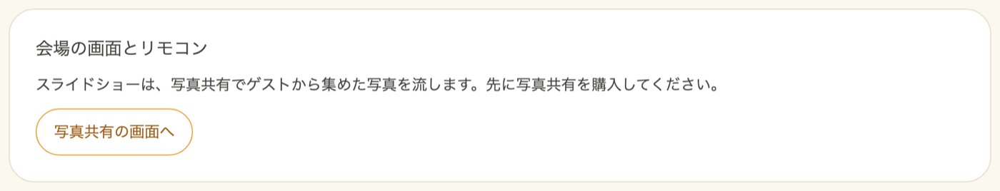

1. スライドショーの画面の「スライドショーを購入する」をタップします
2. 確認の画面で内容を確かめて進み、お支払い画面でお支払いを済ませます
3. スライドショーの画面に戻り、「お支払いありがとうございます。」と表示されたら購入は完了です

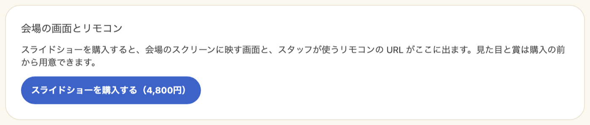

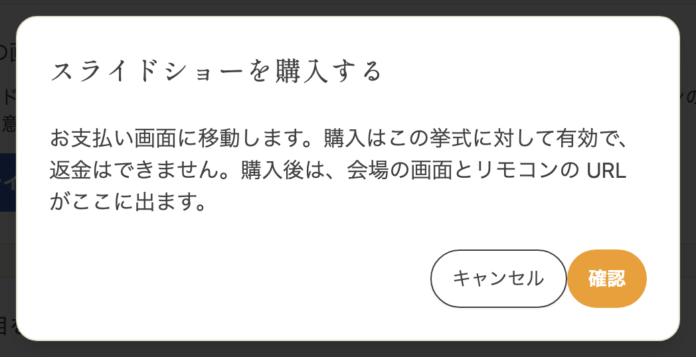

購入すると、購入のボタンがあったところに「会場の画面」の URL と、「スタッフに渡すリモコン」の URL と QR コードが表示されます。使い方は[会場で流す](#venue)をご覧ください。

購入はこの挙式に対して有効です。お支払い方法は[はじめに](/)の「ご利用料金」をご覧ください。

見た目の選択と賞の作成は、購入する前からできます。

---

## 5. 見た目を選ぶ {#appearance}

「見た目を選ぶ」で、会場の画面の見た目を選びます。選んだ見た目は、上の見本でそのまま確かめられます。見本には、挙式の写真のうち会場に流せる写真を 1 枚使います。まだ写真がないときは、envas が用意した見本の写真を使います。

| 選ぶもの | 選べるもの |
| --- | --- |
| デザイン | クラシック |
| カラー | ブラック |
| 画面の形 | 16:9 ワイド、4:3 標準 |
| 写真の上映中に、写真を送る QR コードを隅に出す | 出す、出さない |

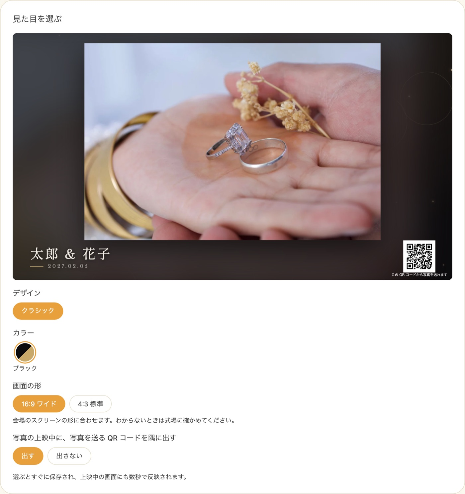

画面の形は、会場のスクリーンの形に合わせて選びます。わからないときは式場にご確認ください。スクリーンの形と違うときは、余白が背景の色で埋まります。

写真が流れているあいだ、会場の画面の右下に写真を送る QR コードが小さく表示されます。写真の邪魔になるときは「出さない」を選んでください。はじめは「出す」になっています。見本の右下の QR コードは位置と大きさを示す見本で、読み取っても写真共有の画面は開きません。写真がまだ届いていないときの大きな QR コードは、どちらを選んでも表示されます。詳しくは「[会場の画面に出る QR コード](#screen-qr)」をご覧ください。

選ぶとすぐに保存されます。上映中に選び替えても、数秒で会場の画面に反映されます。

会場の画面の左下には、お二人のお名前と挙式日が表示されます。お名前と挙式日は、挙式の情報に登録したものを使います。

---

## 6. 賞を作る {#awards}

「ベストショット賞」のような賞を作って受賞する写真を選んでおくと、当日スタッフがリモコンから会場の画面で発表できます。

1. 「発表する賞」の「賞を作る」をタップします
2. 「賞の名前」を入力します
3. 必要なら「説明（なくても構いません）」を入力します
4. 「受賞する写真」から写真を 1 枚選びます
5. 「作る」をタップします

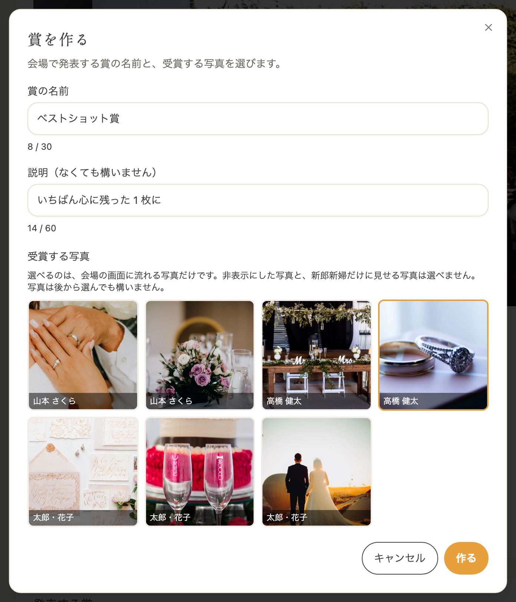

- 賞の名前は 30 文字まで、説明は 60 文字までです。会場の画面に 1 行で表示されます
- 賞は 1 つの挙式で 20 個まで作れます
- 受賞する写真は、後から選んでもかまいません。ゲストから写真が届いてから選べます
- 選べるのは、会場の画面に流れる写真だけです。動画と、非表示にした写真と、新郎新婦だけに見せる写真は選べません

作った賞は一覧に並び、リモコンにも同じ順に並びます。

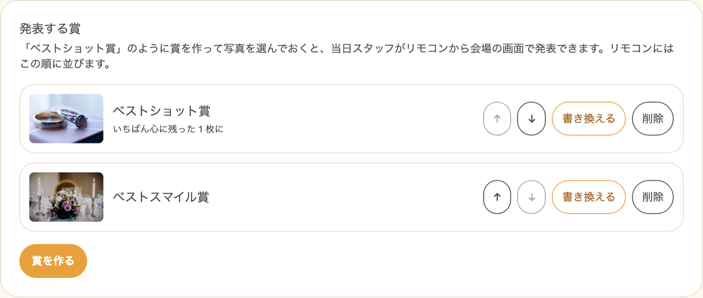

| ボタン | できること |
| --- | --- |
| ↑ と ↓ | 賞の並び順を入れ替えます |
| 書き換える | 賞の名前、説明、受賞する写真を書き換えます |
| 削除 | 賞を削除します。会場の画面でその賞を発表しているときは、スライドショーに戻ります |

### 発表できない賞 {#awards-not-ready}

次のときは、賞の一覧に理由が表示され、リモコンからその賞を発表できません。

| 一覧の表示 | 直し方 |
| --- | --- |
| 写真がまだ選ばれていません。このままでは発表できません。 | 「書き換える」から受賞する写真を選びます |
| 選んだ写真は、非表示か新郎新婦だけに見せる写真になっています。このままでは発表で写真が出ません。 | 写真共有の画面でその写真を「ゲストに表示する」に戻すか、「書き換える」から別の写真を選びます |

受賞する写真に選んだ写真を写真共有の画面で削除すると、その賞は写真が選ばれていない状態に戻ります。

### 発表の流れ {#award-announcement}

リモコンで賞のボタンを押すと、会場の画面で次の順に発表が進みます。

1. 流れている写真がタイルのように並び、「AND THE WINNER IS」と表示されます
2. スポットライトが写真の上を跳ね、受賞した写真で止まります
3. 受賞した写真が大きく映り、紙吹雪とともに賞の名前と説明が表示されます
4. 最後に、写真を送ったゲストのお名前が表示されます

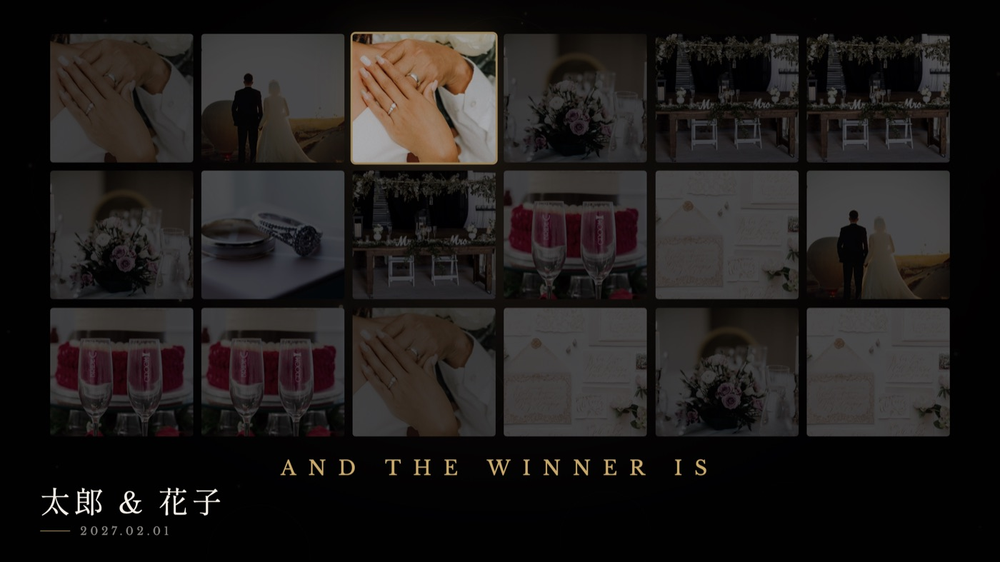

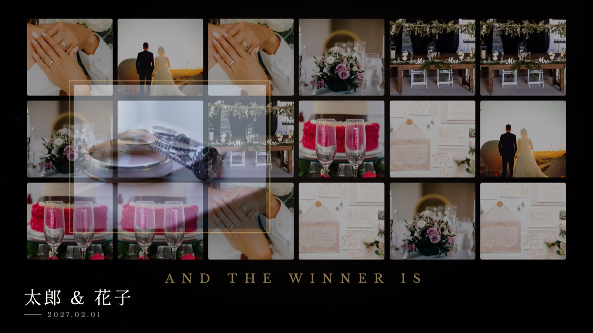

ゲストのお名前が表示されるのは、賞の発表のときだけです。ふだんのスライドショーでは表示されません。お名前を入れずに送られた写真では、お名前は表示されません。

---

## 7. 会場で流す {#venue}

購入すると、スライドショーの画面に会場の画面とリモコンの URL が表示されます。どちらも、当日の進行をお願いする式場のスタッフや友人に渡してください。

当日の流れは次のとおりです。

1. 会場の PC で会場の画面の URL を開き、スクリーンに映します
2. ゲストはいつもどおり写真共有で写真を送ります。届いた写真から順に会場の画面に映ります
3. 賞を発表するときは、スタッフが手元のリモコンで切り替えます

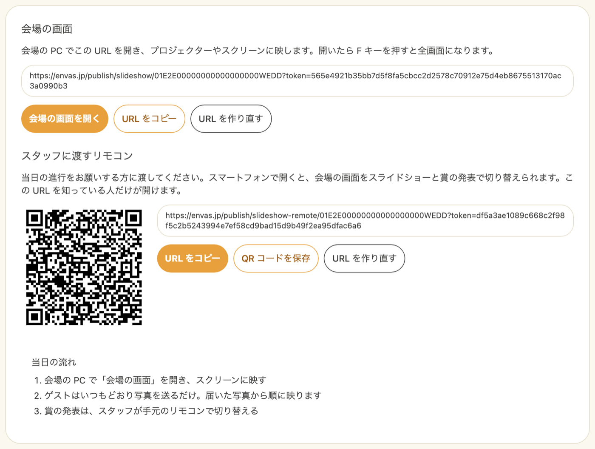

### 会場の画面 {#screen}

「会場の画面」の URL を会場の PC のブラウザで開き、プロジェクターやスクリーンに映します。「URL をコピー」で URL をコピーでき、「会場の画面を開く」でお手元のブラウザでも開けます。

- 開いたら F キーを押すか、右下の「全画面で映す（F キー）」をクリックすると全画面になります
- マウスをしばらく動かさないと、ボタンとマウスの矢印は隠れます
- 写真は 1 枚ずつゆっくり入れ替わり、最後まで流れると最初に戻ります
- 新しく届いた写真は、数秒で今の写真の次に割り込み、「NEW PHOTO」の印とともに映ります
- 写真がまだ 1 枚もないときは「ゲストのみなさまが撮った写真が、ここに映ります」と、写真を送る QR コードが表示されます
- 上映中に写真共有の画面で「ゲストから隠す」をした写真や削除した写真は、数秒で会場の画面からも消えます

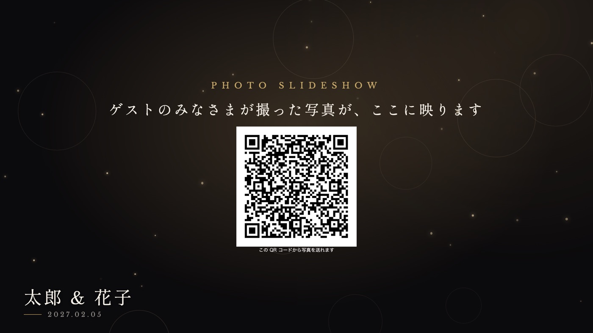

写真がたくさん届いたときは、新しい写真から 200 枚までを流します。

通信が途切れても、それまでに読み込んだ写真は流れ続けます。通信が不安定なときは、画面の上に「通信が不安定です。新しい写真の表示が遅れています」と表示されます。

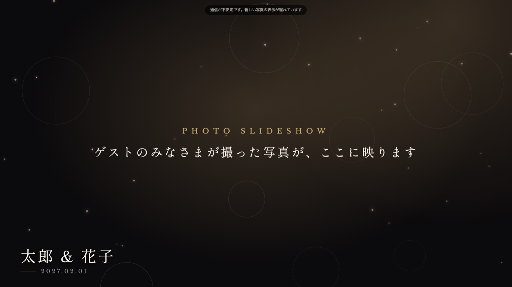

### 会場の画面に出る QR コード {#screen-qr}

会場の画面には、ゲストが写真を送るための QR コードが「この QR コードから写真を送れます」の一文とともに表示されます。中身は[写真共有でゲストに配る QR コード](/guest-photo-sharing/#purchase)と同じです。スクリーンを見たゲストがスマートフォンで読み取ると、写真を送る画面が開きます。

| 会場の画面 | QR コード |
| --- | --- |
| 写真がまだ 1 枚もないとき | 画面の中央に大きく表示されます |
| 写真が流れているとき | 画面の右下に小さく表示されます。[見た目を選ぶ](#appearance)で「出さない」を選ぶと消えます |
| 賞の発表中 | 表示されません |

写真共有の画面で[URL を作り直した](/guest-photo-sharing/#reissue)ときは、会場の画面の QR コードも数秒で新しい QR コードに替わります。会場の画面を開き直す必要はありません。

QR コードは、購入したあとに写真共有の画面を一度開くと表示されるようになります。会場の画面に QR コードが出ないときは、写真共有の画面を開いてから数秒お待ちください。

### リモコン {#remote}

「スタッフに渡すリモコン」の URL か QR コードを、当日の進行をお願いする方に渡してください。スマートフォンで開くと、会場の画面をスライドショーと賞の発表で切り替えられます。

- 「URL をコピー」で URL をコピーできます
- 「QR コードを保存」で QR コードを画像として保存できます

リモコンの画面には、今会場で流しているものが「NOW PLAYING」として表示され、その下にボタンが並びます。

| ボタン | できること |
| --- | --- |
| スライドショー | 写真を順番に流します |
| 賞の名前のボタン | 会場の画面でその賞を発表します。発表中にもう一度押すと、発表を最初からやり直します |

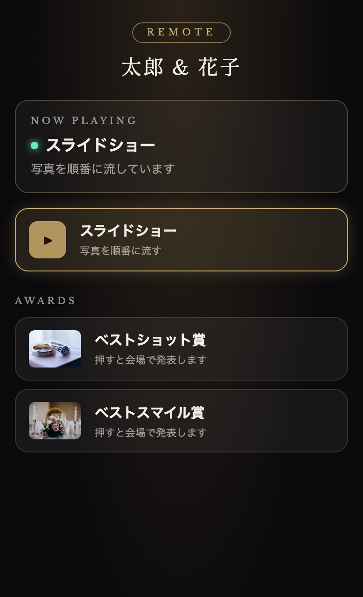

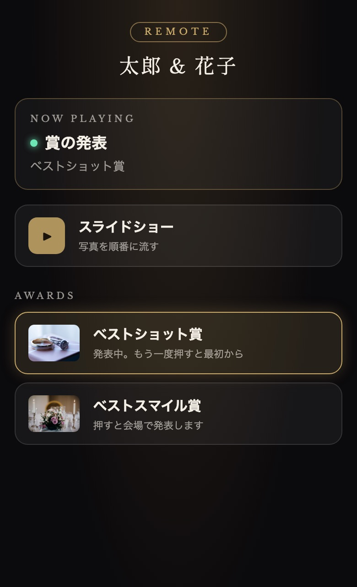

賞の発表が終わったら、「スライドショー」を押して写真を流す画面に戻してください。発表している間に届いた写真は、スライドショーに戻したときに先に映ります。

同じリモコンの URL を、何台かのスマートフォンで開いてもかまいません。どの端末で押しても、ほかの端末の表示も数秒で替わります。当日にお二人が賞を作ったり書き換えたりしても、数秒でリモコンに反映されます。

### URL を作り直す {#reissue}

URL が思わぬところに出回ってしまったときは、会場の画面とリモコンのそれぞれの「URL を作り直す」をタップし、確認の画面で「作り直す」をタップします。

:::warning[作り直すと今の URL は使えなくなります]
会場の画面の URL を作り直したときは、会場の PC で新しい URL を開き直してください。リモコンの URL はそのまま使えます。
リモコンの URL を作り直したときは、スタッフに新しい URL か QR コードを渡し直してください。会場の画面はそのまま使えます。
使えなくなった URL を開くと「このスライドショーの URL は使えなくなっています。」または「このリモコンの URL は使えなくなっています。」と表示されます。
:::

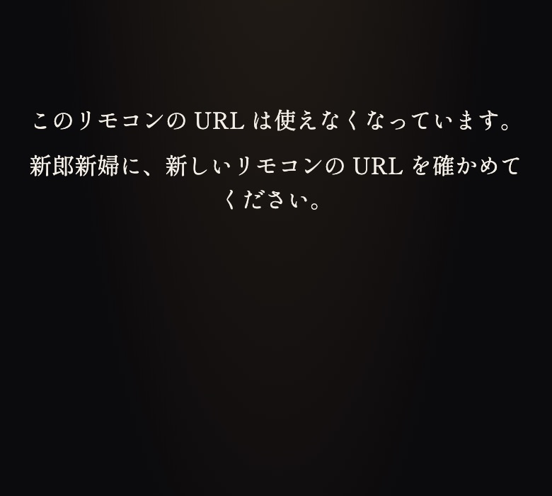

---

## 8. 使える期間 {#period}

スライドショーは、挙式の[データの保管期限](/storage-period/)まで使えます。写真共有でゲストが写真を送れる期間と同じです。

保管期限を過ぎると、スライドショーの画面に「保管期限を過ぎたため、スライドショーは使えません。保管期間を延長すると、また使えます。」と表示され、会場の画面とリモコンの URL も開けなくなります。[データ保管期間を延長する](/storage-extension/)と、また使えるようになります。

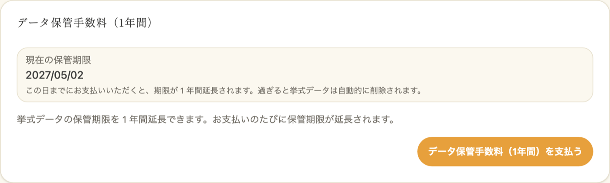

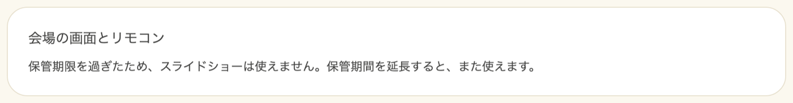

---

## 9. よくある質問 {#faq}

### Q. 写真共有を購入していなくても、スライドショーだけ購入できますか？ {#faq-without-sharing}

できません。スライドショーは写真共有でゲストから集めた写真を流すため、先に写真共有を購入してください。

### Q. 購入する前に、どんなふうに映るか確かめられますか？ {#faq-preview}

確かめられます。スライドショーの画面の「サンプルを見る」で、先に並べておいた写真を使って会場と同じ見た目のスライドショーを見られます。購入する前は透かしが入ります。詳しくは[サンプルを見る](#sample)をご覧ください。

### Q. 会場の PC にソフトのインストールは必要ですか？ {#faq-install}

必要ありません。会場の画面の URL をブラウザで開くだけで映せます。リモコンも、スマートフォンのブラウザで URL を開くだけで使えます。どちらもログインは要りません。

### Q. 会場の PC はインターネットにつながっている必要がありますか？ {#faq-network}

必要です。新しく届いた写真やリモコンの操作は、インターネットを通じて会場の画面に届きます。会場の画面を開いたときにつながらないと「つながりません。会場の PC がインターネットにつながっているかを確かめてください」と表示されます。

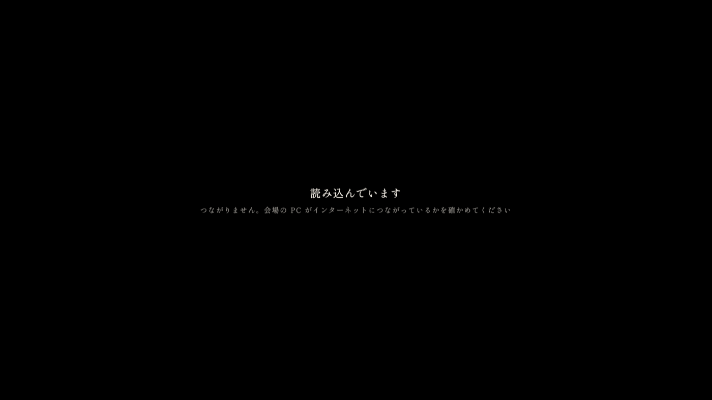

### Q. 流したくない写真が届いたときはどうすればよいですか？ {#faq-hide}

写真共有の画面で、その写真の「ゲストから隠す」をタップしてください。上映中でも、数秒で会場の画面から消えます。

### Q. 会場の画面の QR コードを消せますか？ {#faq-screen-qr}

写真が流れているあいだの右下の QR コードは、[見た目を選ぶ](#appearance)で「出さない」を選ぶと消せます。上映中に選び替えても、数秒で会場の画面に反映されます。写真がまだ 1 枚もないときの大きな QR コードは消せません。

### Q. 動画は流せますか？ {#faq-video}

流せません。写真共有ではゲストから動画も受け取れますが、スライドショーに流れるのは写真だけです。届いた動画は、写真共有の画面で再生や保存ができます。

### Q. BGM は流せますか？ {#faq-bgm}

スライドショーには BGM の機能はありません。音楽は会場の音響でお流しください。

### Q. リモコンで次の写真へ進められますか？ {#faq-next}

できません。写真は自動で入れ替わります。リモコンでできるのは、スライドショーと賞の発表の切り替えです。

### Q. 賞の発表で、受賞した写真のゲストのお名前は出ますか？ {#faq-credit}

出ます。発表の最後に、写真を送ったゲストのお名前が表示されます。ゲストがお名前を入れずに送った写真では、お名前は表示されません。
