ゲスト一覧ページでは、席次表に表示するゲストの追加・編集・削除や、CSV を使った一括登録・更新、AI を使ったゲスト一覧の取り込みができます。
席次表へのゲストの配席方法については[席次表の使い方](/seating-chart/)をご覧ください。

ゲスト一覧ページは、サイドメニューの「ゲスト一覧」から開きます。

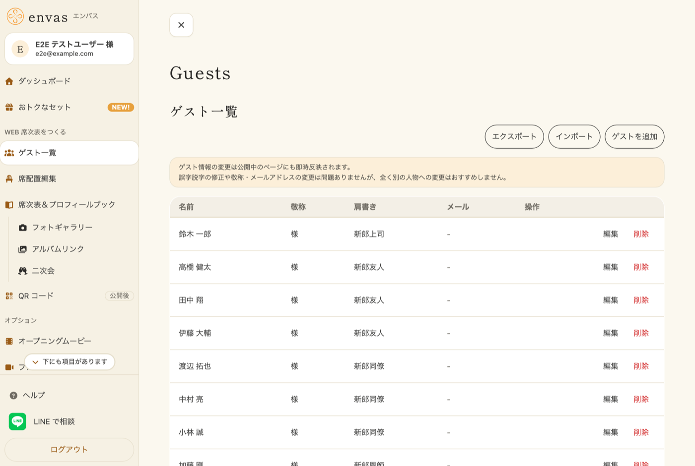

---

## 1. ゲストを追加する {#add-guest}

1. ゲスト一覧ページで「ゲストを追加」ボタンをタップします
2. 以下の情報を入力します
   - **名前**(必須)
   - **敬称**(例:様、さん、くん)
   - **肩書き**(例:新郎友人、新婦同僚)
   - **メールアドレス**
3. 「追加」ボタンをタップして保存します

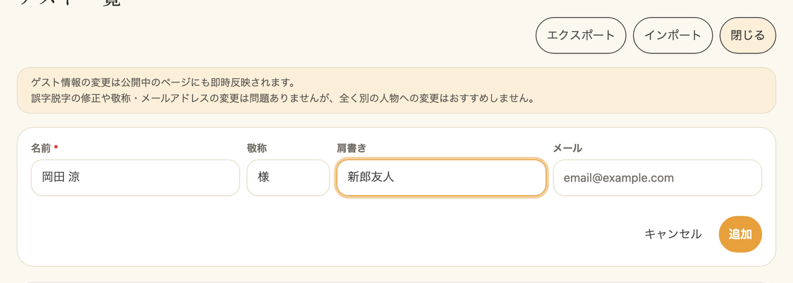

::video{src="/movies/add-guest.mp4"}

---

## 2. ゲストを CSV で一括登録・更新する {#import-guests-csv}

CSV ファイルから複数のゲストをまとめて登録(新規)、または既存のゲストを一括で更新できます。
事前にまとめておかれたゲストリストの取り込みや、登録済みゲストの一斉修正にご利用いただけます。

### 2-1. CSV のフォーマット {#import-guests-csv-format}

- **ヘッダー行**:1 行目は `ゲストID,ゲスト名,敬称,肩書き` の順に固定です
- **行数**:最大 500 件(ヘッダー行を除く)
- **文字コード**:UTF-8 / UTF-8 (BOM 付き) / Shift_JIS のいずれにも対応
- **改行コード**:LF / CRLF / CR のいずれにも対応

### 2-2. ゲストID 列の役割 {#import-guests-csv-id-column}

`ゲストID` 列の値によって、その行が新規登録か更新かが切り替わります。

| `ゲストID` の値 | 動作 |
|---|---|
| 空欄 | **新規登録**(INSERT) |
| 既存ゲストの ID | その既存ゲストを **更新**(UPDATE) |

ゲストIDは「現在のゲスト一覧 CSV」をダウンロードしたときに自動的に
出力されます。手動で考えて入力する必要はありません。

### 2-3. 新規一括登録の手順 {#import-guests-csv-insert}

1. ゲスト一覧ページで「インポート」ボタンをタップします
2. モーダル内の「テンプレート CSV をダウンロード」リンクからテンプレートを取得します
3. テンプレートを編集して、登録したいゲストの情報を入力します(`ゲストID` 列は空のまま)
4. 「ファイルを選択」から作成した CSV ファイルを選択します
5. 「インポート」ボタンをタップします
6. 成功すると登録件数のメッセージが表示され、ゲスト一覧が更新されます

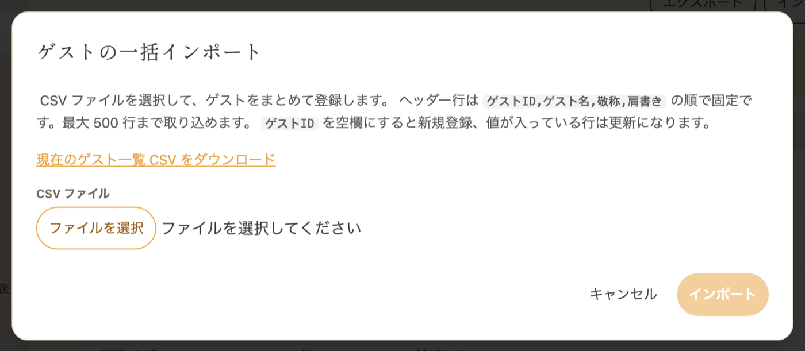

### 2-4. 既存ゲストの一括更新の手順 {#import-guests-csv-update}

1. ゲスト一覧ページで「エクスポート」ボタンをタップして、現在のゲスト一覧 CSV を
   ダウンロードします
   - 「インポート」モーダル内の「現在のゲスト一覧 CSV をダウンロード」リンクからも
     同じ CSV を取得できます
2. ダウンロードした CSV を編集して、ゲスト名・敬称・肩書きを変更します
   - `ゲストID` 列は **変更しないでください**(変更すると別のゲストの更新と
     見なされるか、ID が見つからずエラーになります)
3. 「インポート」ボタンをタップしてモーダルを開きます
4. 「ファイルを選択」から編集後の CSV を選択します
5. 「インポート」ボタンをタップします
6. 該当行の既存ゲストが更新されます

:::warning[編集時の注意]
Excel で CSV を開くと、ゲストIDが「数値」と判定されて表記が崩れることがあります。
可能であればテキストエディタ(VS Code など)での編集をおすすめします。
Excel で編集される場合は、ゲストID 列を「文字列」として読み込むよう
ご注意ください。
:::

:::warning[エラーが発生したとき]
取り込めなかった行はモーダル内に **行番号・列名・原因** とともに一覧表示されます。
エラーが 1 件でもあるとインポートは**全件中止**されますので、
表示されたエラーをすべて修正してから再度アップロードしてください。

主なエラー例:

- `ゲストID が見つかりません`:該当 ID のゲストが存在しない
- `ゲストID が N 行目と重複しています`:同じ ID が CSV 内に複数行ある
- `ゲスト名 は必須です`:名前列が空欄
- `ゲスト名 は255文字以内で入力してください`:文字数超過
:::

---

## 3. AI でゲスト一覧を取り込む {#import-guests-ai}

決まった形式でなくても大丈夫です。式場のシステムで登録したゲスト一覧ファイルや、自分で管理しているテキストファイルなどをそのままアップロードすると、AI が名前・敬称・肩書きを読み取って登録します。

:::danger[今のゲスト一覧は置き換わります]
AI で取り込むと、今のゲスト一覧はすべて削除され、ファイルから読み取ったゲストに置き換わります。席次表に配置したゲストも外れ、公開中の席次表にもすぐに反映されます。
:::

### 3-1. 取り込めるファイル {#import-guests-ai-files}

- CSV・TSV・テキスト（.txt）・Excel（.xlsx）のファイル
- 1MB まで、ゲスト 500 名まで
- CSV とテキストは UTF-8 でも Shift_JIS でも読み取れます
- Excel は、すべてのシートを読み取ります

### 3-2. 取り込みの手順 {#import-guests-ai-steps}

1. ゲスト一覧の「AI で取り込む」ボタンをタップします
2. 「取り込む前にご確認ください」の内容を読み、ゲスト一覧のファイルをドラッグするか、「ファイルを選ぶ」から選びます
3. 「取り込む」をタップします
4. 「ゲスト一覧を置き換えます」の確認で、今のゲストの人数と置き換わることを確かめ、「置き換える」をタップします
5. 進み具合が表示され、AI がゲスト一覧を読み取ります。終わるまで 5 分ほどかかることがあります。この画面を離れても取り込みは続きます
6. 終わると「ゲスト 17 名を取り込みました。読み取りの結果をゲスト一覧で確かめてください。」のように表示されます。「閉じる」をタップすると、置き換わったゲスト一覧と結果の案内が表示されます

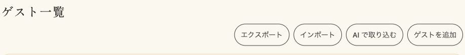

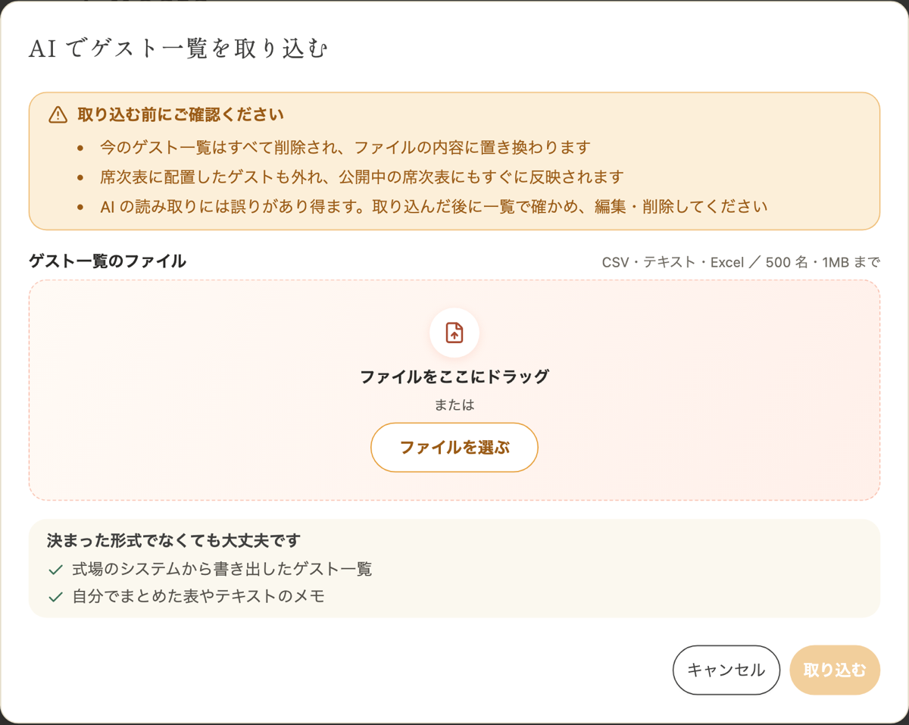

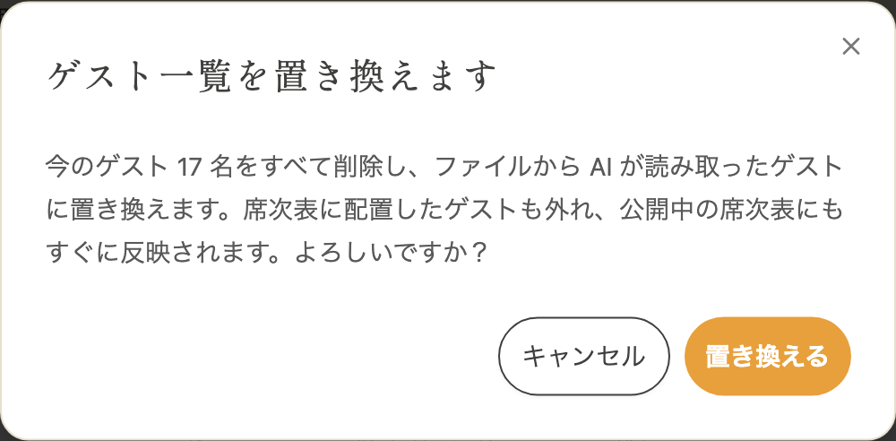

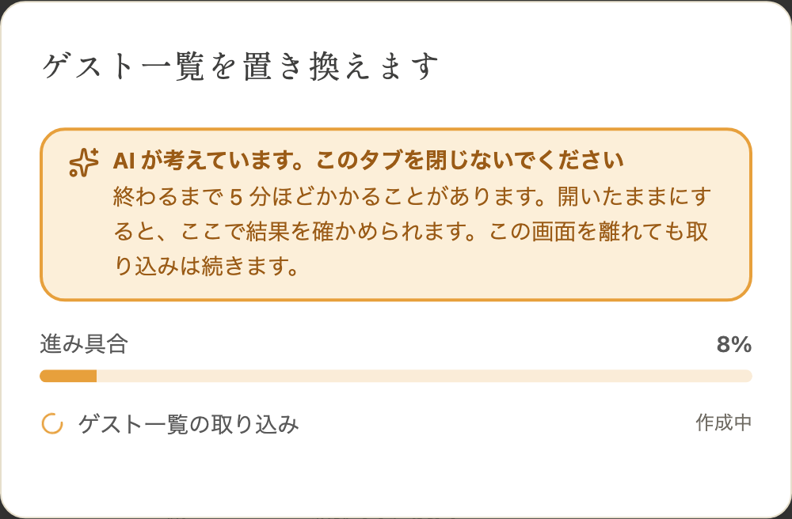

### 3-3. 取り込んだ後に確かめること {#import-guests-ai-check}

AI の読み取りには誤りがあり得ます。取り込んだ後は、名前の誤字や脱字、敬称、肩書きを確かめ、違うところは一覧から[編集](#edit-guest)・[削除](#delete-guest)してください。

結果の案内には、次のものが表示されます。

- **ファイルと表記が違うかもしれない名前**:ファイルの中に同じ表記が見つからなかった名前です。漢字の書き換え（「髙」が「高」になるなど）や誤字が無いか、特にご確認ください
- **AI が判断に迷ったところ**:新郎側・新婦側が分からなかった行などの説明です

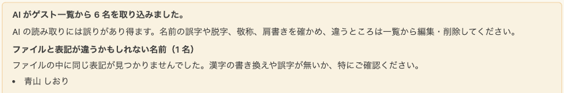

肩書きは「新郎 父」「新婦 株式会社サンプル 部長」のように、新郎側・新婦側と関係をつないで登録します。敬称が書かれていないゲストは「様」で登録します。

取り込めなかったときは、今のゲスト一覧は変わりません。表示された案内に従って、ファイルを確かめるか、時間をおいてお試しください。

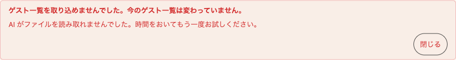

:::warning[ご注意]
- AI による取り込みは、同じ挙式で 5 分に 1 回までです。続けて取り込むと、次に取り込める時刻が表示されます
:::

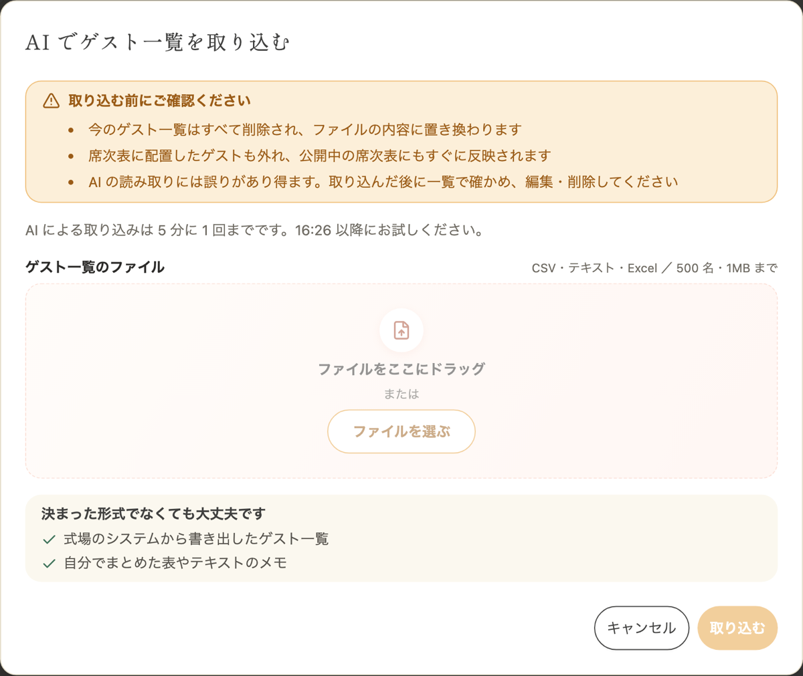

取り込んだゲストは、席次表で [AI に席配置を任せる](/seating-chart/#ai-arrangement)と、肩書きをもとに卓へ振り分けられます。

ゲスト一覧の取り込み・プロフィールブックの文章・席配置をまとめて作りたいときは、「[AI でまとめて作る](/ai-onboarding/)」をご覧ください。

---

## 4. ゲストを編集する {#edit-guest}

1. ゲスト一覧で編集したいゲストの「編集」ボタンをタップします
2. 名前・敬称・肩書き・メールアドレスを変更します
3. 「保存」ボタンをタップします
4. 確認ダイアログが表示されるので「更新」をタップします

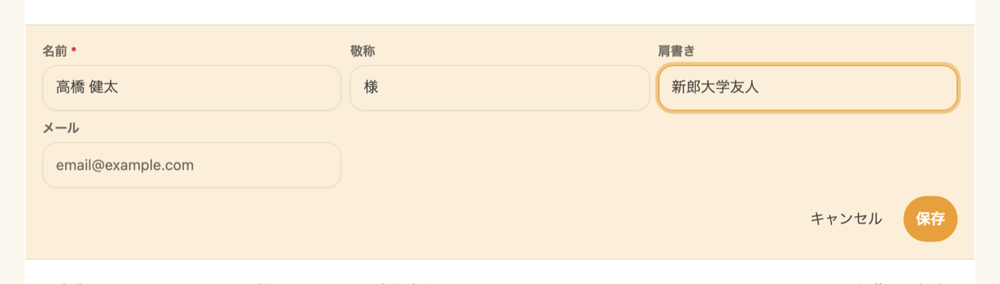

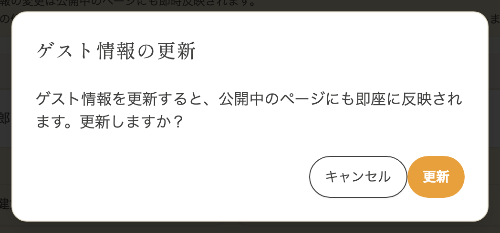

:::warning[ご注意]
ゲスト情報の変更は公開済みの席次表にも即時反映されます。
誤字脱字の修正や敬称の変更は問題ありませんが、まったく別の人物への変更はおすすめしません。
:::

::video{src="/movies/edit-guest.mp4"}

---

## 5. ゲストを削除する {#delete-guest}

1. ゲスト一覧で削除したいゲストの「削除」ボタンをタップします
2. 確認ダイアログが表示されるので「削除」をタップします

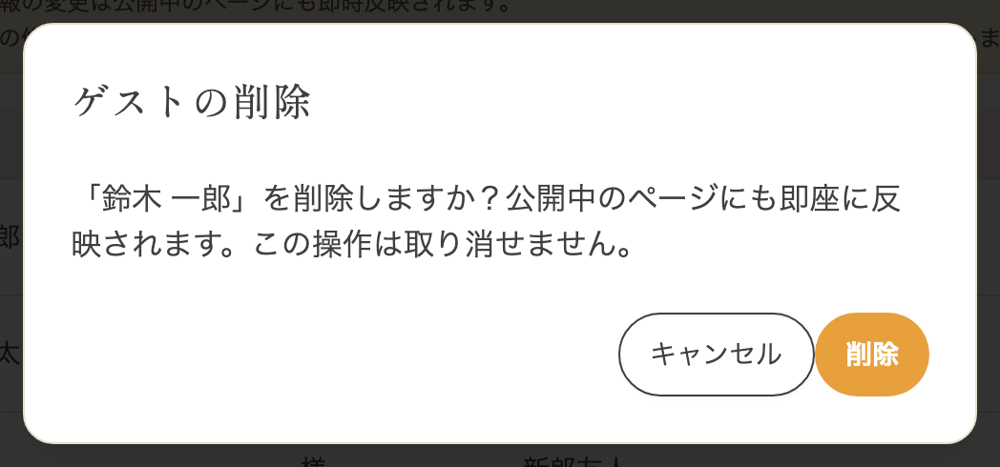

:::warning[ご注意]
ゲスト情報の変更は公開済みの席次表にも即時反映されます。
誤字脱字の修正や敬称の変更は問題ありませんが、まったく別の人物への変更はおすすめしません。
:::

---

## 6. よくある質問 {#faq}

### Q. ゲスト情報を変更すると公開済みの席次表にも反映されますか? {#faq-edit-reflect}

はい。ゲスト一覧でゲスト情報を変更すると、公開済みの席次表にも即時反映されます。

### Q. ゲストを削除するとどうなりますか? {#faq-delete-effect}

ゲストを削除すると、席次表上のそのゲストの席は空席になります。公開済みの席次表にも即座に反映されるのでご注意ください。
公開済みの席次表に存在しないゲストを削除しても、席次表には影響ありません。

### Q. CSV インポートで一部の行だけエラーになった場合、エラーのない行は登録されますか? {#faq-import-csv-partial}

いいえ、エラーが 1 件でもあるとインポートは**全件中止**されます。エラー行も正常な行も含めて 1 件も登録されないため、エラーメッセージに従ってすべての行を修正してから再度アップロードしてください。

### Q. 取り込めるゲストの上限はありますか? {#faq-import-csv-limit}

1 度のインポートで最大 500 件までです。これを超える場合はファイルを分割してアップロードしてください。

### Q. エクスポートとテンプレートの違いはなんですか? {#faq-export-vs-template}

- **テンプレート**:ゲストがまだ登録されていないとき、CSV のフォーマットの参考用にサンプル行 1 件入りのファイルが手に入ります
- **エクスポート**:既に登録済みのゲストを CSV で書き出します。一括更新の起点として使ってください

「インポート」モーダル内のリンクは、ゲストが 0 件のときは「テンプレート CSV をダウンロード」、1 件以上のときは「現在のゲスト一覧 CSV をダウンロード」と挙動が自動で切り替わります。

### Q. ゲストID は手動で入力できますか? {#faq-guest-id-manual}

ゲストIDは ULID 形式の固定値で、システムが自動で発行します。手動で考案したり別のシステムから持ち込んだりすることはできません。
新規登録時は **空欄のまま** にしてください。

### Q. AI で取り込むと、今のゲストに追加されますか? {#faq-import-ai-append}

いいえ。AI で取り込むと、今のゲスト一覧はすべて削除され、ファイルから読み取ったゲストに置き換わります。今のゲストを残したまま足したいときは、[ゲストを追加する](#add-guest)か、[CSV で一括登録](#import-guests-csv)してください。

### Q. AI で取り込んだゲストの名前が、ファイルと違います {#faq-import-ai-wrong-name}

AI の読み取りには誤りがあり得ます。ゲスト一覧の「編集」から正しい名前に直してください。結果の案内の「ファイルと表記が違うかもしれない名前」に、ファイルの中に同じ表記が見つからなかった名前が並びます。
