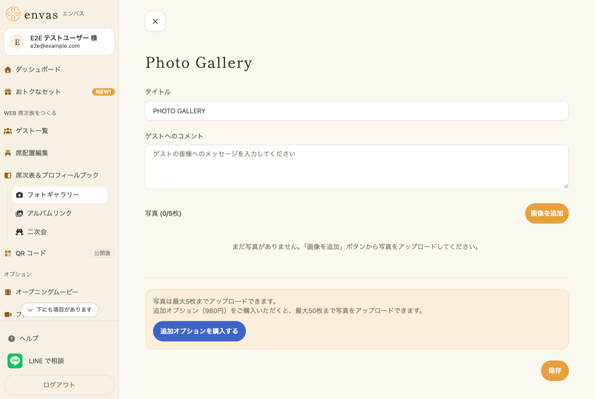
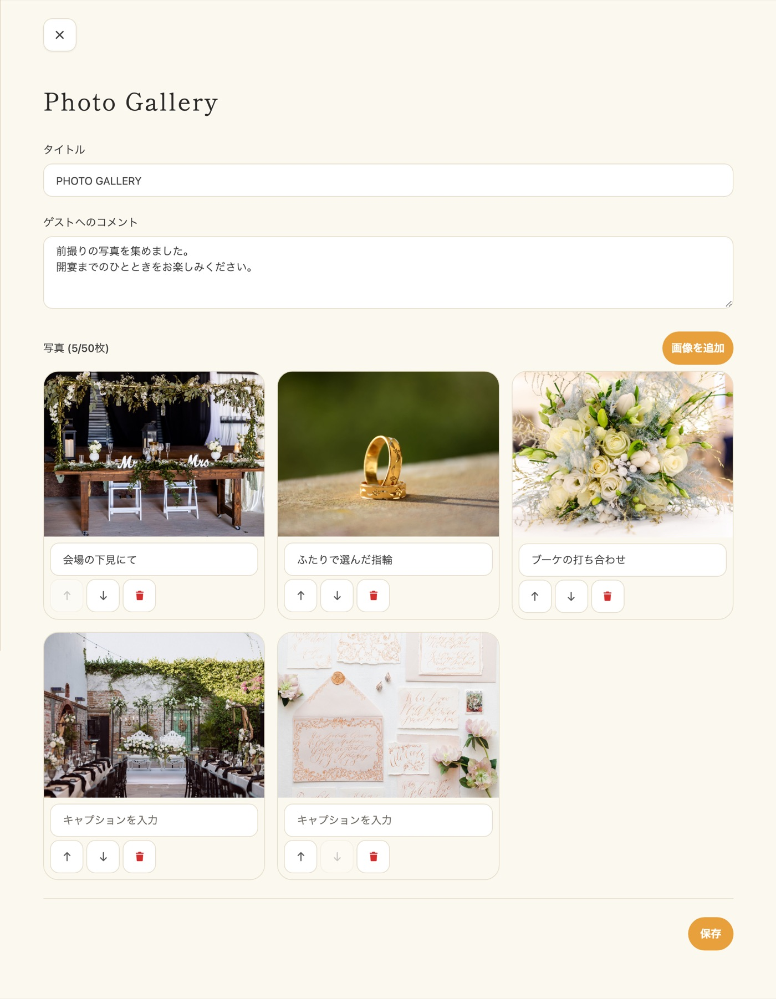
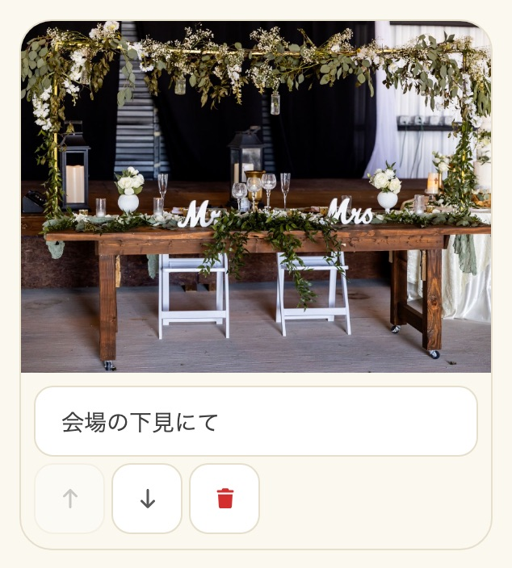
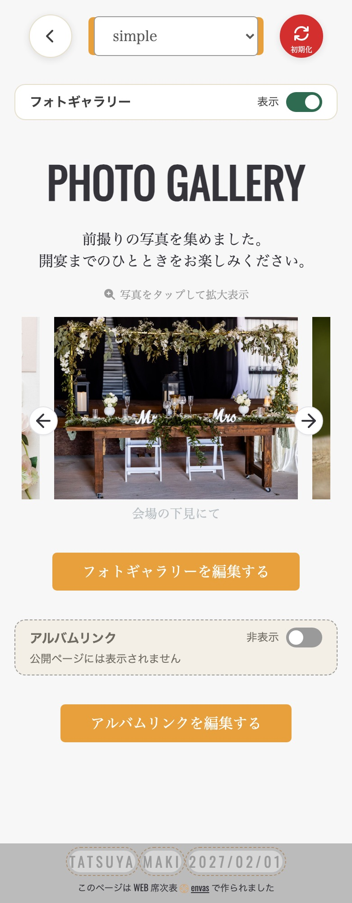
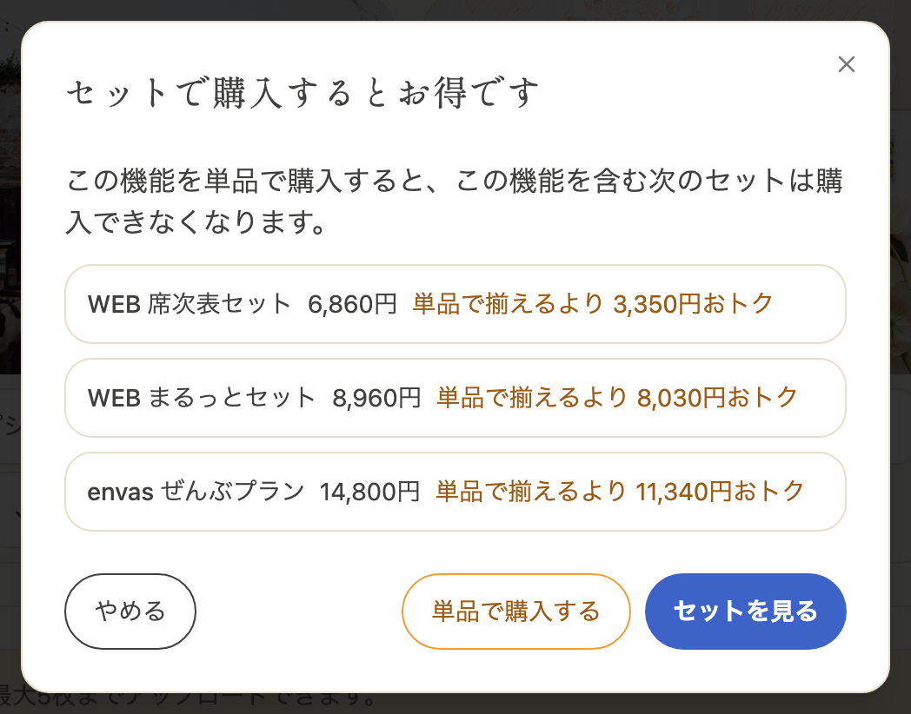
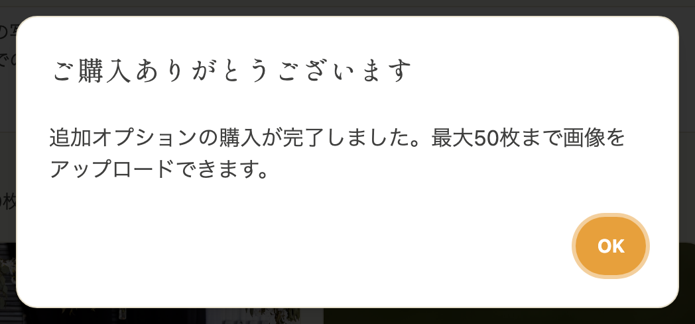

フォトギャラリーは、プロフィールブック内にお二人の写真を掲載できる機能です。
ゲストの待ち時間にお楽しみいただけるフォトギャラリーを作成しましょう。

---

## 1. フォトギャラリーの使い方 {#how-to-use}

サイドメニューの「席次表＆プロフィールブック」の下にある「フォトギャラリー」をクリックすると、フォトギャラリーの編集画面が表示されます。

---

## 2. タイトルとコメントの設定 {#title-and-comment}

フォトギャラリーにはタイトルとゲストへのコメントを設定できます。

1. **タイトル**: プロフィールブックに表示されるセクションタイトルです。デフォルトは「PHOTO GALLERY」です
2. **ゲストへのコメント**: 写真と一緒に表示されるメッセージを入力できます

---

## 3. 画像の追加 {#add-images}

1. 「画像を追加」ボタンをクリックします
2. アップロードしたい画像ファイルを選択します（複数選択可）
3. 選択した画像が順番にアップロードされます

:::warning[ご注意]
- 1枚あたりの画像サイズは **5MB** までです
- 対応形式: JPEG、PNG、WebP、GIF など一般的な画像形式
- 無料では最大 **5枚** まで登録できます
:::

---

## 4. 画像の編集 {#edit-images}

アップロードした画像に対して、以下の操作ができます。

- **キャプション**: 各画像の下にキャプション（説明文）を追加できます
- **並び替え**: 矢印ボタン（↑↓）で画像の表示順を変更できます
- **削除**: ゴミ箱ボタンで画像を削除できます

編集が終わったら、画面下の「保存」をクリックしてください。

---

## 5. プロフィールブックへの掲載 {#display-in-profile-book}

フォトギャラリーをプロフィールブックに掲載するには、以下の手順で設定します。

1. サイドメニューの「席次表＆プロフィールブック」をクリックしてプロフィールブックの編集画面を開きます
2. ページ下部にある「フォトギャラリー」の切り替えを「表示」にします
3. フォトギャラリーのタイトル、コメント、画像がプロフィールブック内に表示されます
4. 画面右下の「保存」で保存します

切り替えを「非表示」にすると、フォトギャラリーはプロフィールブックに表示されなくなります。

表示の切り替えは、公開中のプロフィールブックにはすぐには出ません。編集画面右下の「公開」から「現在の下書きを公開する」をタップすると反映されます。公開中にもう一度公開しても、追加の料金はかからず、URL も変わりません。

---

## 6. 追加オプション（画像枠の拡張） {#upgrade-option}

無料では最大5枚までの登録ですが、追加オプション（980円）をご購入いただくと、**最大50枚** まで画像を登録できるようになります。

1. フォトギャラリー編集画面の下部にある「追加オプションを購入する」ボタンをクリックします
2. 「セットで購入するとお得です」の画面が表示されたときは、単品で買うなら「単品で購入する」を、セットを見るなら「セットを見る」をクリックします
3. 決済画面で購入手続きを行います
4. 購入完了後、すぐに画像枠が拡張されます

フォトギャラリーは、WEB 席次表セット・WEB まるっとセット・envas ぜんぶプランにも含まれます。セットでまとめて購入するとお得です。詳しくは「[おトクなセット](/bundle/)」をご覧ください。

---

## 7. よくある質問 {#faq}

### Q. 画像がアップロードできません {#faq-upload-error}

画像ファイルのサイズが5MBを超えている可能性があります。
画像のサイズを確認し、5MB以下に圧縮してから再度お試しください。

### Q. プロフィールブックにフォトギャラリーが表示されません {#faq-not-displayed}

以下の2点をご確認ください。

1. フォトギャラリーに画像が1枚以上登録されていること
2. プロフィールブック編集画面で「フォトギャラリー」の切り替えが「表示」になっていること

### Q. 追加オプションを購入したのに画像枠が増えません {#faq-upgrade-not-applied}

決済完了後、画面の更新に少しお時間がかかる場合があります。
ページをリロードしていただくか、しばらくお待ちいただいてから再度ご確認ください。
