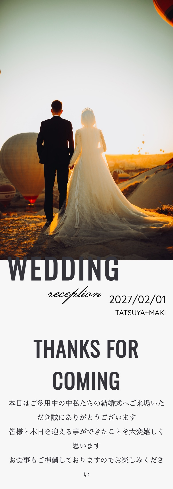
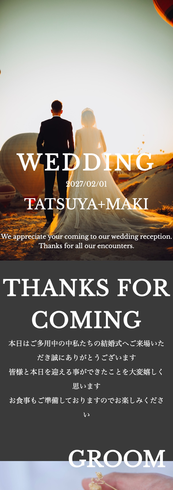
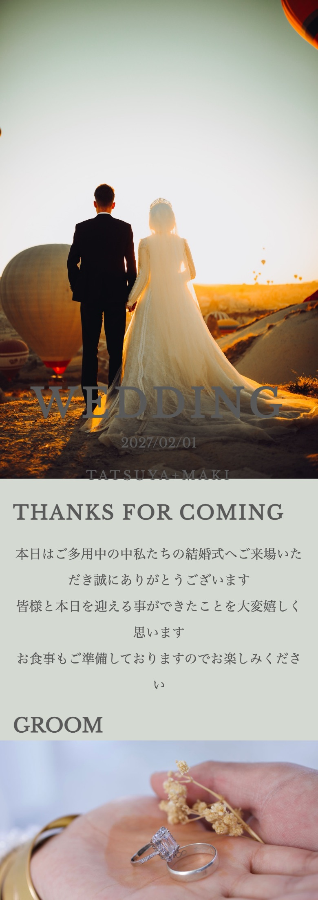
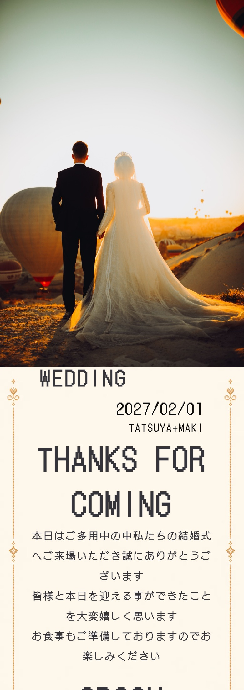
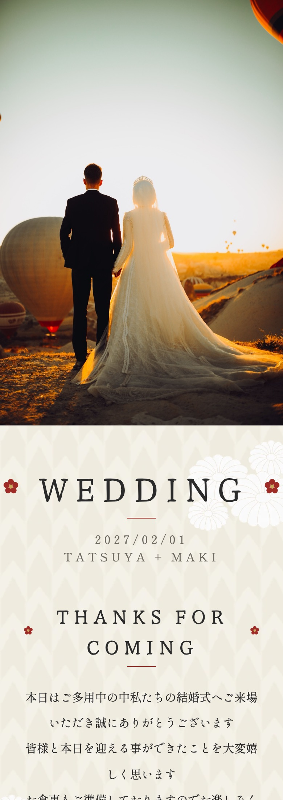
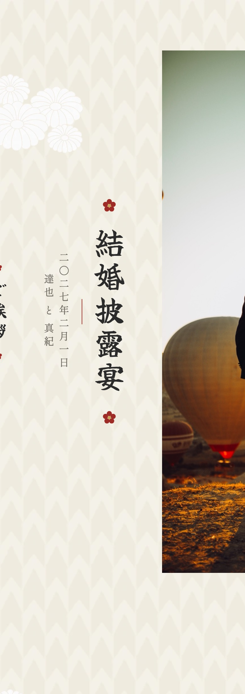
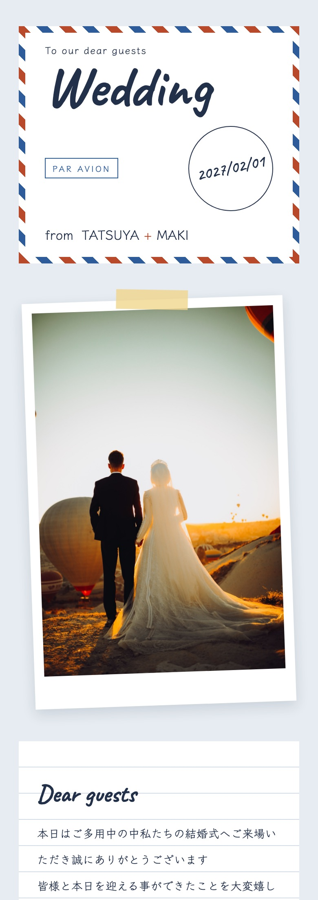
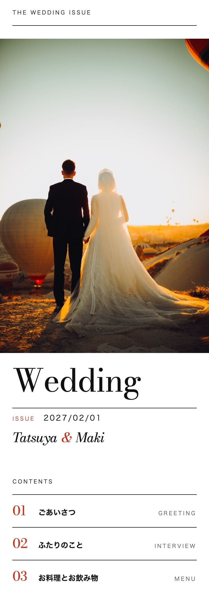
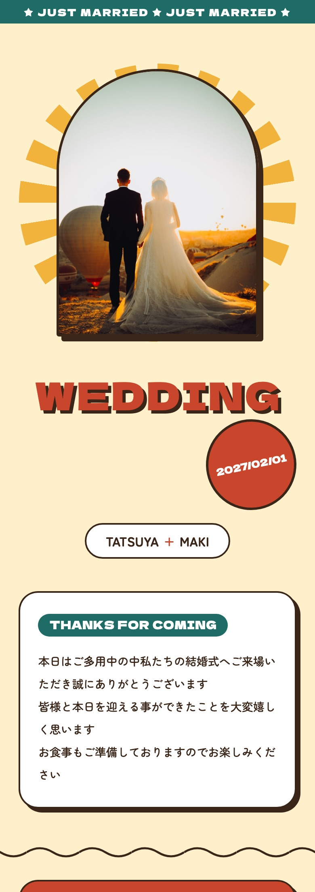

プロフィールブックは、編集画面上部のデザイン選択欄からテーマを選べます。現在、9 種類のテーマをご用意しています。

---

## 1. テーマを選ぶ {#select-theme}

サイドメニューの「席次表＆プロフィールブック」からプロフィールブックの編集画面を開き、画面上部のデザイン選択欄からお好みのテーマを選んでください。右下の目のボタンでプレビューに切り替えると、ゲストが見るのと同じ見た目を確認できます。

| テーマ | 特徴 |
|---|---|
| `simple` | シンプルなデザイン |
| `cool` | クールなデザイン |
| `stylish` | スタイリッシュなデザイン |
| `game` | ゲーム風のデザイン |
| `wa` | 和紙を思わせる背景と装飾を使った横書きの和テーマ |
| `wa-tate` | `wa` の雰囲気を引き継いだ縦書きの和テーマ |
| `letter` | エアメールの封筒や便箋、ポラロイド写真をモチーフにした手紙風のテーマ |
| `editorial` | 白地に黒の文字と朱色の差し色で組んだ、雑誌の誌面のようなテーマ |
| `retro` | クリーム色の地に朱・青緑・辛子色と太い輪郭線で組んだ、レトロでポップなテーマ |

下の画像は、同じ写真と文章でテーマを切り替え、スマートフォンでプレビューしたときの冒頭です。

プロフィールブックの中の席次表は、プロフィールブックのテーマではなく、席次表エディタの表示設定で選んだテーマで表示されます。`wa` や `wa-tate` には、席次表のテーマ「水引」がよく合います。選び方は[席次表のテーマを選ぶ](/seating-chart/#select-theme)をご覧ください。

---

## 2. 縦書きの和テーマを使う {#wa-tate}

`wa-tate` は、本文を右から左へ読み進めるテーマです。スマートフォンでは画面を左右にスワイプし、PC ではマウスホイールを下へ回すと先へ進めます。席次表は横書きのまま表示されます。

`wa` と `wa-tate` は、配色・背景・装飾を共有しています。横書きと縦書きの見え方をプレビューで比べてお選びください。

---

## 3. 手紙風のテーマを使う {#letter}

`letter` は、ゲストに宛てた手紙をイメージしたテーマです。各項目は次のように表示されます。

- タイトル・挙式日・ニックネームは、エアメールの封筒の中に表示されます。挙式日は消印の中に入ります
- 写真は、マスキングテープで留めたポラロイド写真のように表示されます
- ごあいさつと皆様へのメッセージは、罫線の入った便箋に表示されます
- お料理とお飲み物はチケット、席次表は搭乗券、二次会ははがき、フォトギャラリーはフィルムの帯のデザインで表示されます

封筒の「To our dear guests」「PAR AVION」「from」や、「About us」「Bon appétit!」などの英字は飾りのため、編集できません。

写真を登録していないあいだは、`simple` と同じ見本の写真が表示されます。

---

## 4. 雑誌風のテーマを使う {#editorial}

`editorial` は、プロフィールブックを 1 冊の雑誌に見立てたテーマです。白地に黒の文字と朱色の差し色だけで組み、余白を広く取っています。各項目は次のように表示されます。

- 表紙は、誌名の帯、写真、大きなタイトル、挙式日、ニックネームの順に並びます
- 表紙の下に「CONTENTS」としてもくじが入り、本文の見出しにはもくじと同じ番号が付きます
- プロフィールは、お名前と年齢を罫線の上に並べ、趣味と第一印象を問いと答えの形で、「新郎から一言」「新婦から一言」を大きな引用として表示します
- お料理とお飲み物は 1 行ごとの罫線、席次表は黒地の帯、二次会は項目の表、アルバムは枠で囲んで表示されます

もくじには、ごあいさつ・ふたりのこと・お料理とお飲み物・席次表・二次会が並びます。お料理とお飲み物を両方とも表示しないときは「お料理とお飲み物」が、二次会を表示しないときや二次会の情報を登録していないときは「二次会」が、もくじから外れて番号が詰まります。もくじの項目名は固定で、見出しの文言を書き換えても変わりません。

誌名の帯の「THE WEDDING ISSUE」、挙式日の前の「ISSUE」、もくじの「CONTENTS」、ふたりのことの「Interview」、見出しの番号、問いの前の「Q.」などは飾りのため、編集できません。

写真を登録していないあいだは、`simple` と同じ見本の写真が表示されます。

---

## 5. レトロなポップのテーマを使う {#retro}

`retro` は、クリーム色の地に朱・青緑・辛子色の 3 色と太い輪郭線を使った、レトロでポップなテーマです。丸みのある文字で、カードや写真には影を付けています。各項目は次のように表示されます。

- 表紙は、上端の「JUST MARRIED」の帯、放射状の模様の上に置いたアーチ形の写真、影付きの大きなタイトル、丸いバッジの挙式日、ニックネームの順に並びます
- ごあいさつと皆様へのメッセージは、見出しを青緑の札にしたカードで表示されます
- プロフィールは、見出しの「GROOM」「BRIDE」に「新郎」「新婦」を添え、丸い写真の横にお名前と年齢を並べます。年齢は丸いバッジ、お二人からの一言は吹き出しで表示されます
- お料理とお飲み物は青緑のカード、席次表は辛子色のカード、二次会は点線で縁取ったチケット、アルバムは朱色のボタンで表示されます
- 最後に、波形の縁の付いた帯にニックネームと挙式日が入ります

「JUST MARRIED」の帯、プロフィールの見出しの「GROOM」「BRIDE」「新郎」「新婦」は飾りのため、編集できません。

写真を登録していないあいだは、`simple` と同じ見本の写真が表示されます。

---

## 6. テーマを変更する {#change-theme}

作成途中でもテーマを変更できます。ご自身で入力した文章は引き継がれます。テーマの初期文言のままの欄は、切り替え先の初期文言に変わる場合があります。`wa-tate` では見出しや料理・飲み物の例文が和風になり、挙式日の初期表示は漢数字になります。`letter` では、タイトル・ごあいさつ・皆様へのメッセージの見出しの初期文言が、それぞれ「Wedding」「Dear guests」「With gratitude」になります。`editorial` では、タイトルが「Wedding」、ニックネームが「Tatsuya」「&」「Maki」、ごあいさつ・お料理・お飲み物・皆様へのメッセージの見出しが「Thanks for coming」「Food menu」「Drink menu」「Dear guests」になります。`retro` には専用の初期文言が無く、`simple` と同じ初期文言になります。

