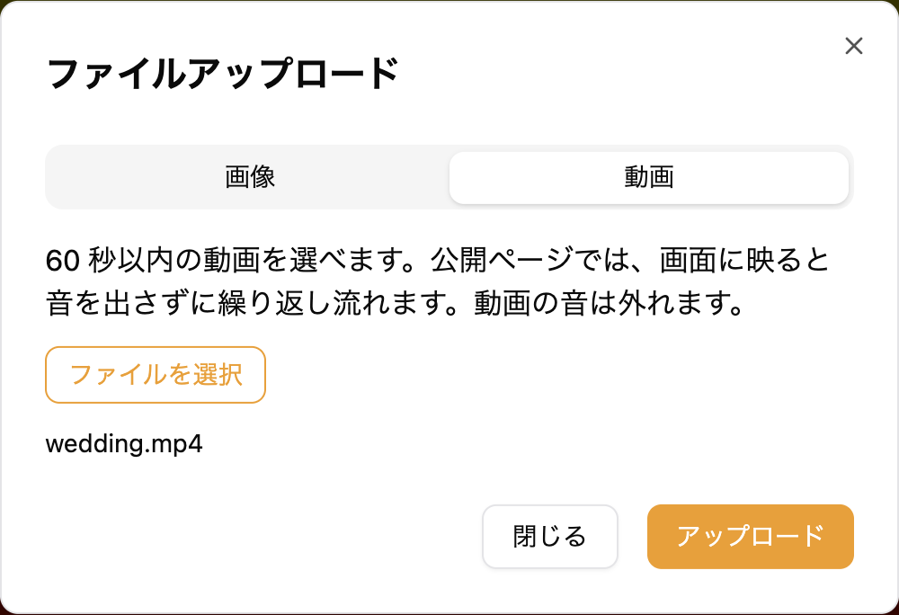
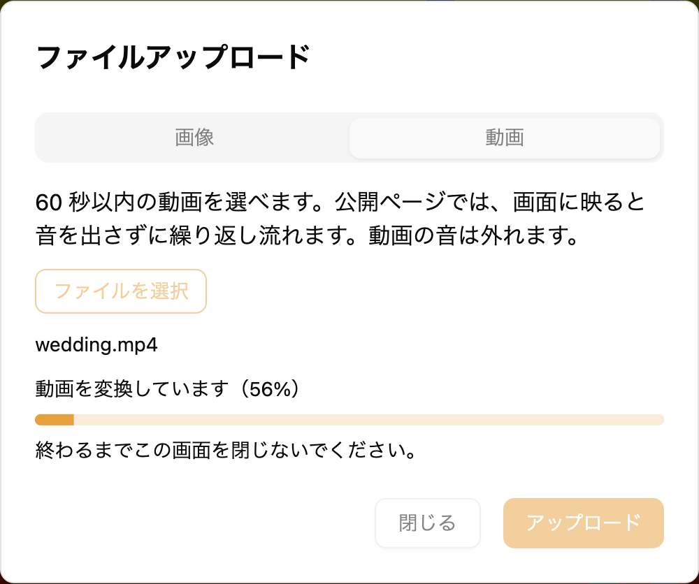
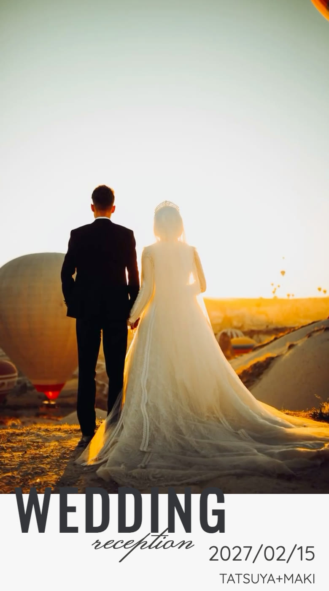

席次表＆プロフィールブックの新郎新婦・新郎・新婦の画像の枠には、画像の代わりに動画を置けます。公開ページでは、ゲストがその枠までスクロールすると、動画が音を出さずに繰り返し流れます。
追加の料金はかかりません。

---

## 1. 動画を置ける枠 {#slots}

動画を置けるのは、次の 3 つの画像の枠です。

- 新郎新婦の画像の枠
- 新郎の画像の枠
- 新婦の画像の枠

[フォトギャラリー](/photo-gallery/)には動画を置けません。

---

## 2. 動画を置く {#upload}

1. サイドメニューの「席次表＆プロフィールブック」から編集画面を開きます
2. 動画を置きたい枠をタップします
3. 「ファイルアップロード」の画面が表示されたら、「動画」タブを選びます
4. 「ファイルを選択」をタップして、動画を選びます
5. 「アップロード」をタップします

「アップロード」をタップすると、「動画を変換しています」「動画を送っています」と進み具合が表示されます。終わるまで、この画面を閉じないでください。終わると画面が閉じ、枠に動画が入ります。

---

## 3. 置ける動画 {#video-limits}

置ける動画は 60 秒以内です。60 秒を超える動画を選ぶと「動画は 60 秒以内にしてください。端末で短く切ってから選んでください。」と表示され、置けません。長い動画は、スマートフォンの写真アプリなどで短く切ってから選んでください。

動画は、送る前にブラウザが自動で小さく作り直します。このとき動画の音は外れ、公開ページでも音は付きません。撮影した場所などの情報も取り除かれます。

:::warning[動画を変換できないとき]
お使いのブラウザによっては「このブラウザでは動画を変換できません。パソコンの Chrome などでお試しください。」と表示されます。そのときは、パソコンの Google Chrome などで操作してください。
:::

---

## 4. 公開ページでの見え方 {#playback}

公開ページでは、ゲストがその枠までスクロールして画面に映ってから 1 秒ほどで、動画が音を出さずに自動で繰り返し流れます。枠が画面から外れると止まります。再生や停止のボタンは表示されません。

:::warning[動画が自動で流れないことがあります]
iPhone の低電力モードなどでは動画が自動で流れず、動画の 1 コマ目の画像のまま表示されることがあります。
:::

---

## 5. 画像に戻す {#back-to-image}

動画を置いた枠を画像に戻すときは、同じ枠をタップし、「画像」タブで画像を選んで「アップロード」をタップします。

---

## 6. 公開中のプロフィールブックに反映する {#republish}

公開中のページには、公開した時点の内容が表示されています。動画を置いたり画像に戻したりしたあとは、画像を変えたときと同じく、編集画面右下の「公開」から「現在の下書きを公開する」をタップして公開し直してください。公開中にもう一度公開しても、追加の料金はかからず、URL も変わりません。

公開の手順は「[公開・非公開の管理](/publish/#publish)」をご覧ください。

---

## 7. よくある質問 {#faq}

### Q. 動画を置くのに料金はかかりますか？ {#faq-cost}

いいえ。画像の枠に動画を置くのに、追加の料金はかかりません。

### Q. 動画の音を流せますか？ {#faq-sound}

流せません。動画は送る前に作り直され、そのときに音が外れます。公開ページでは音を出さずに流れます。

### Q. 公開ページで動画が流れません {#faq-not-playing}

次の 2 点をご確認ください。

1. 動画を置いたあとに、プロフィールブックを公開し直していること。手順は「[6. 公開中のプロフィールブックに反映する](#republish)」をご覧ください
2. スマートフォンが低電力モードになっていないこと。低電力モードなどでは、動画の 1 コマ目の画像のまま表示されることがあります

### Q. フォトギャラリーにも動画を置けますか？ {#faq-photo-gallery}

置けません。動画を置けるのは、新郎新婦・新郎・新婦の 3 つの画像の枠だけです。
