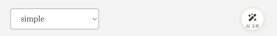
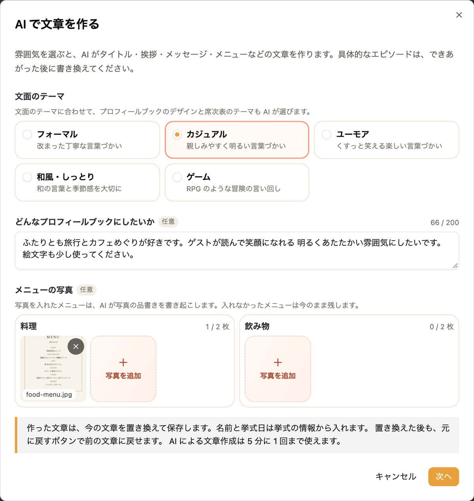
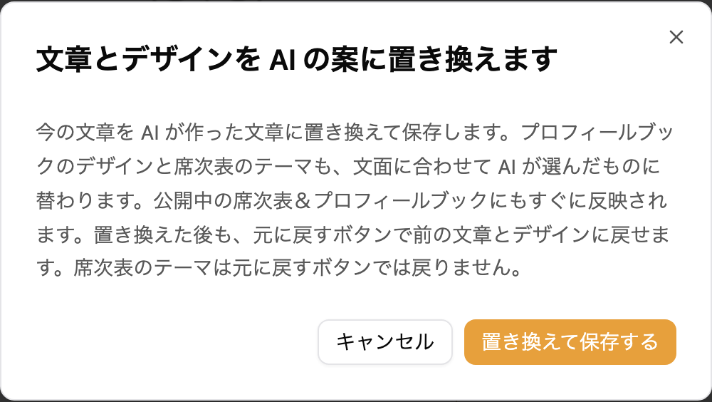
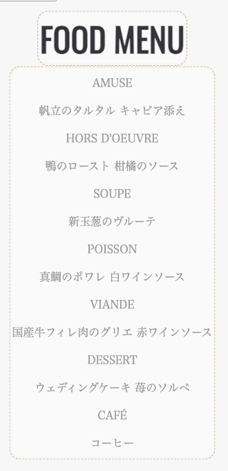
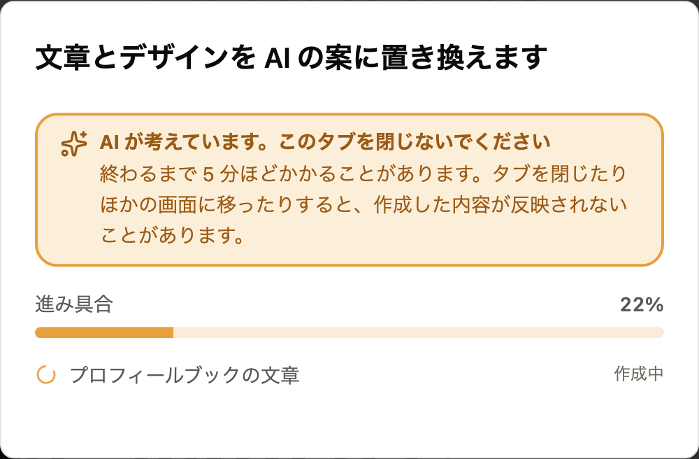
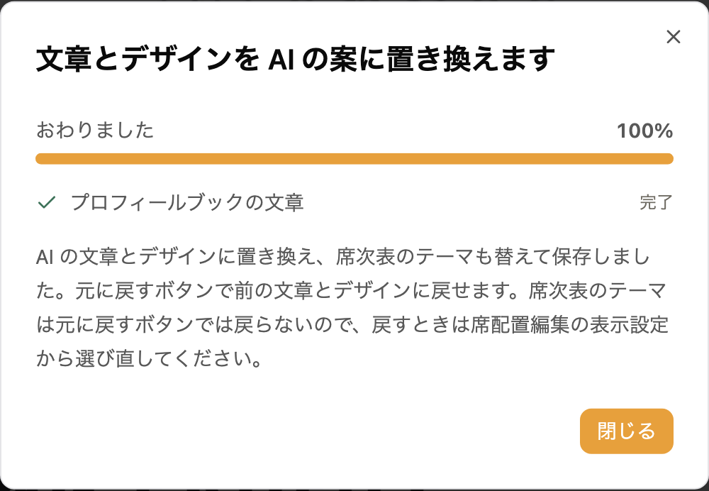

プロフィールブックの編集画面から、AI に頼んで文章を作れます。文面のテーマを選び、どんなプロフィールブックにしたいかを書くと、ごあいさつ・趣味・第一印象・メッセージなどの文章をまとめて作ります。料理と飲み物のメニュー表の写真を添えると、品書きも書き起こします。文面に合わせて、プロフィールブックのデザインと席次表のテーマも AI が選びます。AI による文章作成は無料です。

ゲスト一覧と席配置もまとめて作りたいときは、「[AI でまとめて作る](/ai-onboarding/)」をご覧ください。

---

## 1. AI が作る文章 {#written-fields}

AI が作るのは、プロフィールブックの次の文章です。

- タイトル
- お二人のニックネームと、その間に入る「&」などの言葉
- お二人の名前のローマ字
- ごあいさつの見出しと本文
- 新郎・新婦それぞれの趣味・第一印象・メッセージ
- お料理とお飲み物のメニューの見出しと品書き
- 皆様へのメッセージの見出しと本文

メニューは、写真を添えた側だけ作ります。

次の欄は AI に作らせません。

- お名前と挙式日は、挙式の情報から入ります。挙式の情報にお名前や挙式日が無いときは、今の文章のまま残ります
- 年齢は、今の文章のまま残ります

趣味や第一印象のような欄も、要望から想像した例文で埋めます。具体的なエピソードは、できあがった文章をお二人の言葉に書き換えてください。

### ニックネームとローマ字 {#names}

ニックネームとローマ字は、挙式の情報のお名前から作ります。挙式の情報にお名前がある側だけを作り、お名前が無い側は今の文章のまま残ります。

- ローマ字は、名・姓の順に、すべて大文字のヘボン式で書きます。たとえば「佐藤 健太」なら「KENTA SATO」になります
- ニックネームは下の名前から作り、選んだデザインに合わせた書き方にします。`wa-tate` では漢字の名前、`editorial` では頭文字だけ大文字のローマ字、そのほかのデザインではすべて大文字のローマ字になります。文面のテーマが「カジュアル」や「ユーモア」のときは、名前を縮めた呼び方になることがあります

名前の読みは AI が推測したものです。読みが違うときは、編集画面で直してください。

### 見出しの書き方 {#headings}

見出しは、AI が選んだ[プロフィールブックのテーマ](/profile-book-themes/)に合わせた書き方で作ります。`wa-tate` では日本語、`letter` と `editorial` では頭文字だけ大文字の英語、そのほかのテーマでは大文字の英語になります。文面のテーマが「和風・しっとり」のときは、テーマによらず日本語の見出しになることがあります。

---

## 2. デザインと席次表のテーマも AI が選ぶ {#themes}

AI は文章と一緒に、文面のテーマと要望に合う[プロフィールブックのテーマ](/profile-book-themes/)と、[席次表のテーマ](/seating-chart/#select-theme)を 1 つずつ選びます。要望に和装・ガーデン・二次会・レトロのような雰囲気を書くと、それに合うものを選びやすくなります。

- プロフィールブックのテーマは、文章と一緒に替わります。編集画面の元に戻すボタンを押すと、前の文章とテーマに戻ります
- 席次表のテーマは、席次表を作ってあるときだけ替わります。元に戻すボタンでは戻らないので、前のテーマに戻したいときは、サイドメニューの「席配置編集」の表示設定から選び直してください

---

## 3. 文章を作る {#write}

1. サイドメニューの「席次表＆プロフィールブック」からプロフィールブックの編集画面を開きます
2. 画面上部の「AI 文章」を押します
3. 「AI で文章を作る」の画面で、文面のテーマを選びます
4. 「どんなプロフィールブックにしたいか」に、お二人の雰囲気や大切にしたいことを書きます。任意で、200 文字まで書けます
5. メニューを書き起こしたいときは、「メニューの写真」の「料理」と「飲み物」の「写真を追加」から写真を選びます。任意で、それぞれ 2 枚までです
6. 「次へ」を押します
7. 「文章とデザインを AI の案に置き換えます」の確認が表示されます。内容を読み、「置き換えて保存する」を押します

### 文面のテーマ {#tones}

| テーマ | 文章の雰囲気 |
|---|---|
| フォーマル | 改まった丁寧な言葉づかい |
| カジュアル | 親しみやすく明るい言葉づかい |
| ユーモア | くすっと笑える楽しい言葉づかい |
| 和風・しっとり | 和の言葉と季節感を大切に |
| ゲーム | RPG のような冒険の言い回し |

文面のテーマに合わせて、プロフィールブックのデザインと席次表のテーマも AI が選びます。

### 要望の書き方 {#wish}

要望には、どんなプロフィールブックにしたいかを書いてください。たとえば「アウトドアが好きな二人らしく 明るく元気な雰囲気にしたいです」のように、お二人の好きなことや、ゲストにどう感じてほしいかを書くと、文章に反映されやすくなります。何も書かずに作ることもできます。

絵文字は、要望に「絵文字多めで大丈夫」のように書いたときだけ使います。書かないときは絵文字を使いません。

### メニューの写真 {#menu-photos}

式場からもらったメニュー表を写真に撮って選んでください。iPhone の HEIC の写真も選べます。

- 写真に書かれている品書きを、上から順に 1 行 1 品で書き起こします。前菜や AMUSE のようなコースの区切りがあれば、それも 1 行にします
- 写真に無い料理や飲み物は足しません。値段は書きません
- 料理と飲み物の片方だけ写真を選んだときは、選ばなかった側のメニューは今の文章のまま残ります

写真は文章を作り終えると削除します。

---

## 4. 作った文章を確かめる {#review}

「置き換えて保存する」を押すと、進み具合が表示されます。終わるまで 5 分ほどかかることがあります。終わるまで、この画面を開いたままお待ちください。

終わると、編集画面の文章とデザインが AI の案に置き換わり、そのまま保存されます。公開中のプロフィールブックにもすぐに反映されます。

- 置き換える前の文章とデザインに戻したいときは、右下の元に戻すボタンを押してください。戻した内容も保存されます
- 作成中にタブを閉じたり、ほかの画面に移ったりすると、作った文章が反映されないことがあります。作成中のうちに編集画面へ戻れば、できあがったときに置き換わります。できあがった後に開いた編集画面では置き換わらないので、5 分たってからもう一度お試しください

忌み言葉や句読点を避けるといった結婚式の文章の決まりに沿うよう AI に頼んでいますが、誤りがあり得ます。公開する前に、文章を読み直してください。

:::warning[今の文章は置き換わります]
AI が作った文章は、ご自身で入力した文章も含めて、対象の欄をすべて置き換えます。置き換えた内容は、公開中のプロフィールブックにもすぐに反映されます。残したい文章があるときは、先に控えておいてください。
:::

---

## 5. ご注意 {#notes}

- AI による文章作成は、同じ挙式で 5 分に 1 回までです。続けて頼むと、「AI による文章作成は 5 分に 1 回までです。16:20 以降にお試しください。」のように、次に頼める時刻が表示されます
- 文章を作れなかったときは、「AI が文章を作れませんでした。時間をおいてもう一度お試しください。」と表示されます。今の文章はそのまま残ります
- 挙式のメンバーのどなたかが頼んだ文章作成も、作成中に編集画面を開いていると、終わったときにその画面の文章が置き換わります
