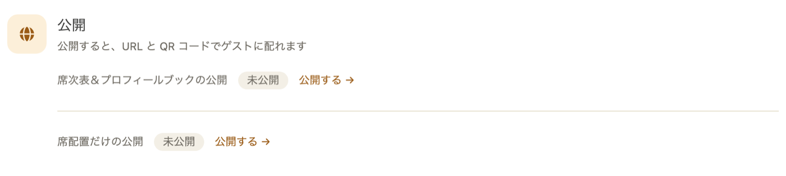
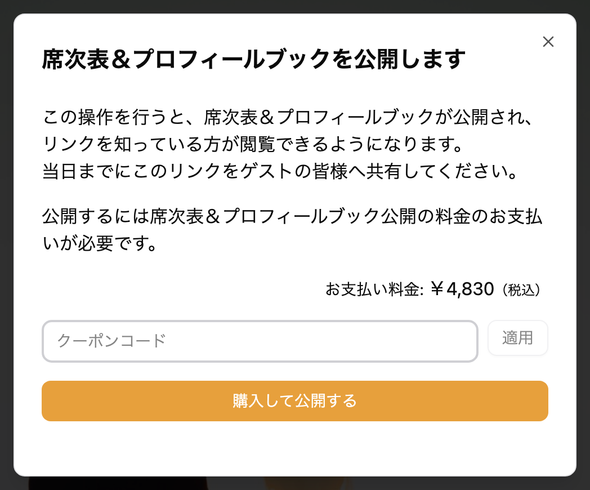
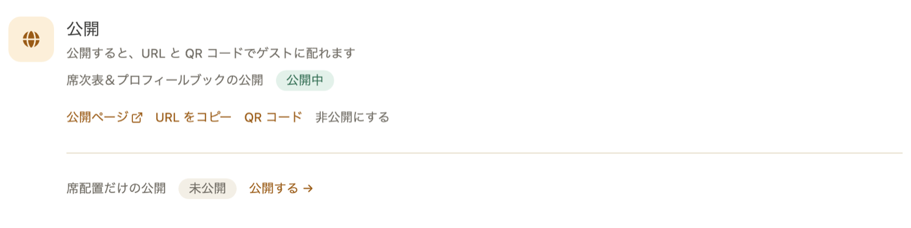
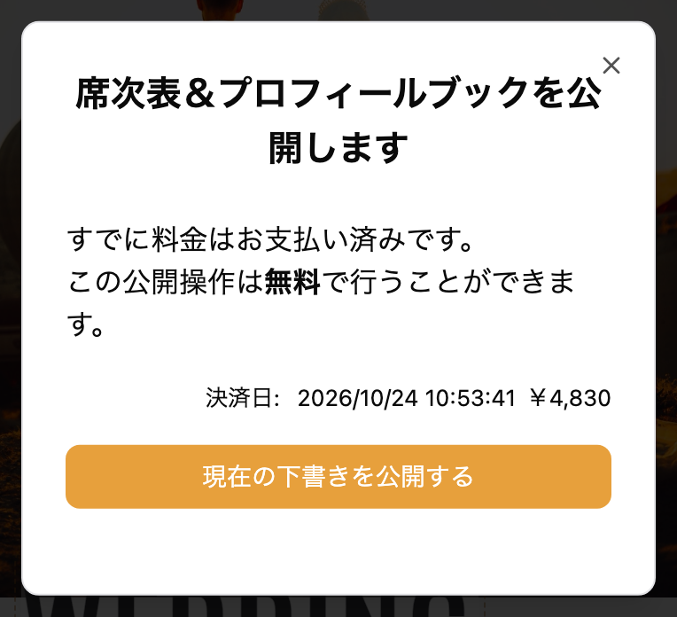
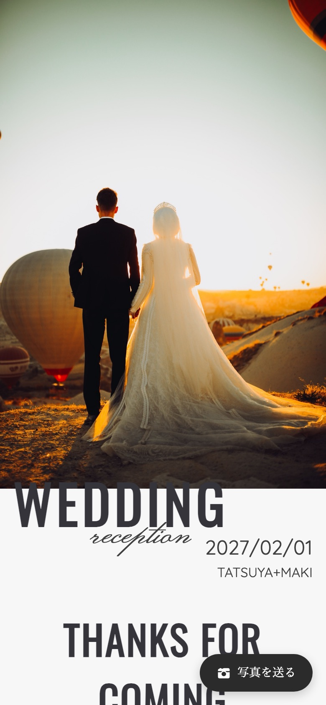
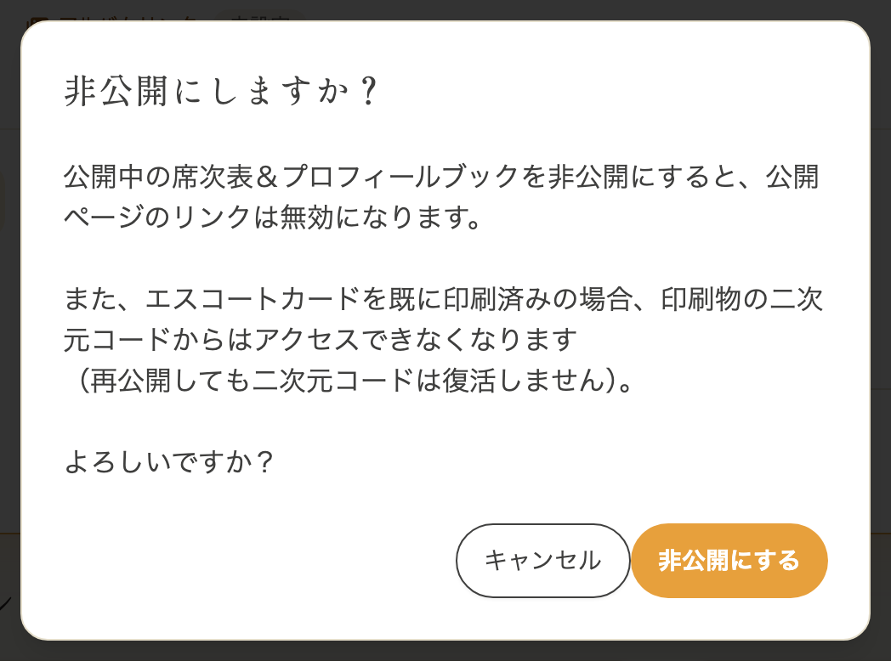

席次表を公開すると、ゲストの皆様にリンクを共有してアクセスしていただけるようになります。
公開後も内容の編集は何度でも可能です。

プロフィールブックを使わず、席次表だけを公開したい場合は「[席次表だけを公開する](/seating-chart-publish/)」をご覧ください。

---

## 1. 席次表を公開する {#publish}

1. ダッシュボードの「WEB 席次表をつくる」にある「公開」の、「席次表＆プロフィールブックの公開」の欄で「公開する →」をタップします
2. プロフィールブックの編集画面に移り、「席次表＆プロフィールブックを公開します」の画面が表示されます
   - **初回**: 「購入して公開する」をタップし、お支払いが済むと公開されます。クーポンをお持ちの場合は、クーポンコードを入力して「適用」をタップします
   - **2回目以降**: お支払い済みのため、「現在の下書きを公開する」をタップするだけで無料で公開できます
3. 公開が完了すると、ゲストの皆様に共有するためのリンクが発行されます

公開すると、ダッシュボードの欄が「公開中」になり、「公開ページ」「URL をコピー」「QR コード」「非公開にする」が表示されます。

公開中にプロフィールブックを編集したときも、編集画面右下の「公開」から「現在の下書きを公開する」をタップすると、無料で公開ページを最新の内容にできます。URL は変わりません。

ゲストの皆様には、次のような公開ページが表示されます。

QR コードは、サイドメニューの「QR コード」からダウンロードできます。

> 一度お支払いいただければ、何度でも無料で公開・非公開の切り替えが可能です。

プロフィールブック公開を含むセットをご購入いただいた場合は、お支払いの時点で保存済みのプロフィールブックが公開されます。まだ保存していなかった場合は、上の手順で無料で公開できます。詳しくは「[おトクなセット](/bundle/)」をご覧ください。

---

## 2. 席次表を非公開にする {#unpublish}

公開中の席次表を一時的に非公開にすることができます。

1. ダッシュボードの「公開」の、「席次表＆プロフィールブックの公開」の欄で「非公開にする」をタップします
2. 「非公開にしますか？」の確認ダイアログが表示されます
3. 「非公開にする」をタップすると、席次表が非公開になります

非公開にすると、ゲストの皆様は公開ページにアクセスできなくなります。

---

## 3. 再度公開する {#republish}

非公開にした席次表を再度公開することができます。
手順は「[1. 席次表を公開する](#publish)」と同じです。

:::warning[再公開すると URL が変わります]
非公開後に再度公開すると、**新しい URL が発行されます**。
以前の URL は無効になりますので、ゲストの皆様にリンクを再度共有してください。
:::

---

## 4. よくある質問 {#faq}

### Q. 非公開にした後、再度公開するのに費用はかかりますか？ {#faq-cost}

いいえ。一度お支払いいただければ、公開・非公開の切り替えは何度でも無料です。

### Q. 非公開にすると編集内容は消えますか？ {#faq-data}

いいえ。非公開にしても編集内容はすべて保持されます。再度公開すれば、最新の内容が表示されます。

### Q. 再公開したら以前と同じ QR コードで読み取れますか？ {#faq-qr}

いいえ。再公開すると新しい URL が発行されるため、QR コードも新しいものになります。ゲストの皆様に新しい QR コードやリンクを共有してください。
