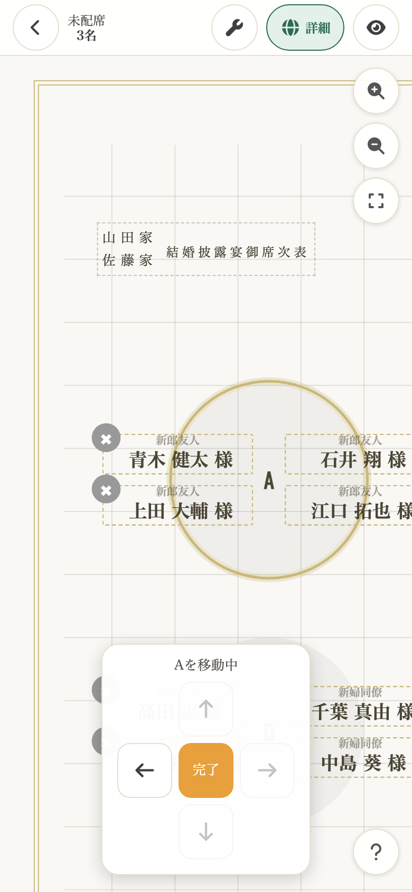
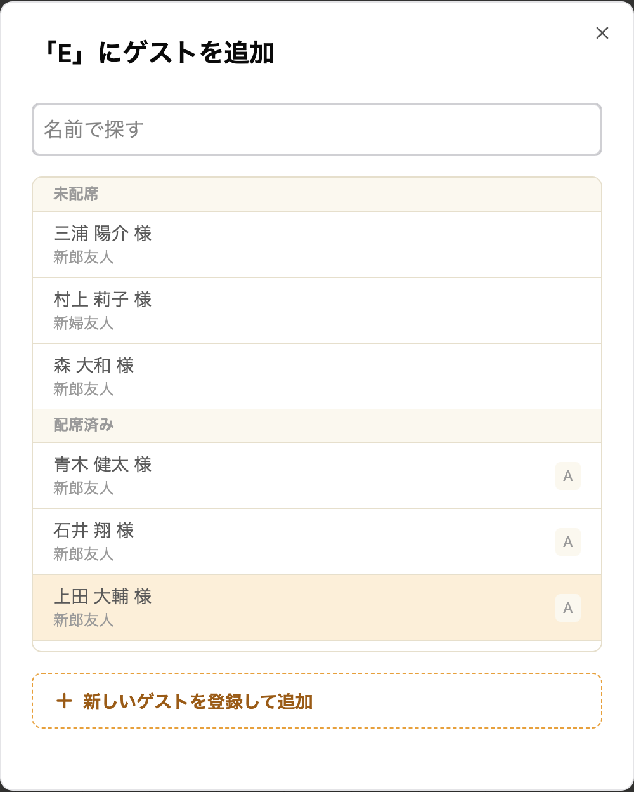
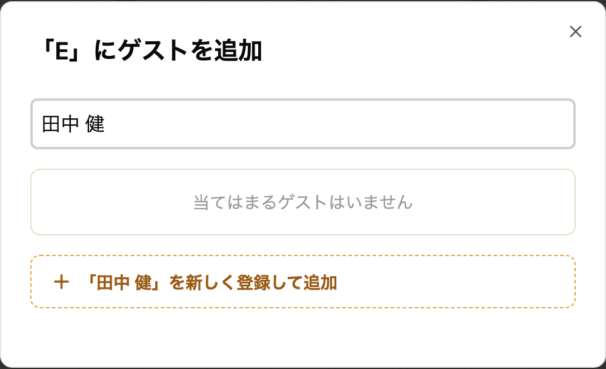
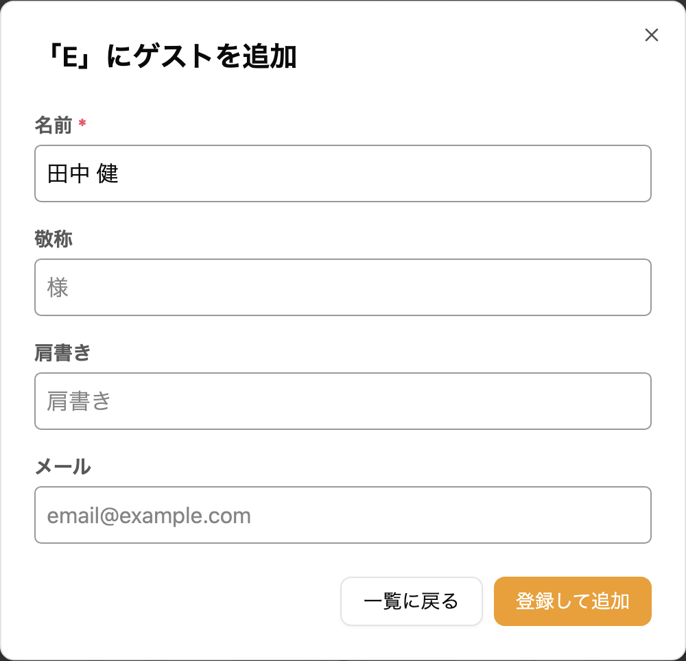

席次表エディタでは、テーブルを方眼の上の好きな位置に並べ、ゲストを席に座らせます。
ゲストの追加・編集・削除については[ゲストの管理](/guest/)をご覧ください。

---

## 1. 席次表を編集する {#edit-seating-chart}

サイドメニューの「席配置編集」をタップすると、席次表エディタが開きます。ダッシュボードの「席配置編集」からも開けます。

### 画面の構成 {#screen-layout}

- テーブルは方眼の上に並びます。方眼は編集中だけ表示され、ダウンロードする画像と公開ページには出ません
- 左上に、まだ席に座っていないゲストの人数（「未配席 3名」など）が表示されます。全員が座ると「全員配席済み」に変わります
- 右上の 3 つのボタンで、拡大・縮小と全体の表示ができます
- 右下の「？」をタップすると、操作の動画が付いた使い方が開きます

スマートフォンでは、空席をタップしてゲストを選び、テーブルは長押しして動かします。

::video[スマートフォンで空席にゲストを座らせ、テーブルを長押しして動かす]{src="/movies/seating-chart/mobile.v1.mp4" loop}

### 操作ガイド {#operation-guide}

| やりたいこと | 手順 |
|---|---|
| ゲストを席に座らせる | 空席をタップするか、テーブルをタップして「ゲストを追加」 |
| ゲストを入れ替える | ゲストをタップ → 入れ替え先のゲストをタップ |
| テーブルを動かす | PC はドラッグ、スマートフォンは長押しして指を動かす |
| テーブルを編集 | テーブルをタップ → メニューから選ぶ |

### 拡大・縮小する {#zoom}

- 右上に縦に並ぶボタンのうち、上の 2 つで拡大・縮小し、3 つ目で全体を表示します
- スマートフォンでは、2 本の指で広げたり縮めたりもできます

::video[右上のボタンで拡大・縮小し、全体を表示する]{src="/movies/seating-chart/zoom.v1.mp4" loop}

### 使い方を見る {#help-button}

右下の「？」をタップすると「席配置の使い方」が開きます。操作ごとの短い動画と、このページへのリンクがあります。

---

## 2. テーブルを操作する {#manage-tables}

### テーブルを追加する {#add-table}

1. 方眼のいちばん下にある「＋卓を追加」をタップします
2. テーブル名と形状を入れて「追加」をタップします

設定する項目は次のとおりです。
- **テーブル名**（例：A、B、松、竹）
- **形状**: 円形 または 正方形

追加したテーブルは、テーブルの並びの左端にそろえて、いちばん下の段の下に置かれます。好きな位置へ動かしてください（[テーブルを動かす](#move-table)）。

::video[「＋卓を追加」でテーブルを足す]{src="/movies/seating-chart/add-table.v1.mp4" loop}

### テーブルを動かす {#move-table}

テーブルは方眼のマスに沿って 1 マスずつ動きます。1 マスはテーブルの 3 分の 1 の大きさです。

- **PC**: テーブルをドラッグします。Tab キーでテーブルを選び、矢印キーで動かすこともできます
- **スマートフォン**: テーブルを長押しすると色が変わります。そのまま指を動かすと、テーブルが付いてきます。長押しせずに指を動かすと、画面がスクロールします
- **矢印のボタンで動かす**: テーブルをタップしてメニューの「テーブルを動かす」を選ぶと、矢印のボタンが出ます。矢印で 1 マスずつ動かし、「完了」で終えます

::video[テーブルをドラッグして、方眼に沿って動かす]{src="/movies/seating-chart/move-table.v1.mp4" loop}

新郎新婦のお名前や挙式日などの見出しも、同じように動かせます。

:::warning[ほかのテーブルと重なる位置には置けません]
名前まで含めてほかのテーブルと重なる位置へ動かすと、テーブルが赤い枠になり、離すと元の位置に戻ります。
名前を変えたり席を足したりして後から重なったときは、テーブルに破線の印が付き、「名前や見出しが重なっています。卓や見出しを動かして離してください。」と表示されます。テーブルを動かして離してください。
:::

### テーブル形状の種類 {#table-shapes}

| 形状 | 特徴 |
|---|---|
| **円形** | 丸テーブル |
| **正方形** | 角テーブル |

ゲストの名前の並び方は、形状ではなく表示設定の「ゲストの配置」で決まります。詳しくは[ゲストの配置を選ぶ](#guest-arrangement)をご覧ください。

### テーブルを編集する {#edit-table}

1. テーブルをタップします
2. メニューから「テーブルを編集」を選びます
3. テーブル名や形状を変えて「保存」をタップします

### テーブルを削除する {#delete-table}

1. テーブルをタップします
2. メニューから「テーブルを削除」を選びます
3. 確認ダイアログで「削除」をタップします

---

## 3. ゲストを席に座らせる {#assign-guest}

ゲストは、空席かテーブルから開く「ゲストを追加」の画面で座らせます。登録済みのゲストを選ぶことも、その場で新しく登録することもできます。

::video[テーブルのメニューの「ゲストを追加」から、名前で探して座らせる]{src="/movies/seating-chart/guest-picker.v1.mp4" loop}

### 空席やテーブルからゲストを選ぶ {#assign-unassigned}

1. 空席をタップするか、テーブルをタップしてメニューの「ゲストを追加」を選びます
2. 「「A」の空席にゲストを追加」のような画面が開きます。ゲストは「未配席」と「配席済み」に分かれて並び、配席済みのゲストには座っているテーブル名が添えられます
3. 座らせたいゲストをタップします

- **空席から開いたとき**: その空席に座ります。配席済みのゲストを選ぶと、元の席は空席になります
- **テーブルから開いたとき**: テーブルの最後に席が足されて座ります。配席済みのゲストを選ぶと、元のテーブルからは席ごと外れます。そのテーブルに座っているゲストを選んだときは、何も変わりません

### ゲストを検索する {#search-guest}

「名前で探す」に名前や肩書きの一部を入れると、当てはまるゲストだけが並びます。姓と名の間の空白の有無や、全角と半角の違いは問いません。

### 新しく登録して座らせる {#register-guest}

1. 名前を入れても見つからないときは、一覧の下の「「田中 健」を新しく登録して追加」のような行をタップします。何も入れていないときは「新しいゲストを登録して追加」です
2. 名前・敬称・肩書き・メールを入れて「登録して追加」をタップします。名前は入力済みになっています
3. ゲストが登録され、その席に座ります

同じ名前のゲストがすでにいるときは、行が「「山田 太郎」を同じ名前の別の人として登録」に変わります。同じ人を二重に登録していないか確かめてください。

### ゲストを入れ替える・別の席に移す {#move-guest}

1. 座っているゲストをタップします。ゲストの欄に色が付きます。スマートフォンでは、画面の上に「〇〇を選択中」と表示されます
2. 移したい先をタップします
   - **ほかのゲスト**: 2 人の席が入れ替わります
   - **空席**: その空席に移ります
   - **テーブル**: そのテーブルの最後に移ります

::video[ゲストをタップしてから、別のゲストやテーブルをタップして入れ替える]{src="/movies/seating-chart/swap-guests.v1.mp4" loop}

### ゲストを席から外す {#remove-from-seat}

席の右上にある「×」ボタンをタップすると、ゲストが席から外れます（席自体は空席として残ります）。

### 選択を解除する {#deselect}

選択中のゲストをもう一度タップすると、選択が解除されます。スマートフォンでは、画面の上の「タップで解除」でも解除できます。

---

## 4. 空席を管理する {#manage-empty-seats}

### 空席を追加する {#add-empty-seat}

1. テーブルをタップしてメニューを開きます
2. 「空席を追加」を選択します
3. テーブルの最後に空席が追加されます

### 空席を削除する {#delete-empty-seat}

空席の右上にある「×」ボタンをタップすると、その空席がテーブルから削除されます。

> 空席をタップすると、その席にゲストを座らせる画面が開きます。詳しくは[空席やテーブルからゲストを選ぶ](#assign-unassigned)をご覧ください。

---

## 5. 表示設定を変える {#display-settings}

席次表の見た目は「表示設定」で変えられます。ここで選んだ見た目が、席次表エディタ・ダウンロードする画像・公開ページのすべてに使われます。

### 表示設定を開く {#open-display-settings}

1. 席次表エディタの右上にある、スパナのボタン（表示設定）をタップします
2. 「表示設定」が開きます。項目を選ぶと、その場で保存されます
3. 「閉じる」をタップして席次表エディタに戻ります

| 項目 | 選べるもの |
|---|---|
| **テーマ** | シンプル / 水引 / 麻の葉 / レトロポップ |
| **スタイル** | ライト / ダーク |
| **卓名の向き** | 縦書き / 横書き |
| **ゲストの配置** | 卓の左右に並べる / 卓を囲む |

表示設定の下の「席次表画像をダウンロードする」から、この見た目のまま画像を出力できます。くわしくは[席次表画像のダウンロード](/seating-chart-image/)をご覧ください。

### テーマを選ぶ {#select-theme}

テーマは、席次表の枠・見出し・書体・色をまとめて変えます。どのテーマでも、スタイルのライトとダークを選べます。テーマを変えても、配席やテーブルの位置、卓名の向き・ゲストの配置はそのままです。

- **シンプル**: 英字の見出し「SEATING CHART」を置いた、洋装に合わせやすいテーマです。はじめはこちらが選ばれています
- **水引**: 和装の披露宴に合わせやすい、和モダンのテーマです
- **麻の葉**: 麻の葉の地紋に縦書きの題字を添えた、藍色の和のテーマです
- **レトロポップ**: リボンの題字と色とりどりの卓を並べた、1.5 次会や二次会などのカジュアルなパーティーに合わせやすいテーマです

水引のテーマでは、見出しに水引の結びと「御席次表」の題字を置き、挙式日を「令和9年1月31日」のように和暦で表示します。枠は金の二重線で、四隅に梅の花を添えています。卓名は筆書きの書体、ゲストの名前は明朝体で表示します。

ライトは和紙のような地に矢絣の柄を薄く敷き、ダークは墨色の地に金と生成りの色の文字で表示します。

プロフィールブックに表示される席次表も、ここで選んだテーマになります。プロフィールブックのテーマ `wa` や `wa-tate` には、水引のテーマがよく合います。

麻の葉のテーマでは、席次表の右端に見出しを縦書きで置き、麻の葉の紋・「御席次表」の題字・両家のお名前・新郎新婦のお名前・挙式日を右から順に並べます。挙式日は「令和九年一月三十一日」のように漢数字の和暦で表示します。地には麻の葉の柄を薄く敷き、題字に朱色の印を添えています。文字は明朝体です。

見出しを右端に置くため、ほかのテーマより卓を並べる幅が狭くなり、ゲストの名前は少し小さく表示されます。

ライトは生成りの地に藍色、ダークは藍色の地に白い文字で表示します。

プロフィールブックのテーマ `wa-tate` や `wa` には、麻の葉のテーマもよく合います。

レトロポップのテーマでは、見出しに朱色のリボンを置き、「席次表」の題字を白抜きで表示します。挙式日は「2027.1.31」のように表示します。卓の色はからし色・コーラル・ミントの 3 色を順に使い、地には小さな水玉を敷いています。文字は丸みのあるゴシック体です。

ライトはバター色の地に焦げ茶と朱色、ダークは焦げ茶の地にクリーム色の文字で表示します。

プロフィールブックのテーマ `retro` や `game` には、レトロポップのテーマがよく合います。

### ゲストの配置を選ぶ {#guest-arrangement}

ゲストの名前をテーブルのまわりにどう並べるかを選べます。

- **卓の左右に並べる**: テーブルの左右に、名前を上から縦に並べます。はじめはこちらが選ばれています
- **卓を囲む**: テーブルのまわりを囲むように名前を並べます。真上・真下に近い席は卓名のそばに、真横の席は少し外側に置かれます

下の図は、同じ 6 席のテーブルをそれぞれの配置で表示したものです。上が「卓の左右に並べる」、下が「卓を囲む」です。

テーブルが並んだ席次表全体では、次のようになります。どちらの配置でも名前の大きさはほとんど変わりません。

:::warning[名前がテーブルに重なることがあります]
「卓を囲む」では、名前を大きく表示するために、名前の一部がテーブルの円や四角に重なることがあります。卓名には重なりません。
:::

### 席の順番と左右の関係 {#guest-arrangement-order}

どちらの配置でも、テーブルの席は次の順番で並びます。配置を切り替えても、ゲストがテーブルの左右どちらに座るかは変わりません。

- **1・3・5…番目の席**: テーブルの左側に、上から順に並びます
- **2・4・6…番目の席**: テーブルの右側に、上から順に並びます
- 席の数が奇数のときは、左側が 1 席多くなります

上の 6 席の図では、肩書きの欄に席の順番を入れています。「卓を囲む」でも 1・3・5 番目が左、2・4・6 番目が右に並んでいることがわかります。

「卓を囲む」では、1 つのテーブルの席をまわりに均等に割り振ります。そのため、席を追加・削除すると、同じテーブルのほかのゲストの位置も少しずつ動きます。新しく追加した席は、テーブルの最後の席になります。

### 空席がある場合 {#guest-arrangement-empty-seat}

空席も 1 つの席として数えます。席次表エディタでは空席が「空席」と表示されますが、ダウンロードする画像と公開ページでは表示されず、その場所が空いたままになります。

空いた場所を詰めたいときは、空席を削除してください（[空席を削除する](#delete-empty-seat)）。

---

## 6. よくある質問 {#faq}

### Q. 編集内容は自動で保存されますか？ {#faq-auto-save}

はい。ゲストの配置・移動・削除などの操作はすべて自動的に保存されます。手動で保存する必要はありません。

### Q. テーブルの形状を後から変更できますか？ {#faq-change-shape}

はい。テーブルをタップしてメニューから「テーブルを編集」を選択すると、形状を変更できます。

### Q. テーマを変えると、配席が変わりますか？ {#faq-change-theme}

いいえ。テーマで変わるのは見た目だけです。配席・テーブルの並び・表示設定のほかの項目はそのまま残ります。何度でも切り替えられます。

### Q. 配席済みのゲストを一覧で確認できますか？ {#faq-assigned-list}

はい。空席をタップするか、テーブルのメニューの「ゲストを追加」を開くと、「配席済み」にゲストと座っているテーブル名が並びます。

### Q. 左側（スマートフォンでは下）のゲスト一覧がなくなりました {#faq-guest-panel}

ゲストを座らせる操作を「ゲストを追加」の画面にまとめたため、ゲスト一覧のパネルはなくなりました。空席をタップするか、テーブルのメニューの「ゲストを追加」から座らせてください。まだ席に座っていないゲストの人数は、画面の左上に表示されます。

### Q. 表示設定の「レイアウト」がなくなりました {#faq-layout-setting}

テーブルを方眼の上の好きな位置へ動かせるようになったため、「標準」「両端ずらし」を選ぶ「レイアウト」はなくなりました。それまでに作った席次表は、選んでいたレイアウトの並びのまま表示されます。並びを変えたいときは、テーブルを動かしてください（[テーブルを動かす](#move-table)）。

### Q. 「卓を囲む」にすると文字が小さくなりますか？ {#faq-guest-arrangement-size}

6 席以下のテーブルなら、「卓の左右に並べる」とほぼ同じ大きさで表示されます。1 つのテーブルに 7 席以上あると、名前がテーブルの上下にはみ出す分だけ、席次表全体が少し小さく表示されることがあります。

### Q. 「卓を囲む」で、真横の名前が外側に出ていない席があります {#faq-guest-arrangement-long-name}

名前が長いゲストは、隣のテーブルの名前と重ならないよう、外側へ出す幅が小さくなります。席次表の中でいちばん長い名前のゲストは、真横の席でも卓名のそばに置かれます。不具合ではありません。
