席次表エディタでは、テーブルの配置やゲストの配席をかんたんに行えます。
ゲストの追加・編集・削除については[ゲストの管理](/guest/)をご覧ください。

---

## 1. 席次表を編集する {#edit-seating-chart}

サイドメニューの「席配置編集」をタップすると、席次表エディタが開きます。ダッシュボードの「席配置編集」からも開けます。

### 画面の構成 {#screen-layout}

- **PC**: 左側にゲスト一覧パネル、右側にテーブルレイアウトが表示されます
- **スマートフォン**: テーブルレイアウトが全画面表示され、画面下部にゲスト一覧パネルがあります

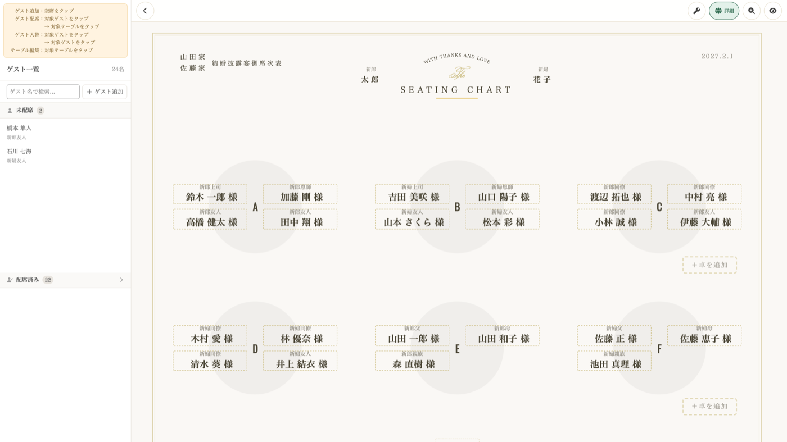

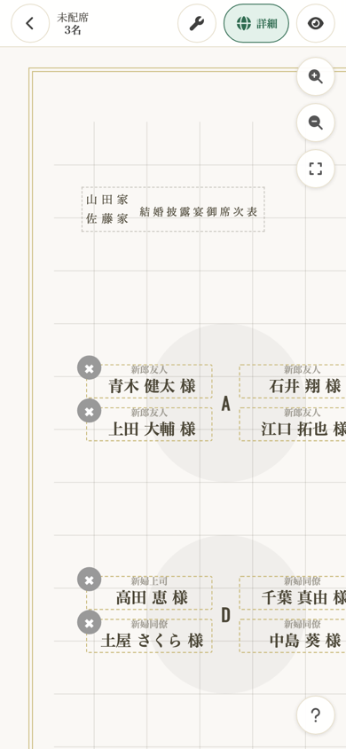

### 操作ガイド {#operation-guide}

| やりたいこと | 手順 |
|---|---|
| ゲストを席に配置 | ゲストをタップ → テーブルをタップ |
| ゲストを入れ替え | ゲストをタップ → 入れ替え先のゲストをタップ |
| テーブルを編集 | テーブルをタップ（ゲスト未選択時） |

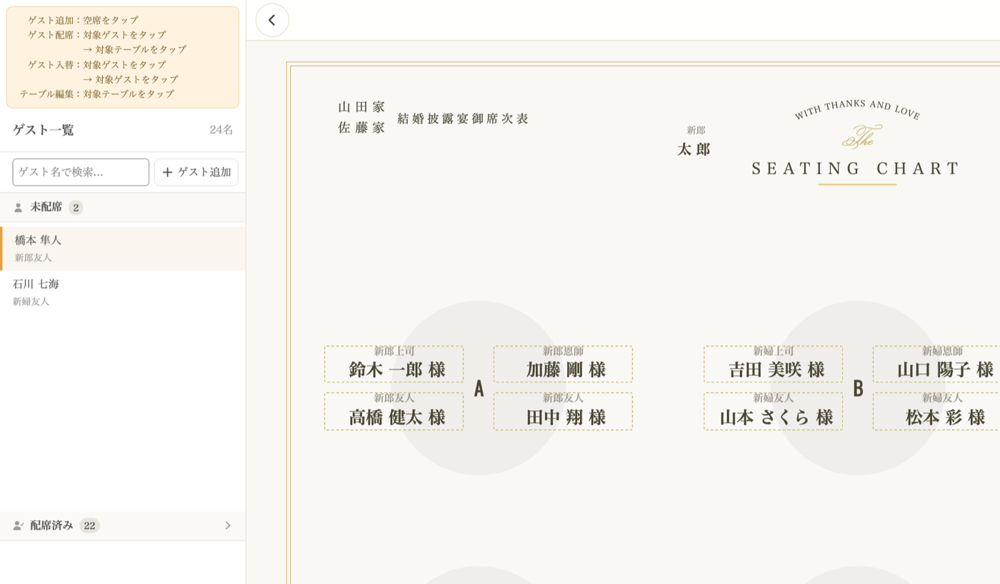

---

## 2. テーブルを操作する {#manage-tables}

### テーブルを追加する {#add-table}

- **同じ段に追加**: その段の右端にある「＋卓を追加」をタップします
- **新しい段を追加**: 画面最下部の「＋行を追加」をタップします

追加時に以下を設定します：
- **テーブル名**（例：A、B、松、竹）
- **形状**: 円形 または 正方形

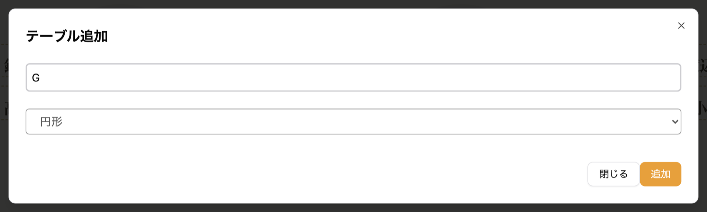

::video{src="/movies/add-table.mp4"}

### テーブル形状の種類 {#table-shapes}

| 形状 | 特徴 |
|---|---|
| **円形** | 丸テーブル |
| **正方形** | 角テーブル |

ゲストの名前の並び方は、形状ではなく表示設定の「ゲストの配置」で決まります。詳しくは[ゲストの配置を選ぶ](#guest-arrangement)をご覧ください。

### テーブルを編集する {#edit-table}

1. テーブル上をタップします（ゲスト選択中でないとき）
2. メニューから「テーブルを編集」を選択します
3. テーブル名や形状を変更できます

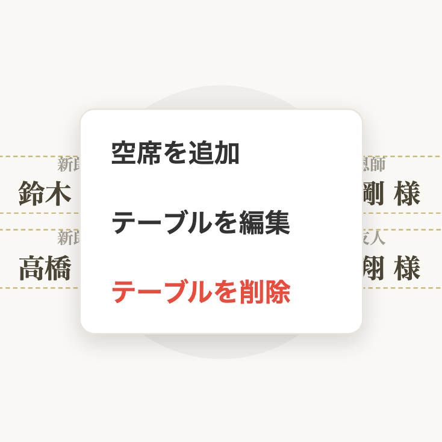

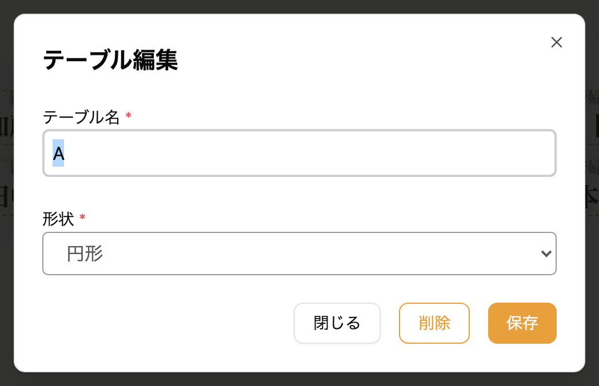

::video{src="/movies/edit-table.mp4"}

### テーブルを削除する {#delete-table}

1. テーブル上をタップします
2. メニューから「テーブルを削除」を選択します
3. 確認ダイアログで「削除」をタップします

---

## 3. ゲストを席に配置する {#assign-guest}

席次表エディタでは「タップして選択 → タップして配置」の操作で、ゲストを席に配置します。

::video{src="/movies/edit-seat.mp4"}

### 未配席のゲストを配置する {#assign-unassigned}

1. ゲスト一覧から配置したいゲストをタップします（選択状態になります）
2. 配置先のテーブルまたは席をタップします
   - **席をタップ**: その席にゲストが配置されます
   - **テーブル本体をタップ**: テーブルの最後に新しい席が追加されてゲストが配置されます
3. 配置が完了すると選択状態が自動的に解除されます

### ゲストを別の席に移動する {#move-guest}

1. 移動したいゲスト（配席済み）をタップします
2. 移動先の席またはテーブルをタップします
   - 移動先に別のゲストがいる場合は、2人の席が入れ替わります
   - 移動先が空席の場合は、ゲストがその席に移動します

### ゲストを席から外す {#remove-from-seat}

席の右上にある「×」ボタンをタップすると、ゲストが席から外れます（席自体は空席として残ります）。

### 選択を解除する {#deselect}

選択中のゲストをもう一度タップすると、選択が解除されます。

---

## 4. 空席を管理する {#manage-empty-seats}

### 空席を追加する {#add-empty-seat}

1. テーブル上をタップしてメニューを開きます
2. 「空席を追加」を選択します
3. テーブルの最後に空席が追加されます

### 空席を削除する {#delete-empty-seat}

空席の右上にある「×」ボタンをタップすると、その空席がテーブルから削除されます。

> 空席にもゲストを配置できます。ゲストを選択してから空席をタップしてください。

### ゲストを検索する {#search-guest}

ゲスト一覧パネルの検索フィールドに名前や肩書きを入力すると、該当するゲストだけが表示されます。

---

## 5. 表示設定を変える {#display-settings}

席次表の見た目は「表示設定」で変えられます。ここで選んだ見た目が、席次表エディタ・ダウンロードする画像・公開ページのすべてに使われます。

### 表示設定を開く {#open-display-settings}

1. 席次表エディタの右上にある、スパナのボタン（表示設定）をタップします
2. 「表示設定」が開きます。項目を選ぶと、その場で保存されます
3. 「閉じる」をタップして席次表エディタに戻ります

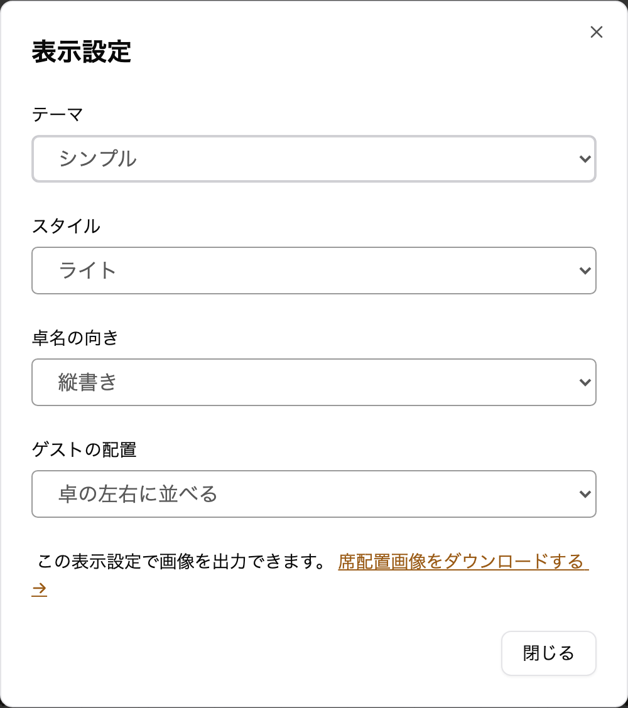

| 項目 | 選べるもの |
|---|---|
| **テーマ** | シンプル / 水引 |
| **スタイル** | ライト / ダーク |
| **レイアウト** | 標準 / 両端ずらし |
| **卓名の向き** | 縦書き / 横書き |
| **ゲストの配置** | 卓の左右に並べる / 卓を囲む |

表示設定の下の「席次表画像をダウンロードする」から、この見た目のまま画像を出力できます。くわしくは[席次表画像のダウンロード](/seating-chart-image/)をご覧ください。

### テーマを選ぶ {#select-theme}

テーマは、席次表の枠・見出し・書体・色をまとめて変えます。どちらのテーマでも、スタイルのライトとダークを選べます。テーマを変えても、配席やテーブルの並び、レイアウト・卓名の向き・ゲストの配置はそのままです。

- **シンプル**: 英字の見出し「SEATING CHART」を置いた、洋装に合わせやすいテーマです。はじめはこちらが選ばれています
- **水引**: 和装の披露宴に合わせやすい、和モダンのテーマです

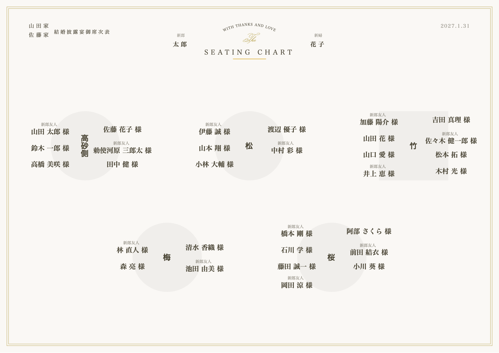

水引のテーマでは、見出しに水引の結びと「御席次表」の題字を置き、挙式日を「令和9年1月31日」のように和暦で表示します。枠は金の二重線で、四隅に梅の花を添えています。卓名は筆書きの書体、ゲストの名前は明朝体で表示します。

ライトは和紙のような地に矢絣の柄を薄く敷き、ダークは墨色の地に金と生成りの色の文字で表示します。

プロフィールブックに表示される席次表も、ここで選んだテーマになります。プロフィールブックのテーマ `wa` や `wa-tate` には、水引のテーマがよく合います。

### ゲストの配置を選ぶ {#guest-arrangement}

ゲストの名前をテーブルのまわりにどう並べるかを選べます。

- **卓の左右に並べる**: テーブルの左右に、名前を上から縦に並べます。はじめはこちらが選ばれています
- **卓を囲む**: テーブルのまわりを囲むように名前を並べます。真上・真下に近い席は卓名のそばに、真横の席は少し外側に置かれます

下の図は、同じ 6 席のテーブルをそれぞれの配置で表示したものです。上が「卓の左右に並べる」、下が「卓を囲む」です。

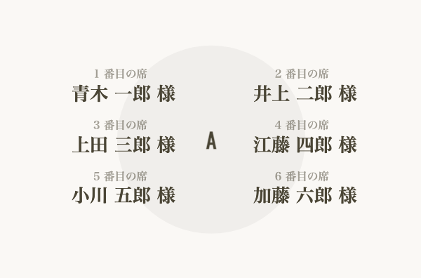

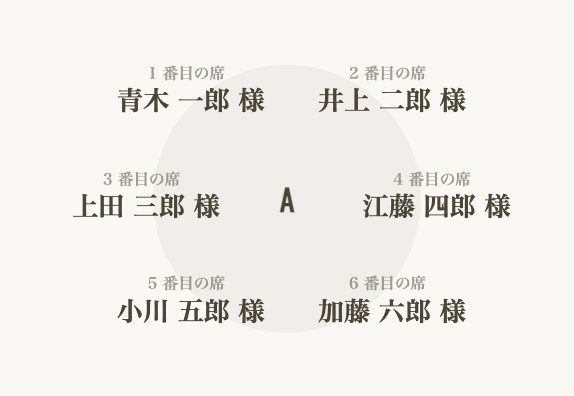

テーブルが並んだ席次表全体では、次のようになります。どちらの配置でも名前の大きさはほとんど変わりません。

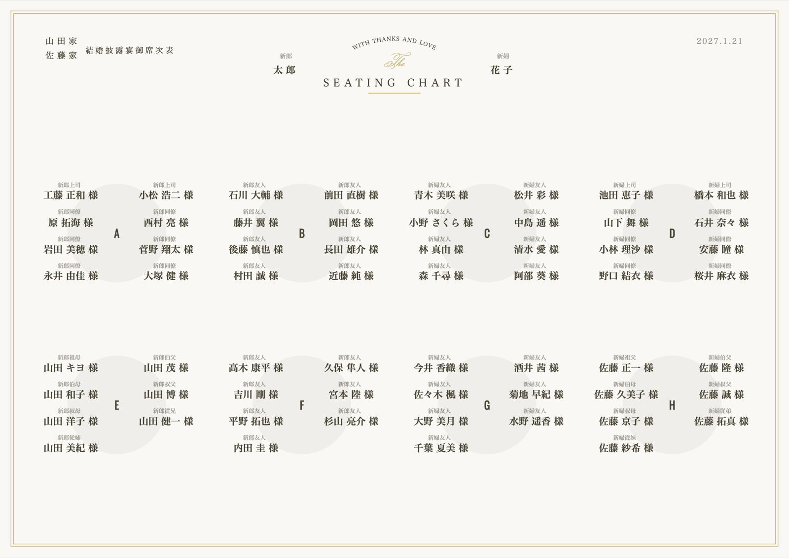

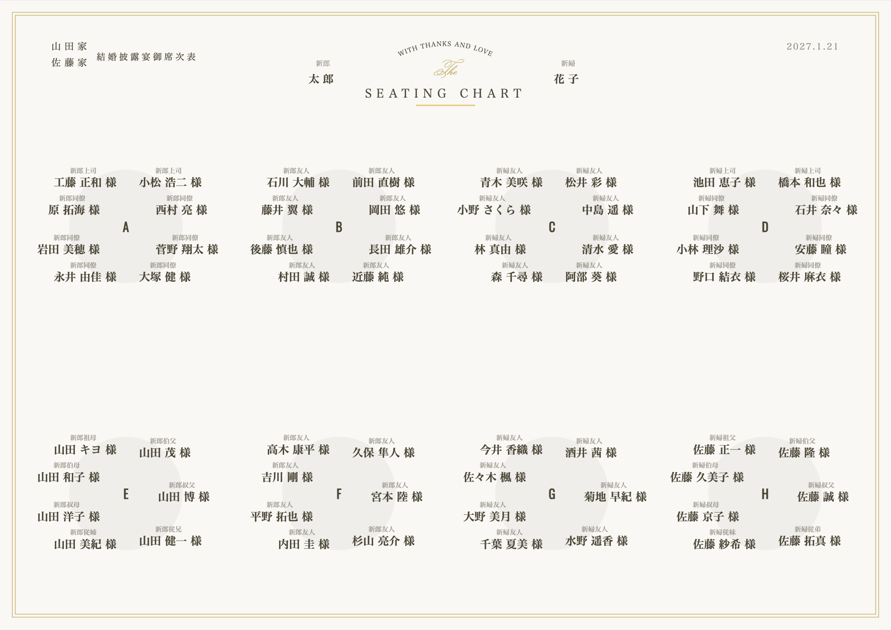

:::warning[名前がテーブルに重なることがあります]
「卓を囲む」では、名前を大きく表示するために、名前の一部がテーブルの円や四角に重なることがあります。卓名には重なりません。
:::

### 席の順番と左右の関係 {#guest-arrangement-order}

どちらの配置でも、テーブルの席は次の順番で並びます。配置を切り替えても、ゲストがテーブルの左右どちらに座るかは変わりません。

- **1・3・5…番目の席**: テーブルの左側に、上から順に並びます
- **2・4・6…番目の席**: テーブルの右側に、上から順に並びます
- 席の数が奇数のときは、左側が 1 席多くなります

上の 6 席の図では、肩書きの欄に席の順番を入れています。「卓を囲む」でも 1・3・5 番目が左、2・4・6 番目が右に並んでいることがわかります。

「卓を囲む」では、1 つのテーブルの席をまわりに均等に割り振ります。そのため、席を追加・削除すると、同じテーブルのほかのゲストの位置も少しずつ動きます。新しく追加した席は、テーブルの最後の席になります。

### 空席がある場合 {#guest-arrangement-empty-seat}

空席も 1 つの席として数えます。席次表エディタでは空席が「空席」と表示されますが、ダウンロードする画像と公開ページでは表示されず、その場所が空いたままになります。

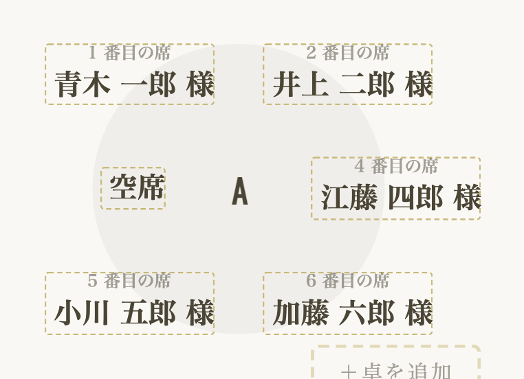

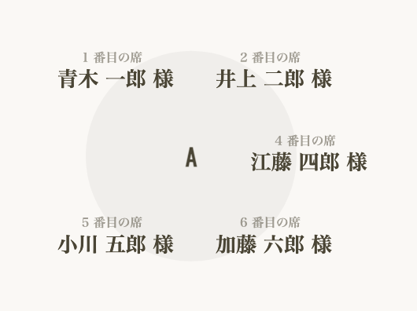

空いた場所を詰めたいときは、空席を削除してください（[空席を削除する](#delete-empty-seat)）。

---

## 6. よくある質問 {#faq}

### Q. 編集内容は自動で保存されますか？ {#faq-auto-save}

はい。ゲストの配置・移動・削除などの操作はすべて自動的に保存されます。手動で保存する必要はありません。

### Q. テーブルの形状を後から変更できますか？ {#faq-change-shape}

はい。テーブルをタップしてメニューから「テーブルを編集」を選択すると、形状を変更できます。

### Q. テーマを変えると、配席が変わりますか？ {#faq-change-theme}

いいえ。テーマで変わるのは見た目だけです。配席・テーブルの並び・表示設定のほかの項目はそのまま残ります。何度でも切り替えられます。

### Q. 配席済みのゲストを一覧で確認できますか？ {#faq-assigned-list}

はい。席次表エディタのゲスト一覧パネルで、「配席済み」セクションを展開すると、配席済みゲストとそのテーブル名を確認できます。

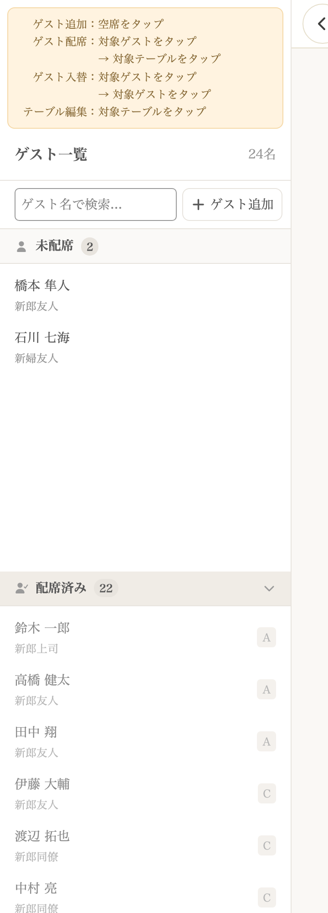

### Q. 「卓を囲む」にすると文字が小さくなりますか？ {#faq-guest-arrangement-size}

6 席以下のテーブルなら、「卓の左右に並べる」とほぼ同じ大きさで表示されます。1 つのテーブルに 7 席以上あると、名前がテーブルの上下にはみ出す分だけ、席次表全体が少し小さく表示されることがあります。

### Q. 「卓を囲む」で、真横の名前が外側に出ていない席があります {#faq-guest-arrangement-long-name}

名前が長いゲストは、隣のテーブルの名前と重ならないよう、外側へ出す幅が小さくなります。席次表の中でいちばん長い名前のゲストは、真横の席でも卓名のそばに置かれます。不具合ではありません。
