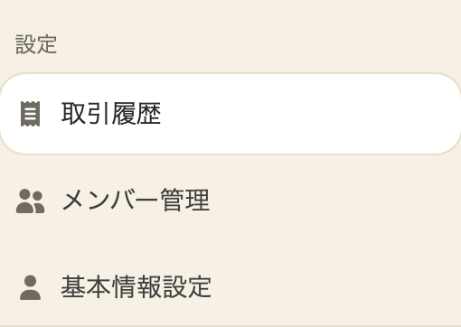
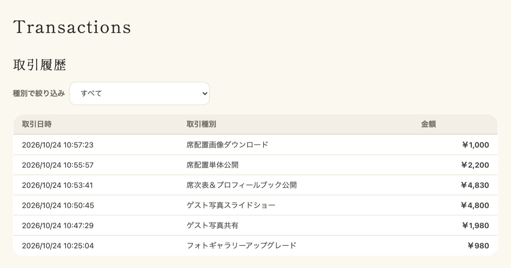

取引履歴ページでは、ご自身のこれまでの取引を一覧で確認できます。

## 取引履歴ページへのアクセス方法

1. サイドバーの「設定」のグループを開きます
2. 「取引履歴」をクリックします

## 取引一覧の見方

取引一覧では、以下の情報が表示されます。

- **取引日時**: 取引が行われた日時
- **取引種別**: 取引の種類（席次表購入、フォトギャラリーアップグレードなど）
- **金額**: 取引金額

パソコンではテーブル形式、スマートフォンではカード形式で表示されます。

## 取引種別フィルタ

取引一覧の上部にある「種別で絞り込み」を使うことで、特定の種類の取引のみを表示できます。

表示したい取引種別を選択すると、該当する取引のみが一覧に表示されます。
