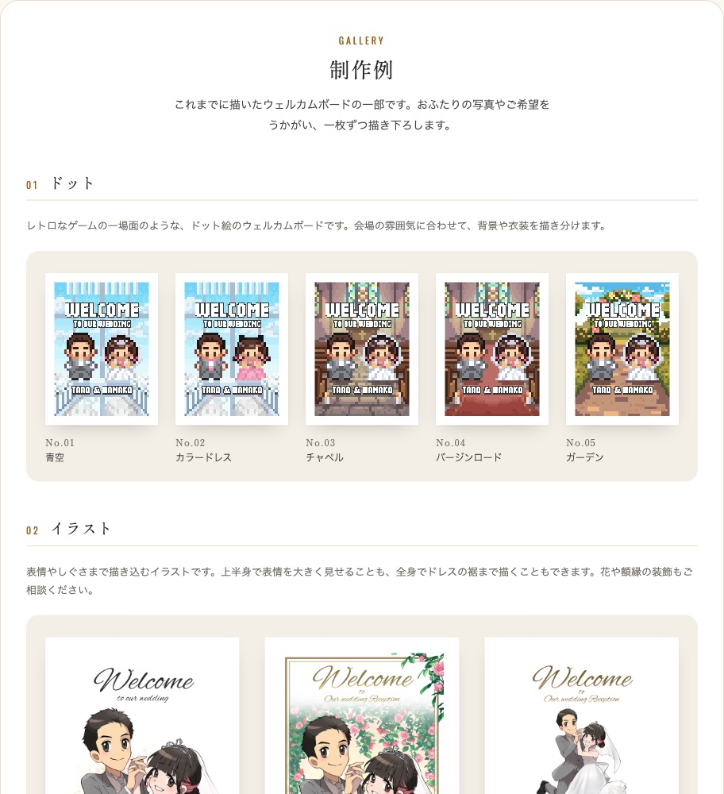
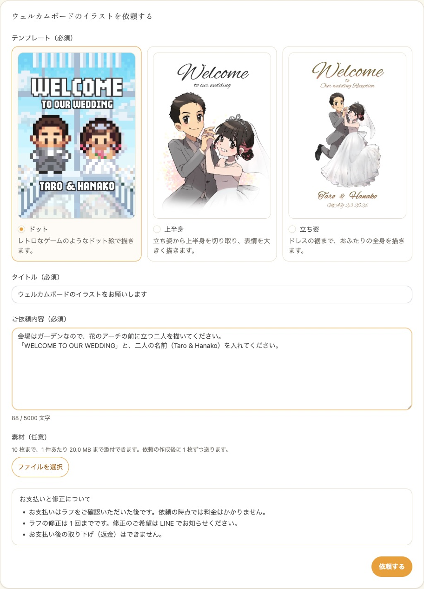
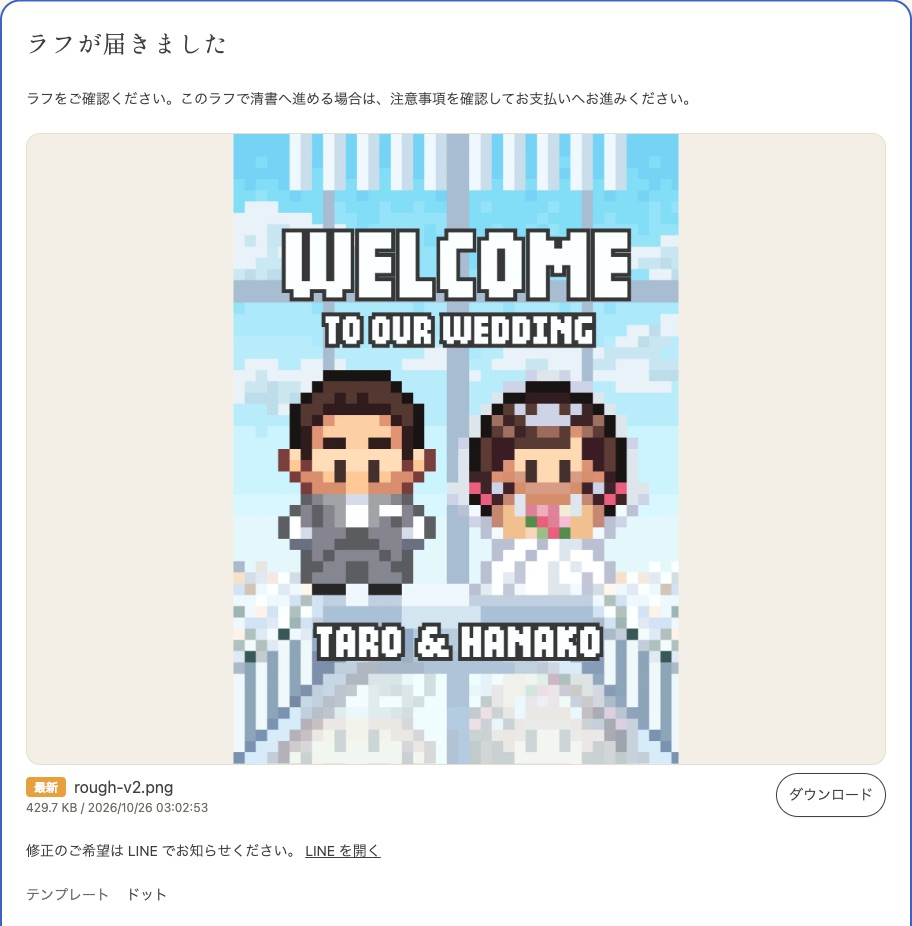

お二人の写真やご希望をもとに、ウェルカムボードのイラストを描いてお届けする機能です。テンプレートを選んで依頼すると、ラフ（下書き）をお送りします。ラフをご確認いただいてからお支払いいただき、清書したイラストを依頼の画面からダウンロードしてお受け取りいただけます。
依頼の時点では料金はかかりません。料金はテンプレートごとに異なり、テンプレートを選ぶ画面に表示されます。

依頼のあとのご連絡は LINE とメールでお送りします。依頼には envas と LINE の連携と、envas 公式アカウントの友だち追加が必要です。

---

## 1. 依頼の画面を開く {#open}

サイドメニューの「オプション」にある「ウェルカムボード依頼」をタップすると、依頼の画面が開きます。ダッシュボードのウェルカムボードのカードからも開けます。

まだ依頼をしていないときは、新しく依頼する画面が開きます。依頼済みのときは、依頼の画面が開きます。ラフが届いている依頼があれば、その依頼が開きます。

依頼する画面の先頭には、これまでに描いたウェルカムボードの制作例が並んでいます。画像をタップすると拡大して見られます。

---

## 2. LINE と連携する {#line}

envas と LINE を連携していないときは、制作例の下に「LINE の連携が必要です」と表示されます。

1. 「LINE と連携する」をタップします
2. LINE の画面でログインし、envas 公式アカウントの友だち追加もあわせて行います
3. envas に戻ると、依頼の入力欄が表示されます

LINE で envas にログインしている方は、連携は済んでいます。

envas 公式アカウントの友だち追加がお済みでないときは、「envas 公式アカウントの友だち追加が必要です」と表示されます。「友だち追加のページを開く」から友だち追加を済ませ、このページに戻って「追加しました」をタップしてください。友だち追加がお済みでないと、LINE のメッセージが届きません。

---

## 3. テンプレートを選んで依頼する {#request}

1. 「テンプレート」から、描き方を 1 つ選びます
2. 「タイトル」に依頼の名前を入力します
3. 「ご依頼内容」に、イメージや雰囲気、入れたい文字、ご希望の色味などを入力します
4. お二人の写真など、描くときの参考にしてほしいファイルがあれば、「素材（任意）」の「ファイルを選択」から選びます
5. 「お支払いと修正について」を確認し、「依頼する」をタップします

依頼すると、依頼の画面に移ります。

テンプレートは次の 3 つです。依頼したあとにテンプレートは変えられません。変えたいときは、依頼を取り下げてから依頼し直してください。

| テンプレート | 描き方 |
| --- | --- |
| ドット | レトロなゲームのようなドット絵で描きます。 |
| 上半身 | 立ち姿から上半身を切り取り、表情を大きく描きます。 |
| 立ち姿 | ドレスの裾まで、お二人の全身を描きます。 |

素材は 1 つの依頼に 10 枚まで、1 枚 20MB まで添えられます。PNG、JPEG、HEIC の画像と PDF を送れます。依頼したあとも、ラフをお支払いいただくまでは、依頼の画面の「素材を追加」から追加したり削除したりできます。

まだ完成していない依頼は、1 人 3 件までです。

---

## 4. ラフを確認する {#rough}

ラフができたら、LINE とメールでお知らせします。依頼の画面を開くと、いちばん上に「ラフが届きました」と表示されます。

1. ラフの画像を確認します。画像をタップすると拡大して見られ、「ダウンロード」で保存できます
2. 修正のご希望があれば、「LINE を開く」から LINE でお知らせください。修正したラフができたら、あらためてお知らせします
3. このラフで清書へ進めるときは、「お支払いへ進む」に進みます（次の「お支払い」をご覧ください）

ラフの修正は 1 回までです。

---

## 5. お支払い {#payment}

1. 「ラフが届きました」の料金を確認します
2. 「注意事項を確認し、このラフで清書を依頼します」にチェックを入れます
3. 「お支払いへ進む」をタップし、お支払い画面でお支払いを済ませます
4. 依頼の画面に戻り、「お支払いありがとうございます。」と表示されたらお支払いは完了です

お支払いが済むと、清書を始めます。依頼の画面には「清書を進めています」と表示されます。

:::warning[お支払い後は取り下げられません]
お支払い後の取り下げ（返金）はできません。ラフを十分にご確認のうえ、お支払いへお進みください。
:::

---

## 6. 完成したイラストを受け取る {#delivery}

イラストが完成したら、LINE とメールでお知らせします。依頼の画面を開くと、いちばん上に「完成したイラスト」が表示されます。「ダウンロード」でイラストを保存してください。

---

## 7. 依頼の状況を確認する {#status}

依頼の画面の上に、依頼の状況が表示されます。

| 表示 | 状況 |
| --- | --- |
| 受付済み | 依頼を受け付けました。ラフの制作を始めるまでお待ちください |
| ラフ制作中 | ラフを制作しています |
| ラフ確認・お支払い待ち | ラフが届いています。ご確認のうえ、お支払いへお進みください |
| 清書中 | お支払いを確認し、清書を進めています |
| 完成 | イラストが完成しました。ダウンロードしてお使いください |
| 取り下げ済み | 依頼を取り下げました |

依頼が複数あるときは、「表示する依頼」から切り替えられます。別の依頼をするときは「新しく依頼する」をタップします。

---

## 8. 依頼を取り下げる {#cancel}

お支払いの前なら、依頼を取り下げられます。

1. 依頼の画面の「この依頼を取り下げる」をタップします
2. 確認の画面で「取り下げる」をタップします

:::warning[添付したファイルは消えます]
取り下げると、添付した素材とお送りしたラフはすべて削除され、元に戻せません。
:::

---

## 9. よくある質問 {#faq}

### Q. 依頼の入力欄が表示されません {#faq-request-paused}

ご依頼が多いときは、新しい依頼の受付を一時的に休止しています。休止中は、依頼の画面に制作例と「現在、多数の依頼を受付中のため依頼を一時中断させていただいております。」が表示されます。再開までお待ちください。休止中も、すでにいただいている依頼はそのまま進みます。

### Q. LINE のメッセージが届きません {#faq-line-message}

envas 公式アカウントを友だち追加しているか、ブロックしていないかをご確認ください。LINE のメッセージが届かないときも、同じお知らせをメールでお送りしています。

### Q. パートナーの依頼が表示されません {#faq-partner}

ウェルカムボードの依頼は、挙式ではなく依頼した方のものです。依頼の画面には、ご自身が依頼したものだけが表示されます。

### Q. 料金はいつかかりますか？ {#faq-price}

依頼の時点では料金はかかりません。ラフをご確認いただき、清書へ進むときにお支払いいただきます。ラフの段階で取り下げた場合も、料金はかかりません。
